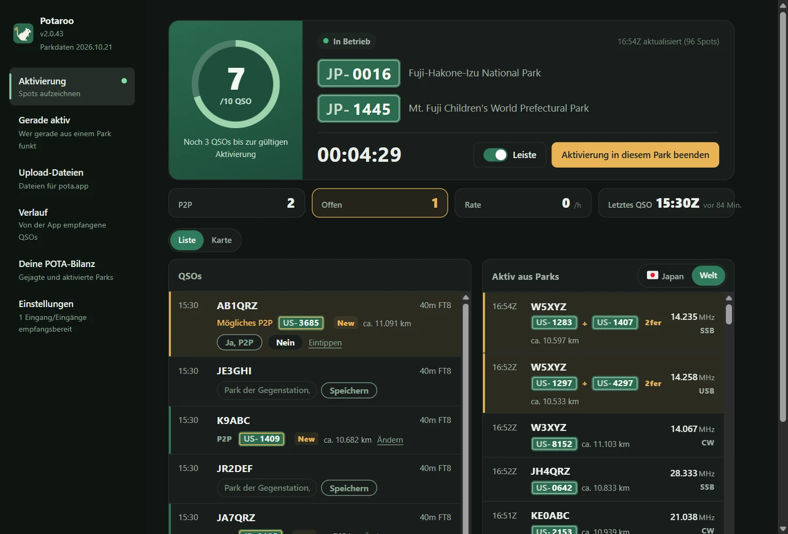
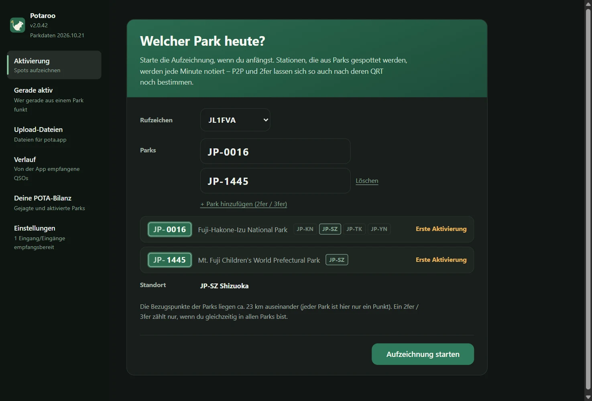
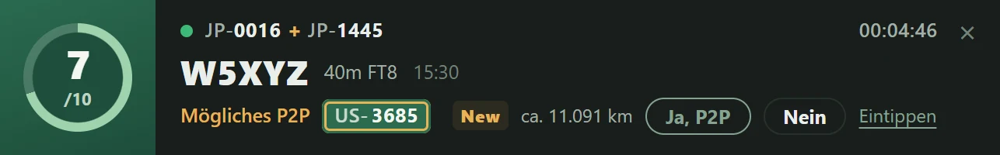
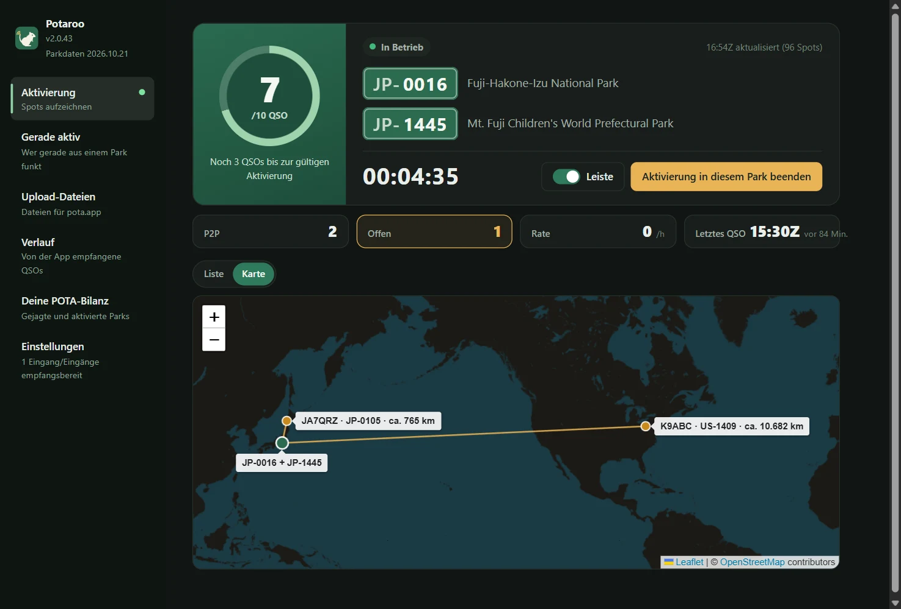
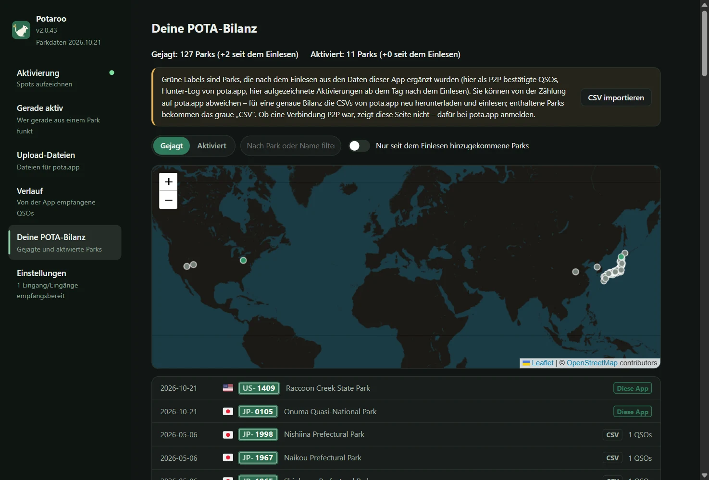
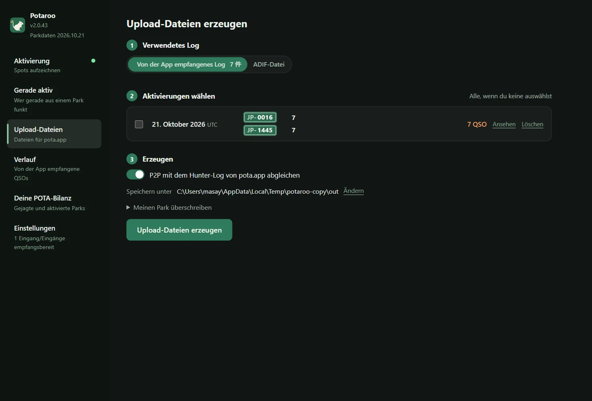
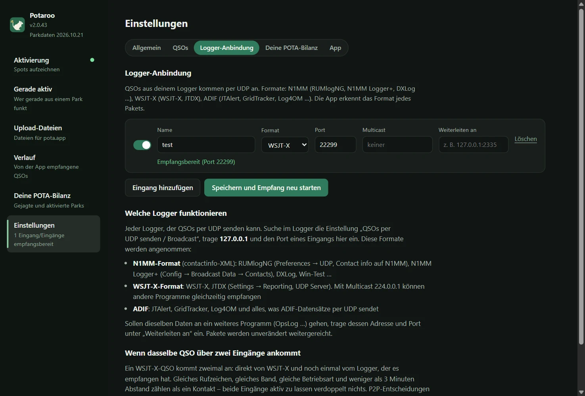

# Potaroo

*Früher POTA Upload Helper*

[日本語](README.md) · [English](README.en.md) · [简体中文](README.zh-CN.md) · [繁體中文](README.zh-TW.md) · [Français](README.fr.md) · [Deutsch](README.de.md) · [Español](README.es.md) · [Italiano](README.it.md) · [Português (Brasil)](README.pt-BR.md) · [한국어](README.ko.md) · [Polski](README.pl.md)

<a href="https://buymeacoffee.com/pudipara"></a>

Eine Desktop-App, die dich bei POTA-Aktivierungen (Parks on the Air) begleitet – vom laufenden Betrieb bis zum Upload. Läuft auf macOS und Windows.

Bei FT8 und ähnlichen Betriebsarten weißt du im Moment des QSOs nicht, ob die Gegenstation aus einem Park funkt, geschweige denn ob es ein 2fer ist. Diese App zeichnet während der Aktivierung die Spots von pota.app auf, gleicht sie sofort mit den QSOs ab, die dein Logger schickt, und **schlägt P2P (Park to Park) und 2fer vor – du bestätigst und speicherst**. Nach dem Betrieb schreibt sie pro eigenem Park und UTC-Tag eine Datei, die du direkt zu pota.app hochladen kannst.



## Was sie kann

### Vor dem Betrieb
- **Park eingeben, Aufzeichnung starten – fertig**: Nach Eingabe der Parkreferenz zeigt die App den Parknamen, den Standort (Bundesland / Präfektur / Staat) und die wievielte Aktivierung es wäre. Für 2fer und 3fer setzt du mit „+ Park hinzufügen (2fer / 3fer)“ weitere Parks dazu.
- **2fer-Prüfung**: Haben die eingegebenen Parks keine gemeinsame Präfektur bzw. keinen gemeinsamen Staat, oder steht in den Parkdaten von pota.app, dass sie sich „nicht überschneiden“, lässt sich das nicht als 2fer aufzeichnen – der Startknopf ist dann gesperrt. Bei Parks, die sich über mehrere Präfekturen erstrecken, wählst du aus einer Liste nur der gemeinsamen Gebiete (gibt es nur eines, wird es automatisch gesetzt).



### Während des Betriebs
- **Aktivierungsansicht**: ein Ring bis 10 QSOs (darüber /20, /30 …), verstrichene Zeit, Anzahl P2P und offener Bestätigungen, Rate der letzten Stunde und das letzte QSO. QSOs und Stationen, die gerade aus Parks funken, siehst du als Liste oder auf der Karte.
- **Leiste**: ein kleines Benachrichtigungsbanner in einem eigenen Fenster, immer im Vordergrund, das du über den Logger legen kannst. Das neueste QSO und die P2P-Bestätigung (Ja / Nein / Überspringen) erledigst du direkt dort, und das Hauptfenster bleibt frei für andere Seiten. Die Breite der Leiste passt sich automatisch dem Inhalt an.
- **QSOs vom Logger**: Empfang per UDP, wie bei OpsLog oder JTAlert. N1MM-Format (RUMlogNG, N1MM Logger+, DXLog …), WSJT-X / JTDX (auch Multicast), ADIF (JTAlert, GridTracker, Log4OM …) und die QSO-Änderungsmeldungen von QLog. Unter Windows liest die App außerdem aus einem laufenden Turbo HAMLOG. Korrekturen und Löschungen im Logger werden übernommen.
- **P2P sofort bestätigen**: Funkt die Gegenstation eines eingegangenen QSOs aus einem Park, zeigt die Zeile „Mögliches P2P“ mit der Parkreferenz, und du entscheidest mit „Ja, P2P“ oder „Nein“. Steht die Station nicht in den Spots (etwa wenn sie dir in Phone oder CW ihren Park nennt), tippst du die Referenz direkt in die Zeile. Nichts wird von selbst zu P2P.
- **Entfernung und Karte**: Die Luftlinie zum Park der Gegenstation wird angezeigt, z. B. „ca. 820 km“ (bei einem 2fer vom Mittelpunkt zwischen den Parks). Der Tab „Karte“ zieht Linien von deinem Standort zu den Parks deiner P2P-QSOs. Als Einheit wählst du km oder Meilen.
- **Feier alle 10 QSOs**: Konfetti im Moment, in dem die Aktivierung gültig ist, und danach alle 10 QSOs.
- **Beenden schreibt die Datei**: „Aktivierung in diesem Park beenden“ schreibt die Upload-Datei des Tages (`JL1FVA@JP-1266-20261020.adi`) in den gewählten Ordner und kehrt zum Startbildschirm zurück. Ist die Gegenstation ein 2fer, wird das QSO je Park wiederholt; bist du selbst ein 2fer, gibt es eine Datei je Park. Schließt du die App während des Betriebs, endet die Aktivierung nicht: Beim nächsten Start geht die Aufzeichnung weiter (vor dem Schließen wird nachgefragt).
- **Nicht zwischen 03:00 und 11:00 UTC hochladen**: In dieser Zeit enden Uploads wegen der Datenbankwartung von pota.app oft mit „Unknown Failure“; POTA hat per E-Mail und in sozialen Medien gebeten, sie zu meiden (steht nicht auf docs.pota.app). Das Ergebnisfeld zeigt diese Zeit in Ortszeit und hebt sie hervor, solange sie gerade ist.
- **Wetter und Warnungen**: Sobald die Aufzeichnung läuft, wird das Wetter am Park alle 15 Minuten geprüft; Leiste und Hauptfenster melden aufziehendes Gewitter, starken Wind oder Starkregen. Für Parks in Japan erscheinen die Hinweise und Warnungen der JMA für die Gemeinde (Gewitter und Warnungen als auffälliges Band), der Tab Wetter zeigt die nächsten Stunden. Evakuierungsanordnungen geben die Gemeinden heraus; sie werden nicht angezeigt.
- **Shifts und Events**: Beginnt oder endet die Early Shift / Late Shift, zeigt die Leiste einen Sonnen- oder Mondaufgang. Während POTA-Events wie Support Your Parks steht ein Hinweis da.
- **Diplome in Reichweite**: Ein QSO, das Rover, Unique Parks, Repeat Offender oder Kilo erreicht, bringt Medaille und Konfetti (bestätigt wird es von pota.app nach dem Log-Upload). Ruft eine Station aus einem anderen Park erneut an, steht „letztes Mal aus …“ in ihrer Zeile.
- **Klubstationen und Uhr**: Eine Klubstation kann Operatoren eintragen und während des Betriebs wechseln. Weicht die Uhr des Computers eine Minute oder mehr von pota.app ab, erscheint ein Hinweis (P2P verlangt höchstens 15 Minuten Abstand zwischen beiden Logs).

| Leiste | Karte |
|---|---|
|  |  |

### Außerdem
- **Gerade aktiv**: Auch ohne Aufzeichnung listet die App die Stationen, die gerade aus Parks funken, nach den Spots von pota.app (jede Minute aktualisiert). Filter: Land und Region, Band, Betriebsart, nur 2fer und mehr, nur nicht gejagte, QRT ausblenden.
- **Verlauf**: die von der App empfangenen QSOs nach Datum, einzeln löschbar.
- **Deine POTA-Bilanz**: Importierst du die von pota.app heruntergeladenen `hunter_parks.csv` / `activator_parks.csv`, siehst du deine gejagten und aktivierten Parks als Liste und auf der Karte. Parks, die nach dem Import über diese App dazugekommen sind, erscheinen grün.
- **Upload-Dateien**: erstellt Dateien vergangener Tage gesammelt aus dem App-Log oder aus der ADIF-Datei des Loggers.
- **Anzeige**: Schriftgröße (Normal / Größer / Sehr groß) und Farben (Wie das System / Hell / Dunkel) lassen sich ändern; das gilt auch für die Leiste.
- **Weiterleitung**: Empfangene Daten können unverändert an ein anderes Programm gehen (RUMlog → diese App → OpsLog).
- **Parkdaten monatlich aktuell**: Die Liste der Parks und ihre Positionen sind in der App enthalten und werden jeden Monat auf den neuesten Stand von pota.app gebracht (als kleines, eigenes Update, getrennt von App-Updates).
- **Erste Schritte**: Beim ersten Start führen sieben Schritte vom Rufzeichen bis zu den Dateien. Jederzeit wieder über „Erste Schritte“ unten links.
- **6-Pack-Fortschritt**: Deine POTA-Bilanz zählt die Parks, die auf 6 m aktiviert oder per P2P gearbeitet wurden (aus dem Log dieser App).

| Deine POTA-Bilanz | Upload-Dateien |
|---|---|
|  |  |

Der Park der Gegenstation wird in dieser Reihenfolge bestimmt:

1. **Hunter-Log von pota.app** (was die Gegenstation hochgeladen hat = bestätigt), Abgleich ±5 Minuten auf demselben Band
2. **Während des Betriebs bestätigte oder eingetippte Parks** (beim Erstellen aus dem App-Log). Unbestätigte QSOs werden nicht zu P2P
3. **Während des Betriebs aufgezeichnete Spots** (nur beim Erstellen aus einer ADIF-Datei; Spots von 30 Minuten vor bis 10 Minuten nach dem QSO)
4. SIG_INFO / POTA_REF aus dem Logger

Gelesen werden nur Daten, die pota.app öffentlich macht (api.pota.app), ohne Login (und ohne offizielle Unterstützung durch POTA). Das Log zu führen ist Sache des Loggers: Diese App übernimmt nur die Beurteilung und das Erstellen der Upload-Dateien und verändert das Log des Loggers nie.

## Download

Die neueste Version gibt es unter [Releases](../../releases).

| OS | Datei | So geht’s |
|---|---|---|
| macOS (Apple Silicon) | `Potaroo-macOS.dmg` | Öffnen und `Potaroo` nach `Applications` ziehen |
| Windows 10 / 11 | `Potaroo-Setup.exe` | Ausführen: installiert pro Benutzer (keine Adminrechte nötig) und legt einen Eintrag im Startmenü an |

Die Zip-Versionen (`Potaroo-macOS.zip` / `Potaroo-Windows.zip`) hängen ebenfalls am Release. Das Update in der App verwendet diese Zips, bitte nicht aus dem Release löschen.

Die App ist nicht signiert, daher erscheint beim ersten Start eine Warnung.

- **macOS**: Rechtsklick auf die App → „Öffnen“ → „Öffnen“. Lässt sie sich dann noch nicht öffnen: „Systemeinstellungen → Datenschutz & Sicherheit“, weiter unten „Trotzdem öffnen“.
- **Windows**: „Der Computer wurde durch Windows geschützt“ → „Weitere Informationen“ → „Trotzdem ausführen“.

**Danach aktualisierst du direkt in der App.** Beim Start prüft sie, ob es eine neue Version gibt; erscheint der Hinweis, drücke „Jetzt aktualisieren“: herunterladen, austauschen, neu starten. Prüfen kannst du jederzeit unter „Einstellungen → App“. Startest du die App direkt aus dem DMG (ohne sie nach `Applications` zu verschieben), lässt macOS den Austausch nicht zu; die neue App wird dann in den Ordner „Downloads“ gelegt und du bekommst einen Hinweis. Ist die App noch unter dem alten Namen (POTA Upload Helper) installiert, benennt sie sich beim ersten Start nach dem Update in Potaroo um (unter Windows werden auch die Verknüpfungen angepasst).

## Logger-Anbindung

Unter „Einstellungen → Logger-Anbindung“ legst du Eingänge an (beliebig viele). **Jeder Logger, der QSOs per UDP senden kann, funktioniert.** Öffne im Logger die Einstellung „QSOs per UDP senden“ und trage als Ziel `127.0.0.1` und als Port dieselbe Nummer wie beim Eingang ein. Das Format der ankommenden Pakete erkennt die App selbst.



| Format | Logger (Beispiele) | Wo einstellen |
|---|---|---|
| N1MM (contactinfo-XML) | RUMlogNG, N1MM Logger+, DXLog, Win-Test | RUMlogNG: Preferences → UDP, Contact info auf N1MM. N1MM Logger+: Config → Broadcast Data → Contacts |
| WSJT-X | WSJT-X, JTDX | Settings → Reporting, UDP Server. Mit `224.0.0.1` (Multicast) können andere Programme gleichzeitig empfangen |
| ADIF | JTAlert, GridTracker, Log4OM … | die Einstellung „ADIF per UDP senden“ des jeweiligen Programms |
| QLog (JSON) | QLog | Settings → Network → Notifications, unter **QSO Changes** `127.0.0.1:Port` |
| Turbo HAMLOG (Windows) | Turbo HAMLOG/Win | Format des Eingangs auf „Turbo HAMLOG“. Kein Port nötig: die App liest aus dem laufenden HAMLOG (auch QSOs über JT_Linker und JT-Get's) |

Auch im Logger korrigierte oder gelöschte QSOs werden in der App übernommen. Unter Windows 11 geprüft sind WSJT-X, Log4OM 2, Turbo HAMLOG, QLog und N1MM Logger+ (Empfang von CW, SSB und FT8 sowie Korrekturen und Löschungen).

**Empfangen wird nur von Loggern auf demselben Rechner.** Die Eingänge lauschen auf `127.0.0.1`; ein Logger auf einem anderen PC erreicht sie nicht.

**WSJT-X / JTDX per Multicast unter Windows**: Unter Windows lauscht auch der Multicast-Eingang auf Loopback (`127.0.0.1`). Nimm in WSJT-X unter Settings → Reporting → **Outgoing interfaces** auch **loopback** auf. Diese Kombination ist unter Windows 11 geprüft. Kommt nichts an, freue ich mich über ein [Issue](../../issues). Ohne Multicast, mit dem UDP Server von WSJT-X auf `127.0.0.1`, kommt sicher alles an (dann können andere Programme aber nicht gleichzeitig empfangen).

**Logger-Einstellungen für den Einsatz mit WSJT-X** (unter Windows 11 geprüft; auch wenn du zwischen FT8-QSOs CW, SSB oder FM einstreust, kommt jedes QSO korrekt einzeln an):

| Logger | Empfang von WSJT-X | Weitergabe an die App |
|---|---|---|
| JT_Linker + Turbo HAMLOG | JT_Linker beobachtet die Logdatei von WSJT-X und trägt in HAMLOG ein | Eingang „Turbo HAMLOG“ |
| N1MM Logger+ | Config → Configure Ports → WSJT/JTDX Setup, Radio #1 auf Enable (Unicast `127.0.0.1`, Multicast `224.0.0.1`, Port 2237) | Broadcast Data → Contacts auf `127.0.0.1:Port des Eingangs` |
| QLog | Settings → Network, Wsjtx Port 2237 (für Multicast Join Multicast einschalten und Multicast Address `224.0.0.1`) | Notifications → QSO Changes auf `127.0.0.1:Port des Eingangs` |

WSJT-X-QSOs kommen auch direkt bei der App an (über den WSJT-X-Eingang) und werden mit denen über den Logger zu einem QSO zusammengeführt. Wenn du per Multicast an mehrere Programme gleichzeitig verteilst, beachte Folgendes:

- **Starte QLog und N1MM vor den anderen Programmen.** Sie öffnen Port 2237 nicht im gemeinsam nutzbaren Modus; später gestartet, ist der Port „belegt“ und sie empfangen nichts.
- **Auch Turbo HAMLOG öffnet Port 2237.** Zusammen mit JT_Linker fragt HAMLOG manchmal, ob es ein „zweites QSO“ eintragen soll. Antworte dann mit „Nein“. Gleichzeitig mit QLog oder N1MM geht es nicht (das später gestartete HAMLOG meldet einen Fehler).

Sollen dieselben Daten auch an ein anderes Programm (OpsLog …) gehen, trage dessen Adresse und Port beim Eingang unter „Weiterleiten an“ ein.

**Beide Eingänge an – trotzdem nichts doppelt**: Ein WSJT-X-QSO kommt zweimal an, direkt von WSJT-X und noch einmal vom Logger, der es empfangen und weitergeschickt hat (rund eine Minute Abstand: Start- gegen Endzeit). Gleiches Rufzeichen, gleiches Band, gleiche Betriebsart und höchstens 3 Minuten Zeitunterschied gelten als ein QSO; P2P-Entscheidungen und Löschungen gelten für beide. Umgekehrt werden auch zwei QSOs mit derselben Station auf demselben Band in derselben Betriebsart innerhalb von 3 Minuten zu einem.

## Wo die Daten liegen

| OS | Ort |
|---|---|
| macOS | `~/Library/Application Support/Potaroo/` |
| Windows | `%APPDATA%\Potaroo\` |

`qsolog.db` (empfangene QSOs), `spots-YYYYMMDD.jsonl` (aufgezeichnete Spots), `sessions.json` (deine Aktivierungszeiten und Parks), `hunter.json` (Kopie des Hunter-Logs), `mypota.json` (importierte Bilanz-CSVs), `settings.json`, `potaroo.log` (Fehlerprotokoll).
Das öffentliche Profil auf pota.app zeigt nur die letzten 25 Einträge des Hunter-Logs; die App ergänzt `hunter.json` deshalb während der Aufzeichnung und bei jedem Erstellen, damit sich die Historie ansammelt. Interne Daten wie empfangene QSOs bleiben erhalten, bis du sie löschst (einzeln unter „Verlauf“, alle zusammen unter „Einstellungen → App → App-Daten“).

## Probleme melden

„Einstellungen → App → Problem melden“ öffnet einen Bericht mit Version, Betriebssystem und dem Ende des Protokolls. Prüfe und bearbeite ihn, dann „Kopieren“ und per E-Mail o. Ä. schicken, oder mit „Auf GitHub melden“ die Seite zum Anlegen eines [Issues](../../issues) öffnen (Meldungen auf GitHub sind öffentlich). Die App sendet nichts von selbst. Das Protokoll enthält Rufzeichen und Parkreferenzen.

## Sprachen

日本語, English, 简体中文, 繁體中文, Français, Deutsch, Español, Italiano, Português (Brasil), 한국어, Polski. Wird automatisch nach der Systemsprache gewählt und lässt sich in den „Einstellungen“ unter „Sprache“ umstellen.

## Nutzungsbedingungen und Haftungsausschluss

Diese App ist Hobby-Software einer Privatperson, ohne jede Gewähr. **Der Autor haftet nicht für Schäden jeglicher Art, die aus der Nutzung entstehen (falsche Uploads zu pota.app, doppelte oder fehlende QSOs, verlorene Logs oder Dateien, Auswirkungen auf Logger- oder Netzwerkeinstellungen usw.).** Prüfe den Inhalt der Dateien vor dem Hochladen immer selbst. Die Erkennung von P2P und 2fer ist eine Schätzung ohne Gewähr für Richtigkeit. Diese App steht in keiner Verbindung zu Parks on the Air® oder pota.app. Der vollständige Text steht in [TERMS.md](TERMS.md) und wird auch beim ersten Start der App angezeigt.

Sicherheitslücken meldest du wie in [SECURITY.md](SECURITY.md) beschrieben.

## Aus dem Quellcode starten

```sh
pip install -r requirements.txt
python3 app.py
```

Auch nur über die Kommandozeile nutzbar (nur Standardbibliothek).

```sh
python3 pota_spotlog.py --parks JP-1266,JP-1206
python3 pota_build.py export.adif --date 20261020
```

## Entwicklung

```sh
scripts/dev.sh                                  # legt ein venv an und startet (Daten in ./data, das echte Log bleibt unberührt)
scripts/dev.sh --debug                          # mit Entwicklerwerkzeugen
scripts/send_test_qso.py 22237 JA1XYZ           # schickt ein Test-QSO an den Entwicklungs-Eingang (nie an 2237)
python3 -m unittest discover -s tests
```

Änderungen bitte auf einem eigenen Branch als Pull Request einreichen. Für jeden PR laufen die Tests auf macOS und Windows; nach dem Merge in `main` baut GitHub Actions beide Versionen und hängt sie an das Release `v<VERSION>` (`VERSION` in `potacommon.py`). In `scripts/` liegen unter anderem `copy_instance.py` (startet eine zweite App mit einer Kopie der Daten), `check_align.mjs` (prüft die Textausrichtung auf dem Bildschirm) und `readme_shots.mjs` (erstellt die Bilder für dieses README).

## License

MIT

Für die Länderflaggen liegt die Schrift aus [country-flag-emoji-polyfill](https://github.com/talkjs/country-flag-emoji-polyfill) (MIT) bei, die nur die Flaggen aus Twemoji (CC-BY 4.0) enthält. Die Karte nutzt [Leaflet](https://leafletjs.com/) (BSD-2-Clause) und Kacheln von © [OpenStreetMap](https://www.openstreetmap.org/copyright) contributors. Wetterdaten von [Open-Meteo](https://open-meteo.com/) (CC BY 4.0). Warnungen für Parks in Japan: japanischer Wetterdienst (Quelle: JMA-Website); die Gemeinde des Parks: Reverse-Geocoder des GSI.
