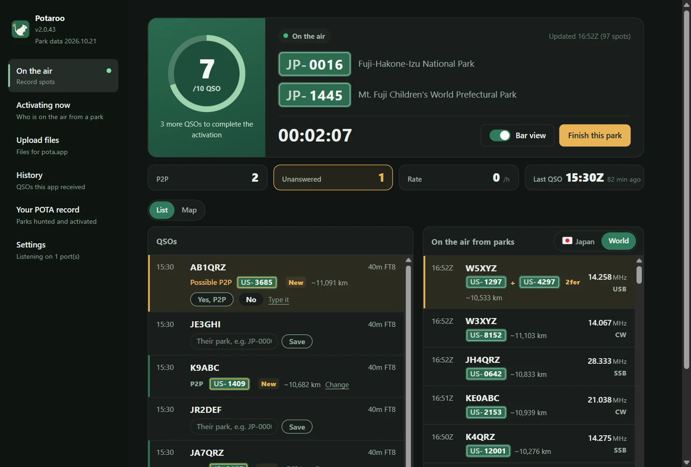
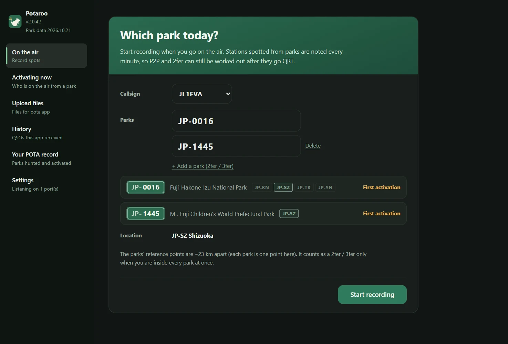
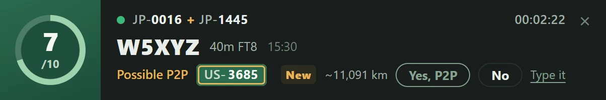
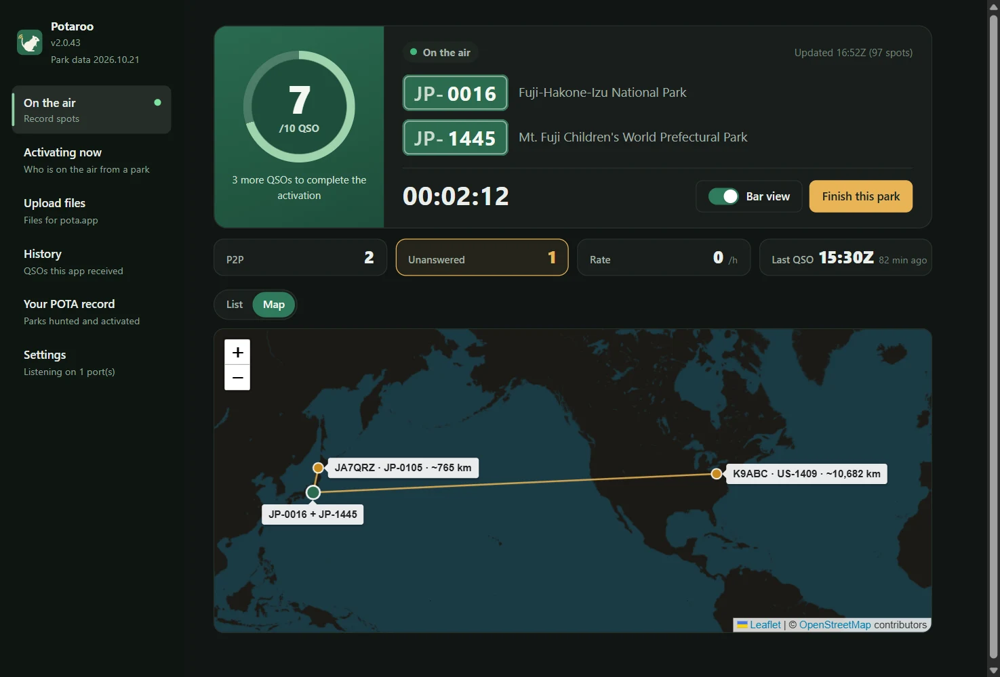
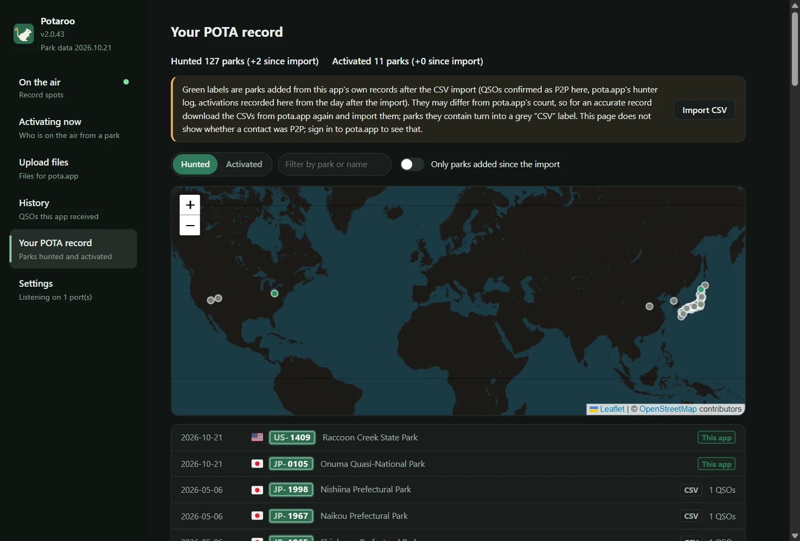
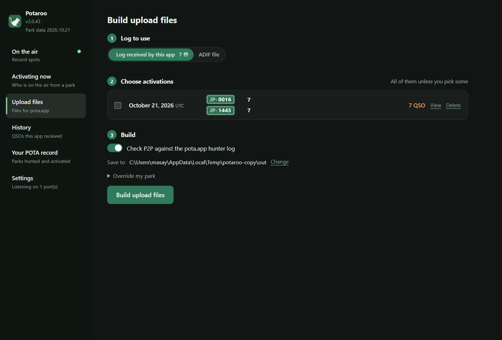
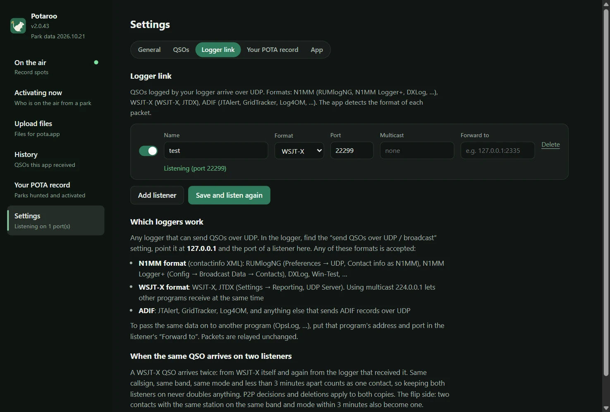

# Potaroo

*Formerly POTA Upload Helper*

[日本語](README.md) · [English](README.en.md) · [简体中文](README.zh-CN.md) · [繁體中文](README.zh-TW.md) · [Français](README.fr.md) · [Deutsch](README.de.md) · [Español](README.es.md) · [Italiano](README.it.md) · [Português (Brasil)](README.pt-BR.md) · [한국어](README.ko.md) · [Polski](README.pl.md)

<a href="https://buymeacoffee.com/pudipara"></a>

A desktop app that helps with your POTA (Parks on the Air) activations, from the time you are on the air until the upload. Runs on macOS and Windows.

On FT8 and similar modes you cannot tell on the spot whether the other station is in a park, let alone a 2fer. This app records pota.app spots while you activate, matches them right away against the QSOs your logger sends, and **suggests park-to-park (P2P) and 2fer candidates for you to confirm and record**. When you finish, it writes files ready to upload to pota.app, one per park of yours and UTC date.



## What it does

### Before you go on the air
- **Enter the park and start recording**: type the park reference and the app shows the park name, its location (state / prefecture) and which activation of that park this will be. For a 2fer or 3fer, line the parks up with "Add a park".
- **2fer check**: when the parks you entered share no state / prefecture, or the pota.app park info says they "do not overlap", they cannot be logged as a 2fer, so the "Start recording" button is disabled. For a park that spans several states / prefectures, you pick from a drop-down that only offers the ones the parks share (when there is only one, it is chosen for you).



### While on the air
- **The On the air screen**: a ring that fills up to 10 QSOs (past 10 it counts to /20, /30…), elapsed time, P2P and unanswered counts, your rate over the last hour, and the last QSO. QSOs and stations on the air from parks can be seen as a list or on a map.
- **The bar**: a small notification banner in its own always-on-top window that you can park above your logger. You can see the latest QSO and answer P2P questions there (yes / no / skip), leaving the main window free for other pages. The bar's width follows its content.
- **QSOs from your logger**: received over UDP, the same way OpsLog or JTAlert do it. N1MM format (RUMlogNG, N1MM Logger+, DXLog, …), WSJT-X / JTDX (multicast supported), ADIF (JTAlert, GridTracker, Log4OM, …), and QLog's QSO change notifications. On Windows it also reads from a running Turbo HAMLOG. Edits and deletions made in the logger are reflected.
- **P2P confirmed on the spot**: when the station you worked is on the air from a park, the row shows "Possible P2P" with the park reference, and you decide with "Yes, P2P" or "No". For stations not on the spots (on Phone or CW, when they gave you their park), type the park reference into that row. Nothing is ever made P2P on its own.
- **Distance and map**: the straight-line distance to the other station's park is shown, e.g. "~820 km" (for a 2fer, from the midpoint of the parks). The Map tab centres on your position and draws lines to the parks you worked P2P. Distances can be shown in km or miles.
- **A celebration every 10 QSOs**: confetti marks the moment the activation becomes valid, and every 10 QSOs after that.
- **Finishing writes the file**: "Finish this park" writes that day's upload file (`JL1FVA@JP-1266-20261020.adi`) to your output folder and takes you back to the first screen. If the other station was a 2fer, the QSO is repeated once per park; if you were a 2fer, you get one file per park. Closing the app during an activation does not end it: recording resumes the next time you start the app (you are asked before it closes).

| The bar | Map |
|---|---|
|  |  |

### And also
- **Activating now**: even when you are not recording, a list of the stations on the air from parks right now, from pota.app spots (refreshed every minute). Filter by country and region, band, mode, 2fer or more, unhunted, and hide QRT.
- **History**: the QSOs this app has received, listed by date; each one can be deleted.
- **Your POTA record**: import the `hunter_parks.csv` / `activator_parks.csv` you downloaded from pota.app to see the parks you have hunted and activated, as a list and on a map. Parks this app has added since the import are shown in green.
- **Upload files**: build the files for past dates in one go, from the app's log or from your logger's ADIF.
- **Display**: change the text size (Standard / Larger / Largest) and the colors (Match the OS / Light / Dark). The bar follows them too.
- **Forwarding**: received data can be passed on unchanged to another program (RUMlog → this app → OpsLog).
- **Park data updated monthly**: the park list and positions ship with the app and are refreshed from pota.app every month (as a small update, separate from app updates).

| Your POTA record | Upload files |
|---|---|
|  |  |

The other station's park is decided in this order:

1. **pota.app hunter log** (what they uploaded = verified), matched within ±5 minutes on the same band
2. **Parks you confirmed or typed while on the air** (when building from the app's log). QSOs you did not confirm are not made P2P
3. **Spots recorded while on the air** (only when building from an ADIF file; spots from 30 minutes before to 10 minutes after the QSO)
4. SIG_INFO / POTA_REF from the logger

It only reads data pota.app makes public (api.pota.app), with no login (and no official support from POTA). Keeping the log is your logger's job: this app only makes the decisions and writes the upload files, and never changes your logger's log.

## Download

Get the latest version from [Releases](../../releases).

| OS | File | How |
|---|---|---|
| macOS (Apple Silicon) | `Potaroo-macOS.dmg` | Open it and drag `Potaroo` to `Applications` |
| Windows 10 / 11 | `Potaroo-Setup.exe` | Run it: it installs per user (no admin rights needed) and adds a Start menu entry |

The zips (`Potaroo-macOS.zip` / `Potaroo-Windows.zip`) are attached too. The in-app update uses them, so please do not remove them from a Release.

The app is not code-signed, so the first launch shows a warning.

- **macOS**: right-click the app → Open → Open. If it still will not open, use "Open Anyway" near the bottom of System Settings → Privacy & Security.
- **Windows**: "Windows protected your PC" → More info → Run anyway.

**From then on you can update inside the app.** On start it checks for a new version; when it tells you about one, press "Update now". It downloads the new version, swaps it in and restarts. You can check any time under "Settings → App". If you open the app straight from the DMG (without moving it to `Applications`), macOS does not allow the swap, so the new app is placed in your Downloads folder and you are told so. An app still installed under its old name (POTA Upload Helper) renames itself to Potaroo on the first start after the update (on Windows the shortcuts are updated too).

## Logger link

Create listeners under "Settings → Logger link" (as many as you like). **Any logger that can send QSOs over UDP works.** In the logger, open its "send QSOs over UDP" setting and set the destination to `127.0.0.1` and the port to the listener's port. The app detects the format of each packet by itself.



| Format | Loggers | Where to set it |
|---|---|---|
| N1MM (contactinfo XML) | RUMlogNG, N1MM Logger+, DXLog, Win-Test | RUMlogNG: Preferences → UDP, set Contact info to N1MM. N1MM Logger+: Config → Broadcast Data → Contacts |
| WSJT-X | WSJT-X, JTDX | Settings → Reporting, UDP Server. With `224.0.0.1` (multicast) other programs can receive at the same time |
| ADIF | JTAlert, GridTracker, Log4OM, … | the program's "send ADIF over UDP" setting |
| QLog (JSON) | QLog | Settings → Network → Notifications, put `127.0.0.1:port` in **QSO Changes** |
| Turbo HAMLOG (Windows) | Turbo HAMLOG/Win | Set the listener's format to "Turbo HAMLOG". No port needed: it reads from the running HAMLOG (including QSOs that come through JT_Linker or JT-Get's) |

QSOs edited or deleted in the logger are reflected in the app as well. Verified on Windows 11: WSJT-X, Log4OM 2, Turbo HAMLOG, QLog and N1MM Logger+ (receiving CW, SSB and FT8 QSOs, plus edits and deletions).

**Only loggers on the same computer can send to it.** Listeners listen on `127.0.0.1`, so a logger on another PC cannot reach them.

**WSJT-X / JTDX multicast on Windows**: on Windows the multicast listener also listens on loopback (`127.0.0.1`). In WSJT-X, under Settings → Reporting → **Outgoing interfaces**, include **loopback**. This combination has been verified on Windows 11. If nothing arrives, please let us know in an [issue](../../issues). Setting WSJT-X's UDP Server to `127.0.0.1` instead of multicast always works (but then other programs cannot receive at the same time).

**Logger settings for use with WSJT-X** (verified on Windows 11; mixing CW, SSB and FM in between FT8 QSOs still gives one correct entry each):

| Logger | Receiving from WSJT-X | Passing to the app |
|---|---|---|
| JT_Linker + Turbo HAMLOG | JT_Linker watches WSJT-X's log file and enters the QSOs in HAMLOG | the "Turbo HAMLOG" listener |
| N1MM Logger+ | Config → Configure Ports → WSJT/JTDX Setup, enable Radio #1 (`127.0.0.1` for unicast, `224.0.0.1` for multicast, port 2237) | Broadcast Data → Contacts to `127.0.0.1:listener port` |
| QLog | Settings → Network, Wsjtx Port 2237 (for multicast, turn on Join Multicast and put `224.0.0.1` in Multicast Address) | Notifications → QSO Changes to `127.0.0.1:listener port` |

WSJT-X QSOs also reach the app directly (through the WSJT-X listener) and are merged with the copies that come through the logger into one QSO. When you share WSJT-X's multicast with several programs at once, keep the following in mind.

- **Start QLog and N1MM before the other programs.** They do not open port 2237 in a way that shares it with other programs, so if they start later the port is "in use" and they receive nothing.
- **Turbo HAMLOG also opens port 2237.** Used together with JT_Linker, HAMLOG may ask whether to log a "second QSO"; answer "No" then. It cannot be used together with QLog or N1MM (a HAMLOG started after them shows an error).

To pass the same data on to another program (OpsLog, …), put that program's address and port in the listener's "Forward to".

**Both on never doubles anything**: a WSJT-X QSO arrives twice, directly from WSJT-X and again from the logger that received and resent it (about a minute apart: start time vs end time). Same callsign, same band, same mode and less than 3 minutes apart = one contact; P2P decisions and deletions apply to both. The flip side: two QSOs with the same station on the same band and mode within 3 minutes also become one.

## Where data is stored

| OS | Location |
|---|---|
| macOS | `~/Library/Application Support/Potaroo/` |
| Windows | `%APPDATA%\Potaroo\` |

`qsolog.db` (received QSOs), `spots-YYYYMMDD.jsonl` (spot records), `sessions.json` (your activation times and parks), `hunter.json` (copy of the hunter log), `mypota.json` (the imported record CSVs), `settings.json`, `potaroo.log` (error log).
pota.app's public profile only shows the last 25 hunter log entries, so the app appends them to `hunter.json` while recording and on every build to keep the history. Internal data such as the received QSOs is kept until you delete it (one by one under "History", or all at once under "Settings → App → App data").

## Reporting a problem

"Settings → App → Report a problem" opens a report prefilled with the version, the OS and the end of the log. Check and edit it, then either "Copy" it and send it by e-mail or similar, or use "Report on GitHub" to open a new [issue](../../issues) (GitHub reports are public). The app never sends anything by itself. The log contains callsigns and park references.

## Languages

日本語, English, 简体中文, 繁體中文, Français, Deutsch, Español, Italiano, Português (Brasil), 한국어, Polski. Chosen automatically from the OS language; switch it under "Language" in "Settings".

## Terms of use and disclaimer

This app is hobby software made by an individual and comes with no warranty. **The author accepts no liability for any damage arising from its use (wrong uploads to pota.app, duplicated or missing QSOs, lost logs or files, effects on your logger or network settings, and so on).** Always check the contents of the files yourself before uploading them. P2P and 2fer detection is an estimate and its correctness is not guaranteed. This app is not affiliated with Parks on the Air® or pota.app. The full text is in [TERMS.md](TERMS.md) and is also shown on first launch.

To report a vulnerability, see [SECURITY.md](SECURITY.md).

## Run from source

```sh
pip install -r requirements.txt
python3 app.py
```

The command-line tools also work on their own (standard library only).

```sh
python3 pota_spotlog.py --parks JP-1266,JP-1206
python3 pota_build.py export.adif --date 20261020
```

## Development

```sh
scripts/dev.sh                                  # creates a venv and runs the app (data in ./data, your real log is never touched)
scripts/dev.sh --debug                          # with developer tools
scripts/send_test_qso.py 22237 JA1XYZ           # sends a test QSO to the dev listener (never to 2237)
python3 -m unittest discover -s tests
```

Please make changes on a branch and open a Pull Request. Every PR runs the tests on macOS and Windows; when it is merged into `main`, GitHub Actions builds both OS versions and attaches them to Release `v<VERSION>` (`VERSION` in `potacommon.py`). `scripts/` also holds `copy_instance.py` (starts a second app on a copy of the data), `check_align.mjs` (checks text alignment on screen), `readme_shots.mjs` (takes the screenshots for this README) and more.

## License

MIT

The country flags use the font from [country-flag-emoji-polyfill](https://github.com/talkjs/country-flag-emoji-polyfill) (MIT), which contains only the Twemoji (CC-BY 4.0) flags, bundled with the app. The maps use [Leaflet](https://leafletjs.com/) (BSD-2-Clause) and tiles © [OpenStreetMap](https://www.openstreetmap.org/copyright) contributors.
