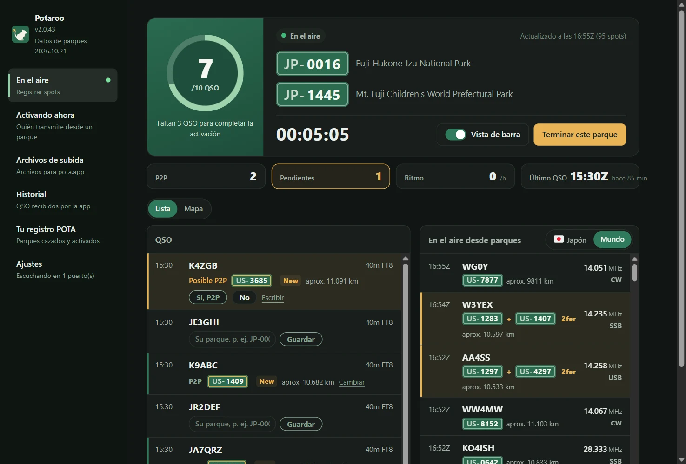
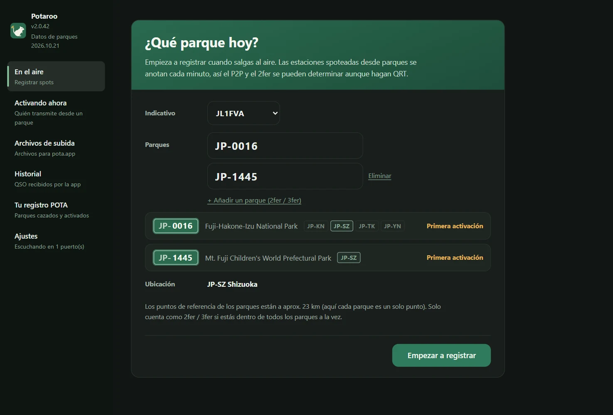
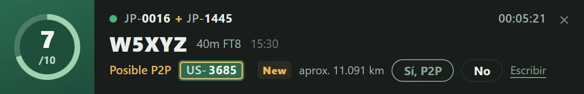
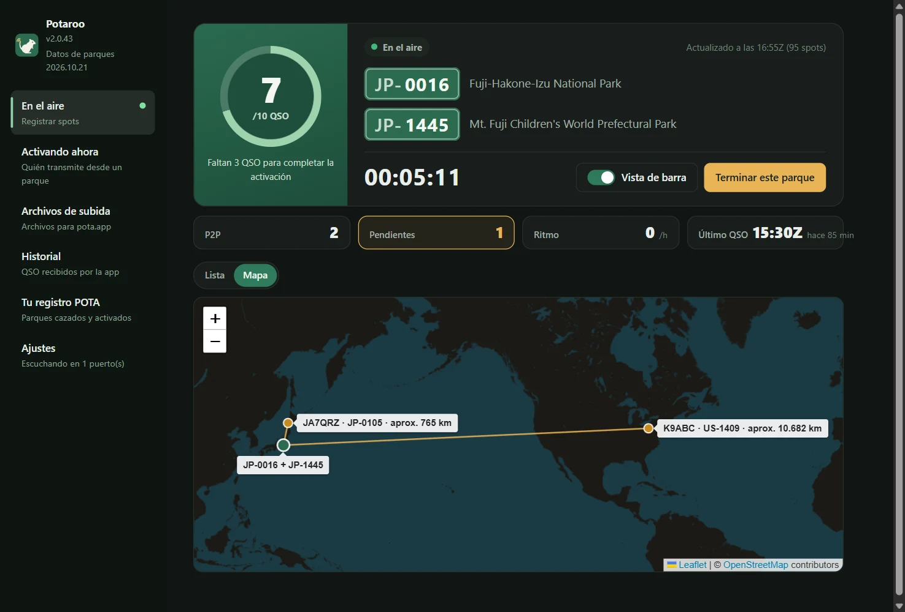
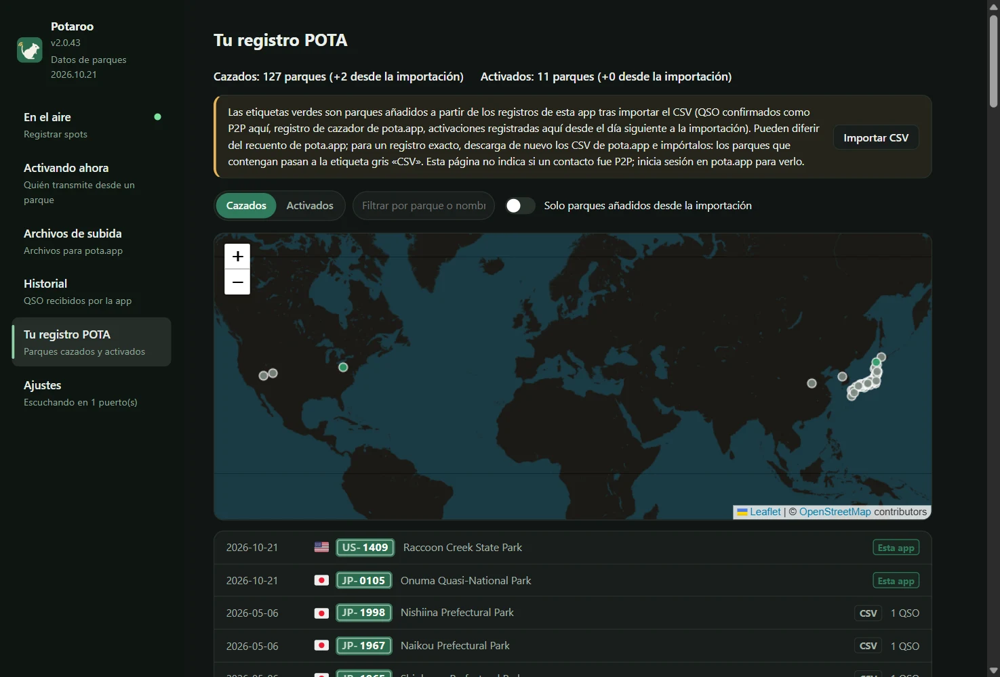
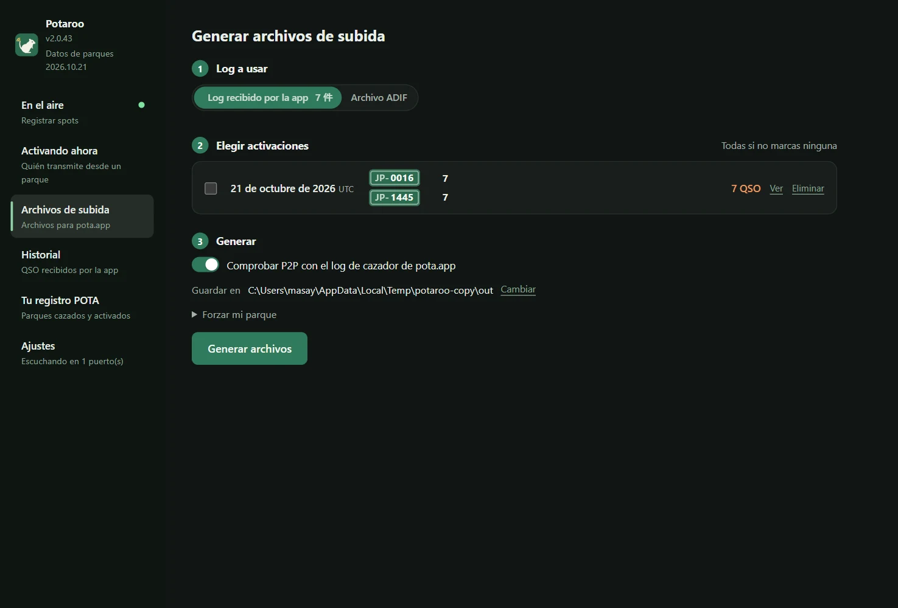
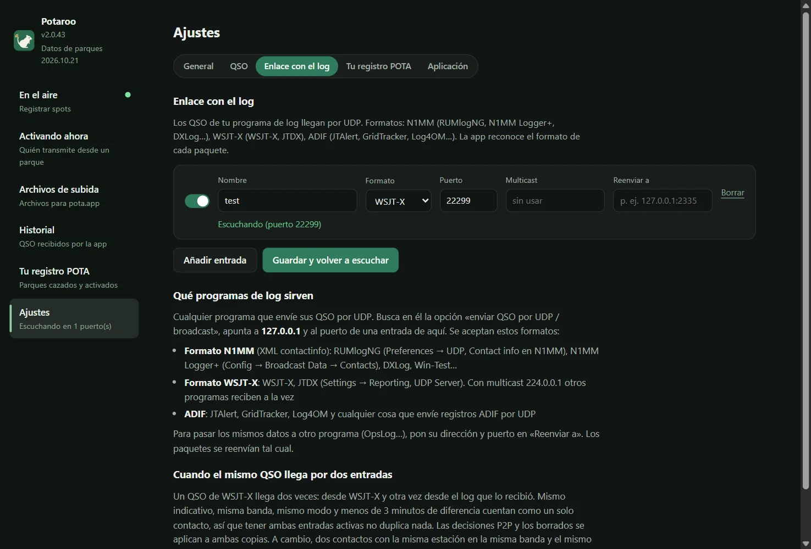

# Potaroo

*Antes POTA Upload Helper*

[日本語](README.md) · [English](README.en.md) · [简体中文](README.zh-CN.md) · [繁體中文](README.zh-TW.md) · [Français](README.fr.md) · [Deutsch](README.de.md) · [Español](README.es.md) · [Italiano](README.it.md) · [Português (Brasil)](README.pt-BR.md) · [한국어](README.ko.md) · [Polski](README.pl.md)

<a href="https://buymeacoffee.com/pudipara"></a>

Una app de escritorio que te ayuda con tus activaciones POTA (Parks on the Air), desde que sales al aire hasta la subida. Funciona en macOS y Windows.

En FT8 y modos parecidos no puedes saber en el momento si la otra estación está en un parque, y menos si es un 2fer. Esta app registra los spots de pota.app mientras activas, los cruza al instante con los QSO que envía tu programa de log y **te propone candidatos a P2P (parque a parque) y 2fer para que tú los confirmes y guardes**. Al terminar, escribe archivos listos para subir a pota.app, uno por cada parque tuyo y fecha UTC.



## Qué hace

### Antes de salir al aire
- **Escribe el parque y empieza a registrar**: al introducir la referencia del parque, la app muestra su nombre, su ubicación (estado / provincia / prefectura) y qué número de activación de ese parque será. Para un 2fer o 3fer, añade los parques con «Añadir un parque».
- **Comprobación del 2fer**: si los parques que introduces no comparten ningún estado / provincia / prefectura, o la información del parque en pota.app dice que «no se solapan», no se pueden registrar como 2fer, así que el botón «Empezar a registrar» queda desactivado. Si un parque abarca varios estados o prefecturas, eliges en un desplegable que solo ofrece las zonas que comparten los parques (si solo hay una, se elige sola).



### En el aire
- **La pantalla En el aire**: un anillo que se llena hasta 10 QSO (pasados los 10 cuenta hasta /20, /30…), tiempo transcurrido, número de P2P y de pendientes, ritmo de la última hora y último QSO. Los QSO y las estaciones que transmiten desde parques se ven en una lista o en un mapa.
- **La barra**: un pequeño aviso en su propia ventana, siempre delante, que puedes dejar encima de tu programa de log. Ahí ves el último QSO y respondes las preguntas de P2P (sí / no / omitir), y la ventana principal queda libre para ver otras páginas. El ancho de la barra se ajusta a su contenido.
- **QSO desde tu programa de log**: se reciben por UDP, igual que hacen OpsLog o JTAlert. Formato N1MM (RUMlogNG, N1MM Logger+, DXLog…), WSJT-X / JTDX (con multicast), ADIF (JTAlert, GridTracker, Log4OM…) y los avisos de cambios de QSO de QLog. En Windows también lee de un Turbo HAMLOG en marcha. Las correcciones y los borrados hechos en el log se reflejan.
- **P2P confirmado al momento**: si la estación con la que acabas de hacer el QSO está transmitiendo desde un parque, la fila muestra «Posible P2P» con la referencia del parque, y decides con «Sí, P2P» o «No». Si la estación no aparece en los spots (en fonía o CW, cuando te ha dicho su parque), escribe la referencia directamente en esa fila. Nada pasa a ser P2P por su cuenta.
- **Distancia y mapa**: se muestra la distancia en línea recta hasta el parque de la otra estación, por ejemplo «aprox. 820 km» (en un 2fer, desde el punto medio entre los parques). La pestaña Mapa se centra en tu posición y traza líneas hasta los parques con los que hiciste P2P. La distancia puede mostrarse en km o en millas.
- **Celebración cada 10 QSO**: confeti en el momento en que la activación es válida y luego cada 10 QSO.
- **Terminar escribe el archivo**: «Terminar este parque» escribe el archivo de subida de ese día (`JL1FVA@JP-1266-20261020.adi`) en la carpeta de destino y vuelve a la primera pantalla. Si la otra estación era un 2fer, el QSO se repite una vez por parque; si el 2fer eras tú, sale un archivo por parque. Cerrar la app durante una activación no la termina: el registro continúa la próxima vez que abras la app (se te pregunta antes de cerrar).
- **Tiempo y avisos**: al empezar a registrar, el tiempo del parque se consulta cada 15 minutos; la barra y la ventana principal avisan cuando se acercan tormentas, viento fuerte o lluvia intensa. En parques de Japón se muestran los avisos y alertas de la JMA por municipio (tormenta y alertas en una franja llamativa), y la pestaña Tiempo muestra las próximas horas. Las órdenes de evacuación las dan los municipios y no se muestran.
- **Shifts y eventos**: cuando empieza o termina la Early Shift / Late Shift, la barra muestra una salida del sol o de la luna. Durante eventos POTA como Support Your Parks, una etiqueta lo indica.
- **Diplomas al alcance**: un QSO que alcanza Rover, Unique Parks, Repeat Offender o Kilo trae una medalla y confeti (pota.app lo confirma al subir el log). Si una estación vuelve a llamar desde otro parque, su fila dice «la última vez desde …».
- **Estaciones de club y reloj**: una estación de club puede registrar operadores y cambiarlos en el aire. Aparece un aviso si el reloj del ordenador difiere un minuto o más de pota.app (el P2P exige menos de 15 minutos entre ambos logs).

| La barra | Mapa |
|---|---|
|  |  |

### Además
- **Activando ahora**: aunque no estés registrando, una lista de las estaciones que transmiten ahora mismo desde parques, según los spots de pota.app (se actualiza cada minuto). Se puede filtrar por país y región, banda, modo, 2fer o más, no cazados, y ocultar QRT.
- **Historial**: los QSO que ha recibido esta app, por fecha; se pueden borrar uno a uno.
- **Tu registro POTA**: importa los `hunter_parks.csv` / `activator_parks.csv` que descargaste de pota.app para ver los parques que has cazado y activado, en una lista y en un mapa. Los parques que esta app ha añadido desde la importación se marcan en verde.
- **Archivos de subida**: genera de una vez los archivos de fechas pasadas, desde el log de la app o desde el ADIF de tu programa de log.
- **Apariencia**: cambia el tamaño del texto (Normal / Grande / Muy grande) y los colores (Como el sistema / Claro / Oscuro). También se aplican a la barra.
- **Reenvío**: los datos recibidos se pueden pasar tal cual a otro programa (RUMlog → esta app → OpsLog).
- **Datos de parques actualizados cada mes**: la lista de parques y sus posiciones vienen con la app y se actualizan cada mes con la última versión de pota.app (como una actualización pequeña, aparte de las de la app).
- **Guía de inicio**: en el primer arranque, siete pasos llevan del indicativo a los archivos. Ábrela cuando quieras desde «Guía de inicio», abajo a la izquierda.
- **Avance de 6 Pack**: Tu registro POTA cuenta los parques activados y trabajados en P2P en 6 m (según el log de la app).

| Tu registro POTA | Archivos de subida |
|---|---|
|  |  |

El parque de la otra estación se decide en este orden:

1. **Log de cazador (hunter log) de pota.app** (lo que subió la otra estación = verificado), cruzado a ±5 minutos en la misma banda
2. **Parques que confirmaste o escribiste en el aire** (al generar desde el log de la app). Los QSO sin confirmar no se hacen P2P
3. **Spots registrados en el aire** (solo al generar desde un archivo ADIF; spots desde 30 minutos antes hasta 10 minutos después del QSO)
4. SIG_INFO / POTA_REF del programa de log

Solo lee datos que pota.app hace públicos (api.pota.app), sin iniciar sesión (y sin soporte oficial de POTA). Guardar el log es trabajo de tu programa de log: esta app solo decide y escribe los archivos de subida, y nunca modifica el log de tu programa.

## Descarga

Descarga la última versión en [Releases](../../releases).

| SO | Archivo | Cómo |
|---|---|---|
| macOS (Apple Silicon) | `Potaroo-macOS.dmg` | Ábrelo y arrastra `Potaroo` a `Applications` |
| Windows 10 / 11 | `Potaroo-Setup.exe` | Al ejecutarlo se instala por usuario (sin permisos de administrador) y aparece en el menú Inicio |

También se adjuntan los zip (`Potaroo-macOS.zip` / `Potaroo-Windows.zip`). La actualización desde la app los usa, así que no los borres de una Release.

La app no está firmada, así que la primera vez aparece un aviso.

- **macOS**: clic derecho en la app → Abrir → Abrir. Si sigue sin abrirse, usa «Abrir igualmente» en la parte de abajo de Ajustes del Sistema → Privacidad y seguridad.
- **Windows**: «Windows protegió su PC» → Más información → Ejecutar de todas formas.

**A partir de la segunda vez puedes actualizar desde la app.** Al arrancar comprueba si hay una versión nueva; cuando te avise, pulsa «Actualizar ahora». La descarga, la reemplaza y se reinicia. Puedes comprobarlo cuando quieras en «Ajustes → Aplicación». Si abres la app directamente desde el DMG (sin moverla a `Applications`), macOS no permite reemplazarla, así que la app nueva se deja en tu carpeta Descargas y se te avisa. Una app instalada todavía con el nombre antiguo (POTA Upload Helper) pasa a llamarse Potaroo en el primer arranque tras la actualización (en Windows también se actualizan los accesos directos).

## Enlace con el log

Crea entradas en «Ajustes → Enlace con el log» (las que quieras). **Sirve cualquier programa de log que pueda enviar sus QSO por UDP.** En el programa de log, abre la opción de «enviar QSO por UDP» y pon como destino `127.0.0.1` y como puerto el mismo número que la entrada. La app reconoce sola el formato de cada paquete.



| Formato | Programas de log | Dónde se configura |
|---|---|---|
| N1MM (XML contactinfo) | RUMlogNG, N1MM Logger+, DXLog, Win-Test | RUMlogNG: Preferences → UDP, Contact info en N1MM. N1MM Logger+: Config → Broadcast Data → Contacts |
| WSJT-X | WSJT-X, JTDX | Settings → Reporting, UDP Server. Con `224.0.0.1` (multicast) otros programas pueden recibir a la vez |
| ADIF | JTAlert, GridTracker, Log4OM… | la opción «enviar ADIF por UDP» de cada programa |
| QLog (JSON) | QLog | Settings → Network → Notifications, pon `127.0.0.1:puerto` en **QSO Changes** |
| Turbo HAMLOG (Windows) | Turbo HAMLOG/Win | Pon el formato de la entrada en «Turbo HAMLOG». No hace falta puerto: lee del HAMLOG en marcha (incluidos los QSO que llegan por JT_Linker o JT-Get's) |

Los QSO corregidos o borrados en el programa de log también se reflejan en la app. Comprobado en Windows 11: WSJT-X, Log4OM 2, Turbo HAMLOG, QLog y N1MM Logger+ (recepción de QSO en CW, SSB y FT8, más correcciones y borrados).

**Solo se reciben QSO de programas de log del mismo ordenador.** Las entradas escuchan en `127.0.0.1`, así que un programa de log en otro PC no llega a ellas.

**Multicast de WSJT-X / JTDX en Windows**: en Windows, la entrada multicast también escucha en loopback (`127.0.0.1`). En WSJT-X, en Settings → Reporting → **Outgoing interfaces**, incluye **loopback**. Esta combinación se ha comprobado en Windows 11. Si no llega nada, avísanos en un [issue](../../issues). Poner el UDP Server de WSJT-X en `127.0.0.1` en lugar de multicast funciona siempre (pero entonces otros programas no pueden recibir a la vez).

**Configuración de programas de log junto con WSJT-X** (comprobado en Windows 11; aunque mezcles CW, SSB y FM entre QSO de FT8, cada uno entra correctamente una sola vez):

| Programa de log | Recepción desde WSJT-X | Envío a la app |
|---|---|---|
| JT_Linker + Turbo HAMLOG | JT_Linker vigila el archivo de log de WSJT-X y registra los QSO en HAMLOG | entrada «Turbo HAMLOG» |
| N1MM Logger+ | Config → Configure Ports → WSJT/JTDX Setup, activa Radio #1 (`127.0.0.1` en unicast, `224.0.0.1` en multicast, puerto 2237) | Broadcast Data → Contacts a `127.0.0.1:puerto de la entrada` |
| QLog | Settings → Network, Wsjtx Port 2237 (en multicast, activa Join Multicast y pon `224.0.0.1` en Multicast Address) | Notifications → QSO Changes a `127.0.0.1:puerto de la entrada` |

Los QSO de WSJT-X también llegan directamente a la app (por la entrada de WSJT-X) y se juntan en uno solo con los que llegan a través del programa de log. Si repartes el multicast de WSJT-X a varios programas a la vez, ten en cuenta lo siguiente.

- **Arranca QLog y N1MM antes que los demás programas.** No abren el puerto 2237 de forma que se pueda compartir con otros programas, así que si arrancan después el puerto está «en uso» y no reciben nada.
- **Turbo HAMLOG también abre el puerto 2237.** Si lo usas con JT_Linker, HAMLOG puede preguntar si registrar un «segundo QSO»; en ese caso responde «No». No se puede usar a la vez que QLog o N1MM (el HAMLOG que arranca después da error).

Para pasar los mismos datos a otro programa (OpsLog…), pon su dirección y puerto en «Reenviar a» de la entrada.

**Con las dos activas no se duplica nada**: un QSO de WSJT-X llega dos veces, directamente de WSJT-X y del programa de log que lo recibió y lo reenvió (con un minuto de diferencia: hora de inicio y hora de fin). Mismo indicativo, misma banda, mismo modo y menos de 3 minutos de diferencia = un solo contacto; las decisiones de P2P y los borrados se aplican a ambos. A cambio, dos QSO con la misma estación en la misma banda y el mismo modo en menos de 3 minutos también se cuentan como uno.

## Dónde se guardan los datos

| SO | Ubicación |
|---|---|
| macOS | `~/Library/Application Support/Potaroo/` |
| Windows | `%APPDATA%\Potaroo\` |

`qsolog.db` (QSO recibidos), `spots-YYYYMMDD.jsonl` (spots registrados), `sessions.json` (horas de tus activaciones y parques), `hunter.json` (copia del log de cazador), `mypota.json` (los CSV del registro importados), `settings.json`, `potaroo.log` (registro de errores).
El perfil público de pota.app solo muestra las últimas 25 entradas del log de cazador, así que la app las va añadiendo a `hunter.json` mientras registra y cada vez que genera archivos, para conservar el historial. Los datos internos, como los QSO recibidos, se conservan hasta que los borres (uno a uno en «Historial», o todos a la vez en «Ajustes → Aplicación → Datos de la app»).

## Informar de un problema

«Ajustes → Aplicación → Informar de un problema» abre un informe con la versión, el sistema operativo y el final del registro. Revísalo y edítalo, y luego pulsa «Copiar» para enviarlo por correo u otro medio, o «Informar en GitHub» para abrir la página de creación de un [issue](../../issues) (los informes en GitHub son públicos). La app no envía nada por su cuenta. El registro contiene indicativos y referencias de parques.

## Idiomas

日本語, English, 简体中文, 繁體中文, Français, Deutsch, Español, Italiano, Português (Brasil), 한국어, Polski. Se elige automáticamente según el idioma del sistema y se cambia en «Idioma» en «Ajustes».

## Condiciones de uso y exención de responsabilidad

Esta app es software de aficionado hecho por un particular y se ofrece sin garantía. **El autor no se hace responsable de ningún daño derivado de su uso (subidas erróneas a pota.app, QSO duplicados o perdidos, pérdida de logs o archivos, efectos en tu programa de log o en la configuración de red, etc.).** Revisa siempre tú mismo el contenido de los archivos antes de subirlos. La detección de P2P y 2fer es una estimación y no se garantiza que sea correcta. Esta app no tiene relación con Parks on the Air® ni con pota.app. El texto completo está en [TERMS.md](TERMS.md) y también se muestra al abrir la app por primera vez.

Para informar de una vulnerabilidad, consulta [SECURITY.md](SECURITY.md).

## Ejecutar desde el código fuente

```sh
pip install -r requirements.txt
python3 app.py
```

También se puede usar solo desde la línea de comandos (solo biblioteca estándar).

```sh
python3 pota_spotlog.py --parks JP-1266,JP-1206
python3 pota_build.py export.adif --date 20261020
```

## Desarrollo

```sh
scripts/dev.sh                                  # crea un venv y arranca (datos en ./data, nunca toca tu log real)
scripts/dev.sh --debug                          # con herramientas de desarrollo
scripts/send_test_qso.py 22237 JA1XYZ           # envía un QSO de prueba a la entrada de desarrollo (nunca a 2237)
python3 -m unittest discover -s tests
```

Haz los cambios en una rama y abre un Pull Request. En cada PR se ejecutan las pruebas en macOS y Windows; al fusionarlo en `main`, GitHub Actions compila las versiones de ambos sistemas y las adjunta a la Release `v<VERSION>` (`VERSION` en `potacommon.py`). En `scripts/` también hay, entre otros, `copy_instance.py` (arranca una segunda app con una copia de los datos), `check_align.mjs` (revisa la alineación del texto en pantalla) y `readme_shots.mjs` (toma las capturas de este README).

## License

MIT

Para las banderas se incluye la fuente de [country-flag-emoji-polyfill](https://github.com/talkjs/country-flag-emoji-polyfill) (MIT), que contiene solo las banderas de Twemoji (CC-BY 4.0). Los mapas usan [Leaflet](https://leafletjs.com/) (BSD-2-Clause) y teselas © de los colaboradores de [OpenStreetMap](https://www.openstreetmap.org/copyright). Datos meteorológicos de [Open-Meteo](https://open-meteo.com/) (CC BY 4.0). Avisos para parques de Japón: agencia meteorológica de Japón (fuente: web de la JMA); el municipio del parque: geocodificador inverso del GSI.
