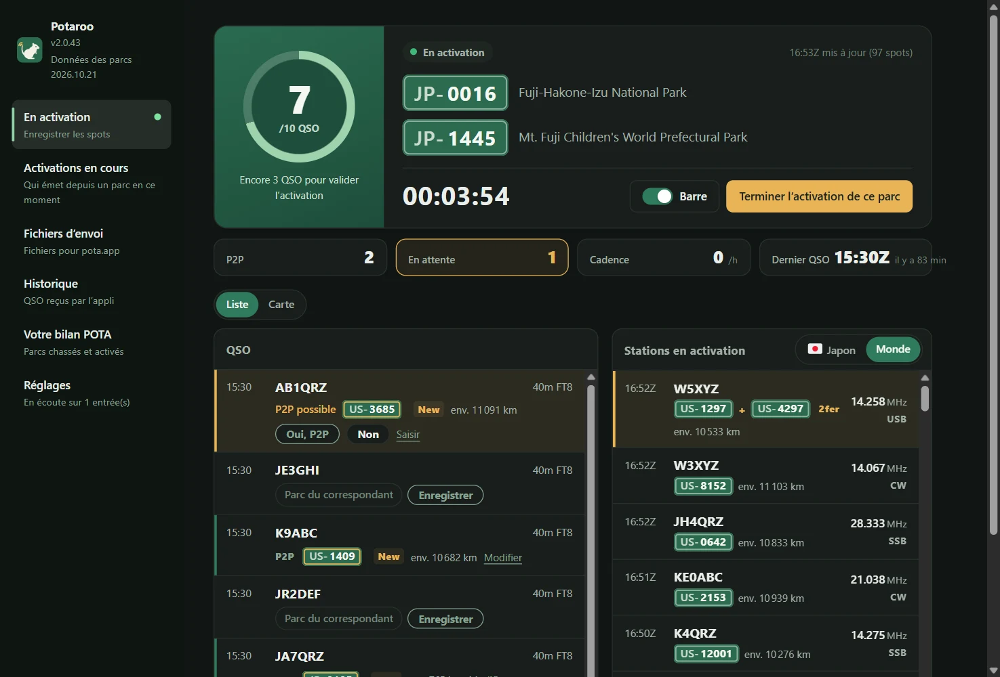
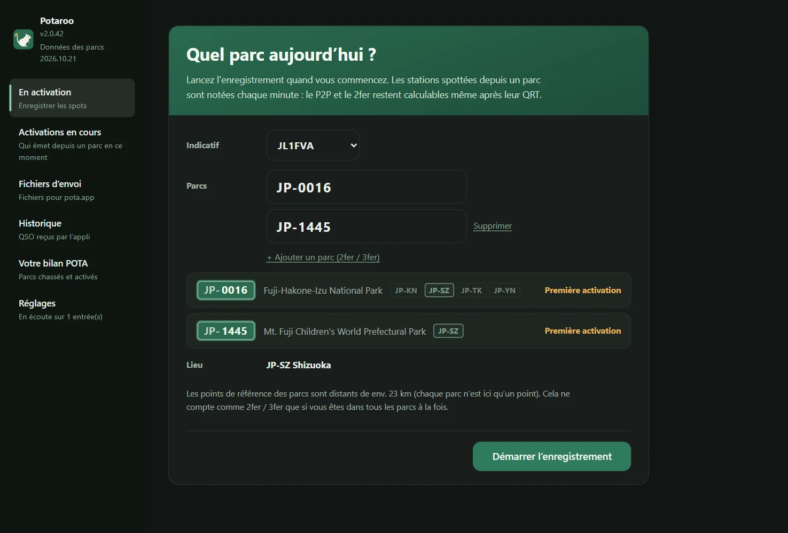
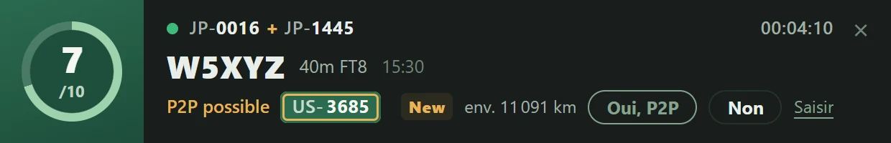
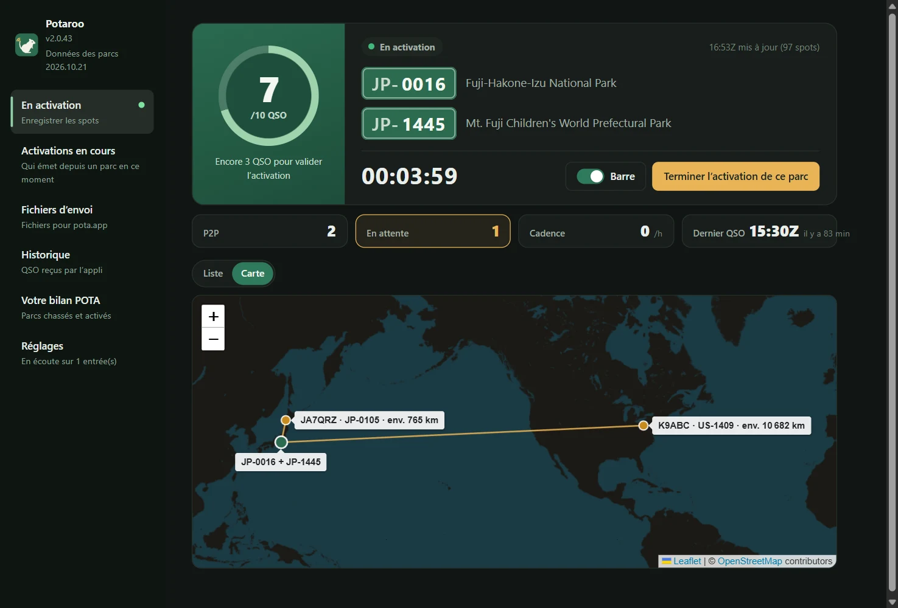
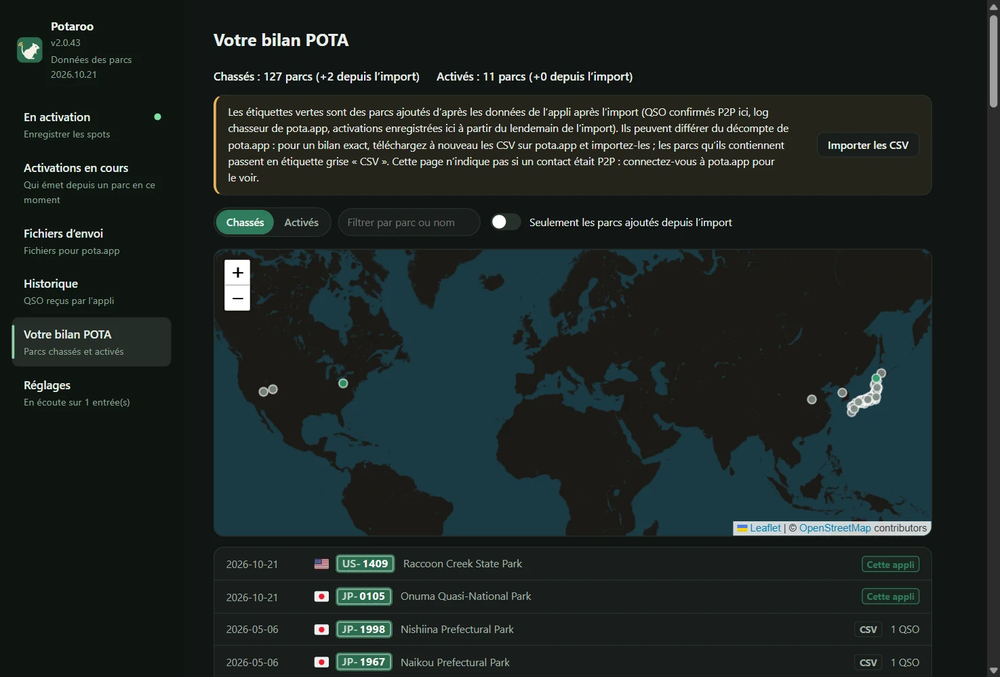
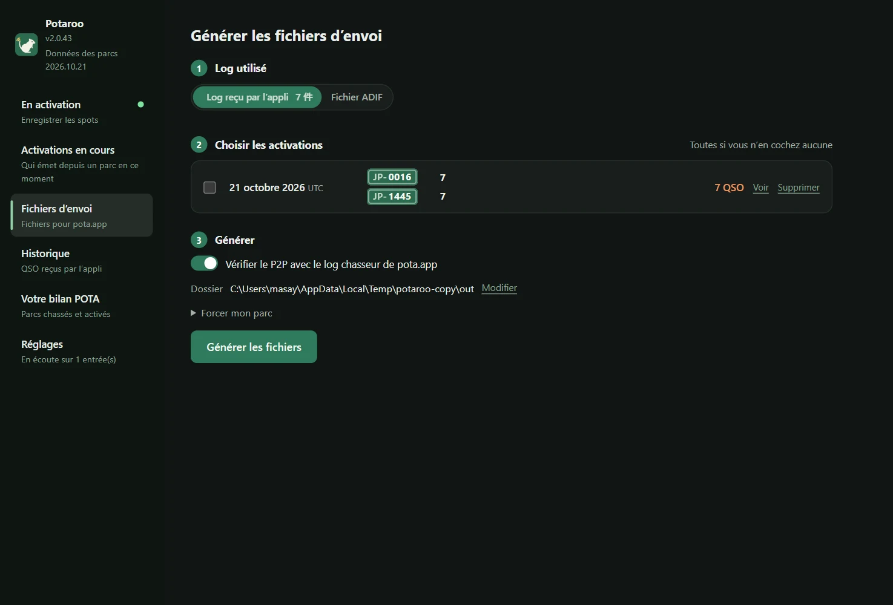
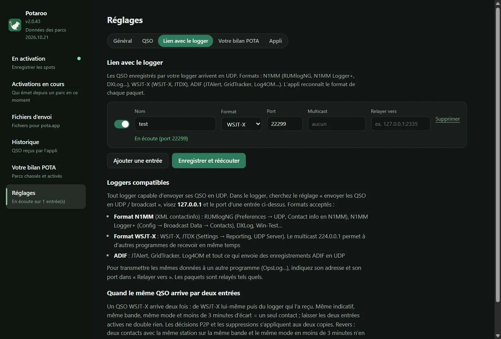

# Potaroo

*Anciennement POTA Upload Helper*

[日本語](README.md) · [English](README.en.md) · [简体中文](README.zh-CN.md) · [繁體中文](README.zh-TW.md) · [Français](README.fr.md) · [Deutsch](README.de.md) · [Español](README.es.md) · [Italiano](README.it.md) · [Português (Brasil)](README.pt-BR.md) · [한국어](README.ko.md) · [Polski](README.pl.md)

<a href="https://buymeacoffee.com/pudipara"></a>

Une application de bureau qui vous accompagne dans vos activations POTA (Parks on the Air), du trafic jusqu’à l’envoi du log. Elle fonctionne sous macOS et Windows.

En FT8 et dans les modes similaires, impossible de savoir sur le moment si la station en face émet depuis un parc, et encore moins si c’est un 2fer. Cette application enregistre les spots pota.app pendant l’activation, les confronte aussitôt aux QSO envoyés par votre logger et **propose les P2P (Park to Park) et les 2fer, que vous confirmez et enregistrez**. Une fois l’activation terminée, elle écrit un fichier par parc et par jour UTC, prêt à être envoyé tel quel sur pota.app.



## Ce qu’elle fait

### Avant l’activation
- **Saisissez le parc et démarrez l’enregistrement, c’est tout** : dès que vous tapez la référence, l’application affiche le nom du parc, sa localisation (préfecture, département, État…) et le numéro de l’activation à venir. Pour un 2fer ou un 3fer, ajoutez les parcs avec « + Ajouter un parc (2fer / 3fer) ».
- **Vérification du 2fer** : si les parcs saisis n’ont aucune préfecture ou aucun État en commun, ou si la fiche du parc sur pota.app indique qu’ils « ne se chevauchent pas », ils ne peuvent pas être enregistrés en 2fer et le bouton de démarrage est désactivé. Pour un parc à cheval sur plusieurs préfectures, vous choisissez dans une liste limitée aux zones communes (s’il n’y en a qu’une, elle est choisie automatiquement).



### Pendant l’activation
- **Écran d’activation** : un anneau jusqu’à 10 QSO (au-delà, /20, /30…), le temps écoulé, le nombre de P2P et de QSO en attente de confirmation, la cadence de la dernière heure et le dernier QSO. Les QSO et les stations qui émettent depuis un parc s’affichent en liste ou sur la carte.
- **Barre** : un petit bandeau de notification dans une fenêtre séparée, toujours au premier plan, à poser au-dessus du logger. Le dernier QSO et la confirmation du P2P (Oui / Non / Passer) se règlent directement dans la barre, et la fenêtre principale reste libre pour consulter les autres pages. La largeur de la barre s’adapte automatiquement à son contenu.
- **QSO reçus de votre logger** : en UDP, comme OpsLog ou JTAlert. Format N1MM (RUMlogNG, N1MM Logger+, DXLog…), WSJT-X / JTDX (multicast pris en charge), ADIF (JTAlert, GridTracker, Log4OM…) et les notifications de modification de QSO de QLog. Sous Windows, l’application lit aussi Turbo HAMLOG en cours d’exécution. Les corrections et suppressions faites dans le logger sont reprises.
- **P2P confirmé sur le moment** : si la station d’un QSO reçu émet depuis un parc, la ligne affiche « P2P possible » avec la référence du parc, et vous tranchez avec « Oui, P2P » ou « Non ». Pour une station absente des spots (en phonie ou en CW, quand elle vous donne sa référence), tapez la référence directement dans la ligne. Rien ne devient P2P tout seul.
- **Distance et carte** : la distance à vol d’oiseau jusqu’au parc de la station en face s’affiche, par exemple « env. 820 km » (pour un 2fer, depuis le point médian entre les parcs). L’onglet « Carte » trace des lignes depuis votre position jusqu’aux parcs contactés en P2P. L’unité se choisit entre km et milles.
- **Une fête tous les 10 QSO** : des confettis au moment où l’activation est validée, puis tous les 10 QSO.
- **Terminer écrit le fichier** : « Terminer l’activation de ce parc » écrit le fichier d’envoi du jour (`JL1FVA@JP-1266-20261020.adi`) dans le dossier choisi et revient au premier écran. Si la station en face est en 2fer, le QSO est répété pour chaque parc ; si c’est vous qui êtes en 2fer, un fichier par parc. Fermer l’application pendant l’activation ne la termine pas : l’enregistrement reprend au prochain démarrage (une confirmation est demandée avant de fermer).
- **Envoyer en dehors de 03:00–11:00 UTC** : pendant ces heures, la maintenance de la base de pota.app fait souvent échouer les envois (« Unknown Failure »), et POTA a demandé par e-mail et sur les réseaux sociaux de les éviter (ce n'est pas sur docs.pota.app). Le cadre des résultats indique ces heures en heure locale et les met en évidence quand on y est.
- **Météo et vigilances** : dès le début de l'enregistrement, la météo du parc est vérifiée toutes les 15 minutes ; la barre et la fenêtre principale préviennent quand l'orage, le vent fort ou une forte pluie approche. Pour les parcs au Japon, les avis et alertes de la JMA sont affichés par commune (orage et alertes en bandeau voyant), et l'onglet Météo donne les prochaines heures. Les ordres d'évacuation relèvent des communes et ne sont pas affichés.
- **Shifts et événements** : quand l'Early Shift / la Late Shift commence ou se termine, la barre montre un lever de soleil ou de lune. Pendant les événements POTA comme Support Your Parks, une étiquette l'indique.
- **Diplômes à portée** : un QSO qui atteint Rover, Unique Parks, Repeat Offender ou Kilo apporte une médaille et des confettis (pota.app le confirme une fois le log envoyé). Une station qui rappelle depuis un autre parc reçoit « la dernière fois depuis … » sur sa ligne.
- **Stations de club et horloge** : une station de club peut enregistrer ses opérateurs et en changer pendant l'activation. Un avis apparaît si l'horloge de l'ordinateur s'écarte d'une minute ou plus de pota.app (le P2P exige moins de 15 minutes d'écart entre les deux logs).

| Barre | Carte |
|---|---|
|  |  |

### Et aussi
- **Activations en cours** : même sans enregistrer, la liste des stations qui émettent en ce moment depuis un parc, d’après les spots pota.app (actualisée chaque minute). Filtres : pays et région, bande, mode, 2fer ou plus seulement, non chassés seulement, masquer QRT.
- **Historique** : les QSO reçus par l’application, classés par date, supprimables un par un.
- **Votre bilan POTA** : importez les fichiers `hunter_parks.csv` / `activator_parks.csv` téléchargés depuis pota.app pour voir vos parcs chassés et activés en liste et sur la carte. Les parcs ajoutés par cette application après l’import apparaissent en vert.
- **Fichiers d’envoi** : génère d’un coup les fichiers des jours passés à partir du journal de l’application ou du fichier ADIF de votre logger.
- **Affichage** : taille du texte (Normale / Grande / Très grande) et couleurs (Comme le système / Clair / Sombre) ; la barre suit aussi ces réglages.
- **Relais** : les données reçues peuvent être retransmises telles quelles à une autre application (RUMlog → cette application → OpsLog).
- **Données des parcs mises à jour chaque mois** : la liste des parcs et leurs positions sont intégrées à l’application et alignées chaque mois sur la dernière version de pota.app (via une petite mise à jour à part, distincte de celles de l’application).
- **Guide de démarrage** : au premier lancement, sept étapes mènent de l'indicatif à la création des fichiers. Rouvrez-le à tout moment depuis « Guide de démarrage » en bas à gauche.
- **Progression 6 Pack** : votre bilan POTA compte les parcs activés et contactés en P2P sur 6 m (d'après le log de l'appli).

| Votre bilan POTA | Fichiers d’envoi |
|---|---|
|  |  |

Le parc de la station en face est déterminé dans cet ordre :

1. **Journal chasseur pota.app** (ce que la station a elle-même envoyé = confirmé), rapproché à ±15 minutes sur la même bande
2. **Les parcs confirmés ou saisis pendant l’activation** (génération depuis le journal de l’application). Un QSO non confirmé ne devient pas P2P
3. **Les spots enregistrés pendant l’activation** (seulement depuis un fichier ADIF ; spots de 30 minutes avant à 10 minutes après le QSO)
4. SIG_INFO / POTA_REF du logger

Elle ne lit que des données que pota.app rend publiques (api.pota.app), sans connexion (et sans soutien officiel de POTA). Tenir le log, c’est le travail du logger : cette application se charge uniquement du jugement et de la création des fichiers d’envoi, et ne modifie jamais le log du logger.

## Téléchargement

Prenez la dernière version dans [Releases](../../releases).

| OS | Fichier | Comment faire |
|---|---|---|
| macOS (Apple Silicon) | `Potaroo-macOS.dmg` | Ouvrez-le et glissez `Potaroo` dans `Applications` |
| Windows 10 / 11 | `Potaroo-Setup.exe` | Lancez-le : l’application s’installe pour l’utilisateur (sans droits administrateur) et apparaît dans le menu Démarrer |

Les versions zip (`Potaroo-macOS.zip` / `Potaroo-Windows.zip`) sont jointes aussi. La mise à jour intégrée utilise ces zips : ne les supprimez pas de la Release.

L’application n’est pas signée : un avertissement s’affiche au premier lancement.

- **macOS** : clic droit sur l’application → « Ouvrir » → « Ouvrir ». Si elle refuse encore, allez dans « Réglages Système → Confidentialité et sécurité » et cliquez sur « Ouvrir quand même », plus bas.
- **Windows** : « Windows a protégé votre ordinateur » → « Informations complémentaires » → « Exécuter quand même ».

**Ensuite, la mise à jour se fait dans l’application.** Au démarrage, elle vérifie s’il existe une nouvelle version ; quand elle vous le signale, appuyez sur « Mettre à jour » : téléchargement, remplacement, redémarrage. Vous pouvez aussi vérifier à tout moment dans « Réglages → Appli ». Si vous lancez l’application directement depuis le DMG (sans la placer dans `Applications`), macOS empêche le remplacement : la nouvelle version est alors déposée dans le dossier « Téléchargements » et l’application vous prévient. Une application encore installée sous l’ancien nom (POTA Upload Helper) se renomme en Potaroo au premier lancement après la mise à jour (sous Windows, les raccourcis sont aussi mis à jour).

## Lien avec le logger

Dans « Réglages → Lien avec le logger », créez des entrées (autant que vous voulez). **Tout logger capable d’envoyer ses QSO en UDP convient.** Dans le logger, ouvrez le réglage « envoyer les QSO en UDP », indiquez `127.0.0.1` comme destination et le même numéro de port que l’entrée. L’application reconnaît d’elle-même le format des paquets reçus.



| Format | Exemples de loggers | Où régler |
|---|---|---|
| N1MM (XML contactinfo) | RUMlogNG, N1MM Logger+, DXLog, Win-Test | RUMlogNG : Preferences → UDP, Contact info sur N1MM. N1MM Logger+ : Config → Broadcast Data → Contacts |
| WSJT-X | WSJT-X, JTDX | Settings → Reporting, UDP Server. Avec `224.0.0.1` (multicast), d’autres applications peuvent recevoir en même temps |
| ADIF | JTAlert, GridTracker, Log4OM… | le réglage « envoyer l’ADIF en UDP » de chaque logiciel |
| QLog (JSON) | QLog | Settings → Network → Notifications, **QSO Changes** sur `127.0.0.1:port` |
| Turbo HAMLOG (Windows) | Turbo HAMLOG/Win | Format de l’entrée : « Turbo HAMLOG ». Pas de port : l’application lit HAMLOG en cours d’exécution (y compris les QSO passés par JT_Linker ou JT-Get's) |

Les QSO corrigés ou supprimés dans le logger le sont aussi dans l’application. Vérifiés sous Windows 11 : WSJT-X, Log4OM 2, Turbo HAMLOG, QLog et N1MM Logger+ (réception en CW, SSB et FT8, corrections et suppressions).

**Seuls les loggers du même ordinateur peuvent envoyer.** Les entrées écoutent sur `127.0.0.1` : un logger sur un autre PC ne peut pas les atteindre.

**Multicast WSJT-X / JTDX sous Windows** : sous Windows, l’entrée multicast écoute elle aussi sur la boucle locale (`127.0.0.1`). Dans WSJT-X, Settings → Reporting → **Outgoing interfaces**, incluez **loopback**. Cette combinaison a été vérifiée sous Windows 11. Si rien n’arrive, merci de le signaler dans une [issue](../../issues). Sans multicast, en réglant l’UDP Server de WSJT-X sur `127.0.0.1`, la réception est garantie (mais les autres applications ne peuvent alors pas recevoir en même temps).

**Réglages des loggers utilisés avec WSJT-X** (vérifiés sous Windows 11 ; même en glissant de la CW, de la SSB ou de la FM entre des QSO FT8, chaque QSO arrive correctement, un par un) :

| Logger | Réception depuis WSJT-X | Envoi vers l’application |
|---|---|---|
| JT_Linker + Turbo HAMLOG | JT_Linker surveille le fichier de log de WSJT-X et l’inscrit dans HAMLOG | Entrée « Turbo HAMLOG » |
| N1MM Logger+ | Config → Configure Ports → WSJT/JTDX Setup, Radio #1 sur Enable (unicast `127.0.0.1`, multicast `224.0.0.1`, port 2237) | Broadcast Data → Contacts sur `127.0.0.1:port de l’entrée` |
| QLog | Settings → Network, Wsjtx Port 2237 (en multicast, activez Join Multicast et mettez `224.0.0.1` dans Multicast Address) | Notifications → QSO Changes sur `127.0.0.1:port de l’entrée` |

Les QSO WSJT-X arrivent aussi directement dans l’application (par l’entrée WSJT-X) et sont fusionnés en un seul avec ceux qui passent par le logger. Si vous diffusez en multicast vers plusieurs logiciels à la fois, faites attention aux points suivants :

- **Lancez QLog et N1MM avant les autres logiciels.** Ils n’ouvrent pas le port 2237 en mode partagé : lancés après, ils trouvent le port « déjà utilisé » et ne reçoivent rien.
- **Turbo HAMLOG ouvre lui aussi le port 2237.** Avec JT_Linker, HAMLOG demande parfois s’il doit enregistrer un « deuxième QSO » : répondez « Non ». Il ne peut pas tourner en même temps que QLog ou N1MM (le HAMLOG lancé en dernier affiche une erreur).

Pour transmettre les mêmes données à une autre application (OpsLog…), indiquez son adresse et son port dans « Relayer vers » de l’entrée.

**Les deux entrées actives, sans doublon** : un QSO WSJT-X arrive deux fois, directement de WSJT-X puis du logger qui l’a reçu et renvoyé (environ une minute d’écart : heure de début contre heure de fin). Même indicatif, même bande, même mode et au plus 3 minutes d’écart = un seul QSO ; les décisions P2P et les suppressions s’appliquent aux deux. À l’inverse, deux QSO avec la même station sur la même bande et dans le même mode à moins de 3 minutes d’intervalle n’en font qu’un.

## Emplacement des données

| OS | Emplacement |
|---|---|
| macOS | `~/Library/Application Support/Potaroo/` |
| Windows | `%APPDATA%\Potaroo\` |

`qsolog.db` (QSO reçus), `spots-YYYYMMDD.jsonl` (spots enregistrés), `sessions.json` (vos horaires d’activation et parcs), `hunter.json` (copie du journal chasseur), `mypota.json` (CSV du bilan importés), `settings.json`, `potaroo.log` (journal des erreurs).
Le profil public pota.app n’affiche que les 25 dernières entrées du journal chasseur ; l’application complète donc `hunter.json` pendant l’enregistrement et à chaque génération pour accumuler l’historique. Les données internes, comme les QSO reçus, sont conservées tant que vous ne les supprimez pas (une par une dans « Historique », toutes ensemble dans « Réglages → Appli → Données de l’appli »).

## Signaler un problème

« Réglages → Appli → Signaler un problème » ouvre un rapport contenant la version, le système et la fin du journal. Relisez-le et modifiez-le si besoin, puis « Copier » pour l’envoyer par e-mail ou autre, ou « Signaler sur GitHub » pour ouvrir la page de création d’une [issue](../../issues) (les signalements sur GitHub sont publics). L’application n’envoie rien d’elle-même. Le journal contient votre indicatif et des références de parcs.

## Langues

日本語, English, 简体中文, 繁體中文, Français, Deutsch, Español, Italiano, Português (Brasil), 한국어, Polski. Choisie automatiquement d’après la langue du système, modifiable dans « Réglages », rubrique « Langue ».

## Conditions d’utilisation et non-responsabilité

Cette application est un logiciel amateur réalisé par un particulier, sans aucune garantie. **L’auteur décline toute responsabilité pour tout dommage résultant de son utilisation (envoi de données erronées sur pota.app, QSO en double ou manquants, perte de logs ou de fichiers, effets sur le logger ou les réglages réseau, etc.).** Vérifiez toujours vous-même le contenu des fichiers avant de les envoyer. La détection des P2P et des 2fer est une estimation, sans garantie d’exactitude. Cette application n’a aucun lien avec Parks on the Air® ni avec pota.app. Le texte complet se trouve dans [TERMS.md](TERMS.md) et s’affiche aussi au premier lancement.

Pour signaler une vulnérabilité, voir [SECURITY.md](SECURITY.md).

## Lancer depuis les sources

```sh
pip install -r requirements.txt
python3 app.py
```

Utilisable aussi en ligne de commande seule (bibliothèque standard uniquement).

```sh
python3 pota_spotlog.py --parks JP-1266,JP-1206
python3 pota_build.py export.adif --date 20261020
```

## Développement

```sh
scripts/dev.sh                                  # crée un venv et lance l’appli (données dans ./data, le vrai journal n’est jamais touché)
scripts/dev.sh --debug                          # avec les outils de développement
scripts/send_test_qso.py 22237 JA1XYZ           # envoie un QSO de test à l’entrée de développement (jamais sur 2237)
python3 -m unittest discover -s tests
```

Proposez vos modifications sur une branche, sous forme de Pull Request. Chaque PR lance les tests sous macOS et Windows ; après fusion dans `main`, GitHub Actions construit les deux versions et les joint à la Release `v<VERSION>` (`VERSION` dans `potacommon.py`). Le dossier `scripts/` contient notamment `copy_instance.py` (lance une seconde application sur une copie des données), `check_align.mjs` (contrôle l’alignement du texte à l’écran) et `readme_shots.mjs` (prend les captures de ce README).

## License

MIT

Pour afficher les drapeaux, l’application embarque la police de [country-flag-emoji-polyfill](https://github.com/talkjs/country-flag-emoji-polyfill) (MIT), qui ne contient que les drapeaux de Twemoji (CC-BY 4.0). La carte utilise [Leaflet](https://leafletjs.com/) (BSD-2-Clause) et les tuiles © [OpenStreetMap](https://www.openstreetmap.org/copyright) contributors. Données météo : [Open-Meteo](https://open-meteo.com/) (CC BY 4.0). Alertes pour les parcs au Japon : agence météo japonaise (source : site de la JMA) ; la commune du parc : géocodeur inverse du GSI.
