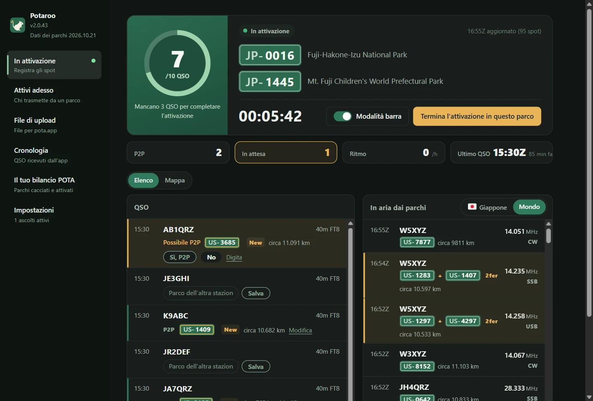
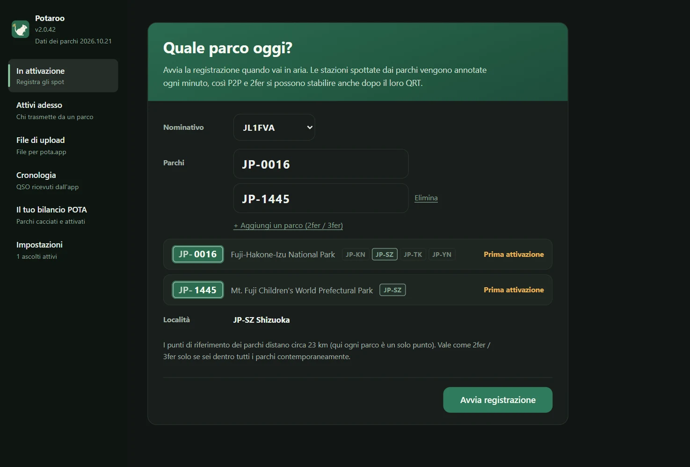
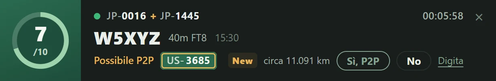
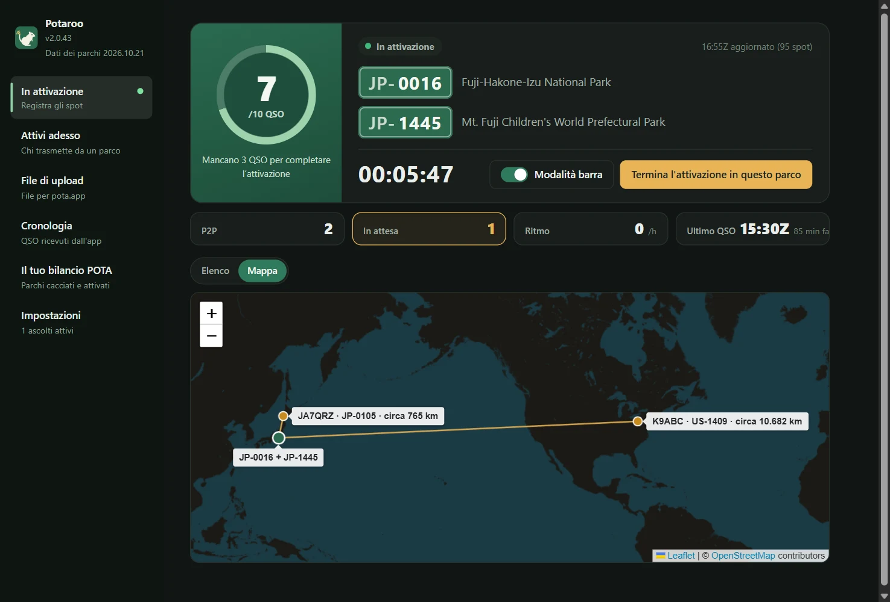
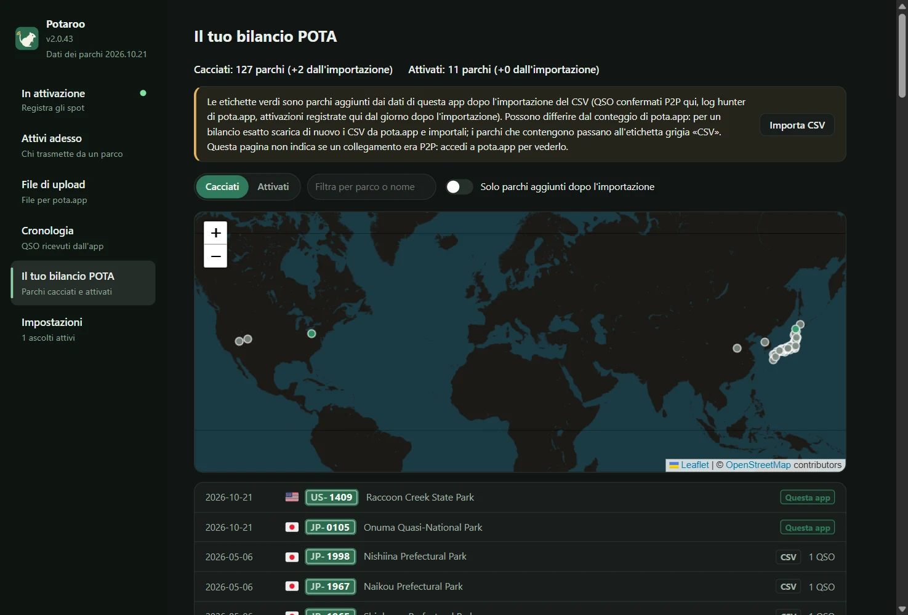
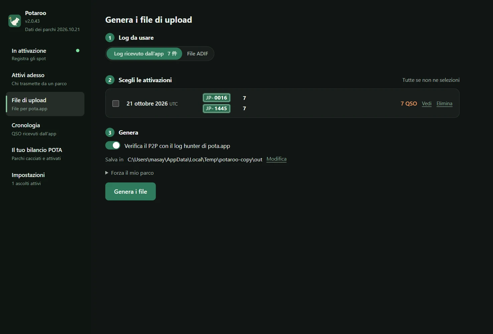
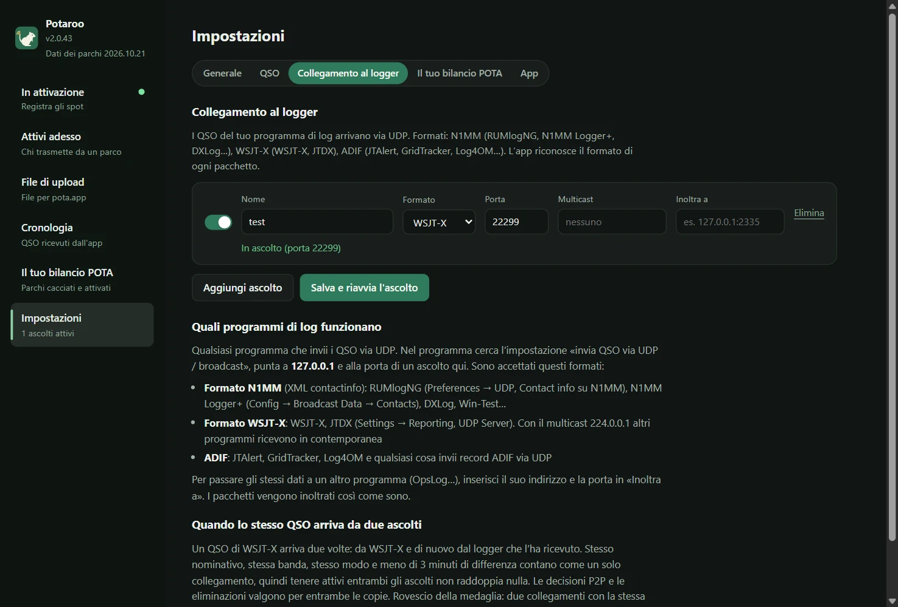

# Potaroo

*In precedenza POTA Upload Helper*

[日本語](README.md) · [English](README.en.md) · [简体中文](README.zh-CN.md) · [繁體中文](README.zh-TW.md) · [Français](README.fr.md) · [Deutsch](README.de.md) · [Español](README.es.md) · [Italiano](README.it.md) · [Português (Brasil)](README.pt-BR.md) · [한국어](README.ko.md) · [Polski](README.pl.md)

<a href="https://buymeacoffee.com/pudipara"></a>

Un’app desktop che accompagna le attivazioni POTA (Parks on the Air) dal momento in cui vai in aria fino all’upload. Funziona su macOS e Windows.

In FT8 e simili, sul momento non puoi sapere se l’altra stazione trasmette da un parco, né tanto meno se è un 2fer. Durante l’attivazione questa app registra gli spot di pota.app, li confronta subito con i QSO che arrivano dal logger e **propone i possibili P2P (Park to Park) e 2fer, che tu confermi e registri**. A fine attivazione scrive, per ogni tuo parco e ogni giorno UTC, file pronti da caricare così come sono su pota.app.



## Cosa fa

### Prima di andare in aria
- **Basta inserire il parco e avviare la registrazione**: inserito il riferimento, l’app mostra nome del parco, località (prefettura / stato) e il numero di questa attivazione. Per 2fer e 3fer aggiungi i parchi con «Aggiungi un parco».
- **Controllo del 2fer**: se i parchi inseriti non hanno nessuna prefettura / stato in comune, o se i dati del parco su pota.app dicono che non si sovrappongono, non si possono registrare come 2fer e il pulsante di avvio resta disattivato. Per un parco che si estende su più prefetture / stati scegli da un menu a tendina, tra le sole zone in comune (se è una sola, viene scelta da sé).



### Durante l’attivazione
- **Schermata dell’attivazione**: un anello fino a 10 QSO (oltre 10 diventa /20, /30…), tempo trascorso, numero di P2P e di QSO «In attesa», ritmo dell’ultima ora e ultimo QSO. I QSO e le stazioni in aria dai parchi si vedono in elenco o sulla mappa.
- **Barra**: un piccolo banner di notifica in una finestra separata, sempre in primo piano, da tenere sopra il logger. Qui vedi l’ultimo QSO e sbrighi la conferma dei P2P (sì / no / «Salta»), mentre la finestra principale resta libera per guardare altre pagine. La larghezza della barra si adatta da sola al contenuto.
- **QSO dal logger**: ricevuti via UDP, come fanno OpsLog o JTAlert. Formato N1MM (RUMlogNG, N1MM Logger+, DXLog…), WSJT-X / JTDX (anche multicast), ADIF (JTAlert, GridTracker, Log4OM…) e le notifiche di modifica QSO di QLog. Su Windows legge anche da Turbo HAMLOG in esecuzione. Correzioni e cancellazioni fatte nel logger vengono riportate.
- **P2P confermato sul momento**: se la stazione collegata è in aria da un parco, la riga mostra «Possibile P2P» con il riferimento, e decidi con «Sì, P2P» o «No». Per una stazione che non è negli spot (in fonia o CW, quando ti dice il parco) digita il riferimento direttamente nella riga. Nulla diventa P2P da solo.
- **Distanza e mappa**: mostra la distanza in linea d’aria dal parco dell’altra stazione, ad esempio «circa 820 km» (per un 2fer, dal punto medio tra i parchi). La scheda «Mappa» traccia le linee dalla tua posizione ai parchi collegati in P2P. L’unità di distanza può essere km o miglia.
- **Festa ogni 10 QSO**: coriandoli nel momento in cui l’attivazione è valida, e poi ogni 10 QSO.
- **Il termine scrive i file**: «Termina l'attivazione in questo parco» scrive nella cartella scelta il file di upload del giorno (`JL1FVA@JP-1266-20261020.adi`) e torna alla prima schermata. Se l’altra stazione è un 2fer, il QSO viene ripetuto per ogni suo parco; se il 2fer sei tu, viene scritto un file per parco. Chiudere l’app durante un’attivazione non la termina: al prossimo avvio la registrazione riprende da dove era rimasta (prima di chiudere viene chiesta conferma).
- **Carica fuori dalle 03:00–11:00 UTC**: in queste ore la manutenzione del database di pota.app fa spesso finire i caricamenti in «Unknown Failure», e POTA ha chiesto via e-mail e social di evitarle (non è su docs.pota.app). Il riquadro dei risultati mostra queste ore nell'ora locale e le evidenzia quando ci sei dentro.
- **Meteo e allerte**: avviata la registrazione, il meteo del parco viene controllato ogni 15 minuti; barra e finestra principale avvisano quando arrivano temporali, vento forte o pioggia intensa. Per i parchi in Giappone compaiono avvisi e allerte della JMA per comune (temporali e allerte in una fascia ben visibile) e la scheda Meteo mostra le prossime ore. Gli ordini di evacuazione li emettono i comuni e non sono mostrati.
- **Shift ed eventi**: quando l'Early Shift / Late Shift inizia o finisce, la barra mostra un'alba o il sorgere della luna. Durante gli eventi POTA come Support Your Parks lo segnala un'etichetta.
- **Diplomi a portata**: un QSO che raggiunge Rover, Unique Parks, Repeat Offender o Kilo porta medaglia e coriandoli (pota.app lo conferma dopo il caricamento del log). Se una stazione richiama da un altro parco, la sua riga dice «l'ultima volta da …».
- **Stazioni di club e orologio**: una stazione di club può registrare gli operatori e cambiarli in aria. Compare un avviso se l'orologio del computer si discosta di un minuto o più da pota.app (il P2P richiede meno di 15 minuti tra i due log).

| Barra | Mappa |
|---|---|
|  |  |

### Altro
- **Attivi adesso**: anche quando non registri, elenca dagli spot di pota.app le stazioni in aria in questo momento dai parchi (aggiornato ogni minuto). Filtri: paese e regione, banda, modo, «Solo 2fer o più», «Solo non cacciati», «Nascondi QRT».
- **Cronologia**: i QSO ricevuti dall’app, raggruppati per giorno; si possono eliminare uno alla volta.
- **Il tuo bilancio POTA**: importando `hunter_parks.csv` / `activator_parks.csv` scaricati da pota.app, vedi in elenco e sulla mappa i parchi che hai cacciato e attivato. I parchi aggiunti da questa app dopo l’importazione sono segnati in verde.
- **File di upload**: genera in blocco i file di giorni passati dal log dell’app o dall’ADIF del logger.
- **Visualizzazione**: puoi cambiare la dimensione del testo (Normale / Grande / Molto grande) e i colori (Come il sistema / Chiaro / Scuro). Le scelte valgono anche per la barra.
- **Inoltro**: i dati ricevuti possono essere passati così come sono a un’altra app (RUMlog → questa app → OpsLog).
- **Dati dei parchi aggiornati ogni mese**: l’elenco dei parchi e le loro posizioni sono inclusi nell’app e vengono aggiornati ogni mese all’ultima versione di pota.app (arrivano come un piccolo aggiornamento a sé, separato da quello dell’app).
- **Guida introduttiva**: al primo avvio, sette passi portano dal nominativo ai file. Riaprila quando vuoi da «Guida introduttiva» in basso a sinistra.
- **Progressi 6 Pack**: il tuo bilancio POTA conta i parchi attivati e collegati in P2P sui 6 m (dal log dell'app).

| Il tuo bilancio POTA | File di upload |
|---|---|
|  |  |

Il parco dell’altra stazione è deciso in quest’ordine:

1. **Log hunter di pota.app** (ciò che l’altra stazione ha caricato = confermato), confrontato a ±15 minuti sulla stessa banda
2. **I parchi confermati o digitati durante l’attivazione** (generando dal log dell’app). I QSO non confermati non diventano P2P
3. **Spot registrati durante l’attivazione** (solo generando da un file ADIF; spot da 30 minuti prima a 10 minuti dopo il QSO)
4. SIG_INFO / POTA_REF dal logger

Legge solo dati che pota.app rende pubblici (api.pota.app), senza login (e senza supporto ufficiale di POTA). Conservare il log è compito del logger: questa app si limita a giudicare e a scrivere i file di upload, e non modifica mai il log del logger.

## Download

Scarica l’ultima versione da [Releases](../../releases).

| SO | File | Come |
|---|---|---|
| macOS (Apple Silicon) | `Potaroo-macOS.dmg` | Aprilo e trascina `Potaroo` in `Applications` |
| Windows 10 / 11 | `Potaroo-Setup.exe` | Eseguilo: si installa nella cartella dell’utente (senza diritti di amministratore) e compare nel menu Start |

Sono allegati anche gli zip (`Potaroo-macOS.zip` / `Potaroo-Windows.zip`). L’aggiornamento interno all’app usa questi zip: non cancellarli dalla Release.

L’app non è firmata, quindi al primo avvio compare un avviso.

- **macOS**: clic destro sull’app → «Apri» → «Apri». Se non si apre, in «Impostazioni di Sistema → Privacy e sicurezza», verso il fondo, premi «Apri comunque»
- **Windows**: «PC protetto da Windows» → «Ulteriori informazioni» → «Esegui comunque»

**Dalla seconda volta l’app si aggiorna da sé.** All’avvio controlla se c’è una versione nuova; quando compare l’avviso, premi «Aggiorna ora»: scarica, sostituisce e riavvia. Puoi controllare in qualsiasi momento da «Impostazioni → App». Se apri l’app direttamente dal DMG (senza spostarla in `Applications`), macOS non permette la sostituzione: la nuova app viene messa nella cartella Download e te lo segnala. Un’app installata con il vecchio nome (POTA Upload Helper) viene rinominata in Potaroo al primo avvio dopo l’aggiornamento (su Windows vengono aggiornati anche i collegamenti).

## Collegamento al logger

Crea gli ascolti in «Impostazioni → Collegamento al logger» (quanti ne vuoi). **Va bene qualsiasi logger che sappia inviare i QSO via UDP.** Nel logger apri l’impostazione «invia QSO via UDP» e indica come destinazione `127.0.0.1` e la stessa porta dell’ascolto. L’app riconosce da sola il formato dei pacchetti ricevuti.



| Formato | Logger di esempio | Dove si imposta |
|---|---|---|
| N1MM (XML contactinfo) | RUMlogNG, N1MM Logger+, DXLog, Win-Test | RUMlogNG: Preferences → UDP, Contact info su N1MM. N1MM Logger+: Config → Broadcast Data → Contacts |
| WSJT-X | WSJT-X, JTDX | Settings → Reporting, UDP Server. Con `224.0.0.1` (multicast) anche altre app ricevono contemporaneamente |
| ADIF | JTAlert, GridTracker, Log4OM… | l’impostazione «invia ADIF via UDP» di ciascun programma |
| QLog (JSON) | QLog | Settings → Network → Notifications, in **QSO Changes** metti `127.0.0.1:porta` |
| Turbo HAMLOG (Windows) | Turbo HAMLOG/Win | Imposta il formato dell’ascolto su «Turbo HAMLOG». Nessuna porta: legge da HAMLOG in esecuzione (compresi i QSO arrivati tramite JT_Linker o JT-Get's) |

Anche i QSO corretti o cancellati nel logger vengono riportati nell’app. Verificati su Windows 11: WSJT-X, Log4OM 2, Turbo HAMLOG, QLog, N1MM Logger+ (ricezione di CW, SSB e FT8, più correzioni e cancellazioni).

**Si ricevono solo i logger dello stesso computer.** Gli ascolti stanno su `127.0.0.1`, quindi un logger su un altro PC non li raggiunge.

**Multicast di WSJT-X / JTDX su Windows**: su Windows anche l’ascolto multicast sta su loopback (`127.0.0.1`). In WSJT-X, in Settings → Reporting → **Outgoing interfaces**, includi **loopback**. Questa combinazione è verificata su Windows 11. Se non arriva nulla, segnalalo con una [issue](../../issues): ci aiuta molto. Senza multicast, impostando l’UDP Server di WSJT-X su `127.0.0.1`, la ricezione è sicura (ma allora le altre app non possono ricevere contemporaneamente).

**Impostazioni dei logger da usare insieme a WSJT-X** (verificate su Windows 11; anche alternando CW, SSB e FM in mezzo all’FT8, ogni QSO entra correttamente uno per uno):

| Logger | Ricezione da WSJT-X | Passaggio all’app |
|---|---|---|
| JT_Linker + Turbo HAMLOG | JT_Linker legge il file di log di WSJT-X e registra in HAMLOG | ascolto «Turbo HAMLOG» |
| N1MM Logger+ | Config → Configure Ports → WSJT/JTDX Setup, abilita Radio #1 (in unicast `127.0.0.1`, in multicast `224.0.0.1`, porta 2237) | Broadcast Data → Contacts su `127.0.0.1:porta dell’ascolto` |
| QLog | Settings → Network, Wsjtx Port 2237 (in multicast attiva Join Multicast e metti `224.0.0.1` in Multicast Address) | Notifications → QSO Changes su `127.0.0.1:porta dell’ascolto` |

I QSO di WSJT-X arrivano anche direttamente all’app (con un ascolto WSJT-X) e vengono uniti in uno solo con quelli passati dal logger. Quando distribuisci in multicast a più programmi contemporaneamente, tieni presente quanto segue.

- **Avvia QLog e N1MM prima degli altri programmi.** Non aprono la 2237 in modo condiviso con altri programmi: se li avvii dopo, la porta risulta «in uso» e non ricevono.
- **Anche Turbo HAMLOG apre la 2237.** Usato insieme a JT_Linker, HAMLOG può chiedere se registrare un «secondo QSO»: in quel caso rispondi «No». Non si può usare insieme a QLog o N1MM (HAMLOG, se avviato dopo, va in errore).

Per passare gli stessi dati anche a un’altra app (OpsLog…), inserisci il suo indirizzo e la sua porta in «Inoltra a» dell’ascolto.

**Con entrambi attivi, nulla viene contato due volte**: un QSO di WSJT-X arriva due volte, direttamente da WSJT-X e dal logger che l’ha ricevuto e lo rimanda (con circa un minuto di differenza tra ora di inizio e ora di fine). Stesso nominativo, stessa banda, stesso modo e meno di 3 minuti di distanza = un solo QSO; decisioni P2P e cancellazioni valgono per entrambi. Al contrario, due QSO con la stessa stazione, sulla stessa banda e nello stesso modo entro 3 minuti diventano uno solo.

## Dove sono i dati

| SO | Posizione |
|---|---|
| macOS | `~/Library/Application Support/Potaroo/` |
| Windows | `%APPDATA%\Potaroo\` |

`qsolog.db` (QSO ricevuti), `spots-YYYYMMDD.jsonl` (spot registrati), `sessions.json` (orari delle tue attivazioni e parchi), `hunter.json` (copia del log hunter), `mypota.json` (CSV del bilancio importati), `settings.json`, `potaroo.log` (registro degli errori).
Il profilo pubblico di pota.app mostra solo gli ultimi 25 QSO del log hunter, quindi l’app li aggiunge a `hunter.json` durante la registrazione e a ogni generazione dei file, per accumulare lo storico. I dati interni, come i QSO ricevuti, restano finché non li elimini (uno alla volta in «Cronologia», tutti insieme in «Impostazioni → App → Dati dell'app»).

## Segnalare un problema

Premendo «Impostazioni → App → Segnala un problema» si apre un testo di segnalazione con versione, sistema operativo e l’ultima parte del registro. Controllalo e modificalo, poi premi «Copia» per inviarlo via e-mail o altro, oppure «Segnala su GitHub» per aprire la pagina di creazione di una [issue](../../issues) (le segnalazioni su GitHub sono pubbliche). L’app non invia nulla da sola. Il registro contiene nominativi e riferimenti dei parchi.

## Lingue

日本語, English, 简体中文, 繁體中文, Français, Deutsch, Español, Italiano, Português (Brasil), 한국어, Polski. La lingua viene scelta in base a quella del sistema e si cambia in «Lingua» nelle «Impostazioni».

## Condizioni d’uso ed esclusione di responsabilità

Questa app è un software amatoriale scritto da un privato e fornito senza alcuna garanzia. **L’autore non risponde di alcun danno derivante dal suo uso (upload di contenuti errati su pota.app, QSO duplicati o mancanti, perdita di log o file, effetti sul logger o sulle impostazioni di rete, ecc.).** Controlla sempre di persona il contenuto dei file prima di caricarli. Il riconoscimento di P2P e 2fer è una stima e la sua correttezza non è garantita. Questa app non ha alcun legame con Parks on the Air® né con pota.app. Il testo completo è in [TERMS.md](TERMS.md) e viene mostrato anche al primo avvio dell’app.

Per segnalare vulnerabilità vedi [SECURITY.md](SECURITY.md).

## Avvio dai sorgenti

```sh
pip install -r requirements.txt
python3 app.py
```

Funziona anche solo da riga di comando (solo libreria standard).

```sh
python3 pota_spotlog.py --parks JP-1266,JP-1206
python3 pota_build.py export.adif --date 20261020
```

## Sviluppo

```sh
scripts/dev.sh                                  # crea un venv e avvia (dati in ./data, il log vero non viene toccato)
scripts/dev.sh --debug                          # con gli strumenti per sviluppatori
scripts/send_test_qso.py 22237 JA1XYZ           # invia un QSO di prova all'ascolto di sviluppo (mai alla 2237)
python3 -m unittest discover -s tests
```

Per le modifiche crea un branch e apri una Pull Request. A ogni PR i test girano su macOS e Windows; al merge su `main`, GitHub Actions compila le versioni per entrambi i sistemi e le allega alla Release `v<VERSION>` (`VERSION` in `potacommon.py`). In `scripts/` ci sono, tra gli altri, `copy_instance.py`, che avvia una seconda app su una copia dei dati, `check_align.mjs`, che controlla la posizione dei testi sullo schermo, e `readme_shots.mjs`, che cattura le immagini di questo README.

## License

MIT

Per le bandiere è incluso il font di [country-flag-emoji-polyfill](https://github.com/talkjs/country-flag-emoji-polyfill) (MIT), che contiene solo le bandiere di Twemoji (CC-BY 4.0). La mappa usa [Leaflet](https://leafletjs.com/) (BSD-2-Clause) e i tile di © [OpenStreetMap](https://www.openstreetmap.org/copyright) contributors. Dati meteo di [Open-Meteo](https://open-meteo.com/) (CC BY 4.0). Avvisi per i parchi in Giappone: agenzia meteorologica giapponese (fonte: sito della JMA); il comune del parco: geocodificatore inverso del GSI.
