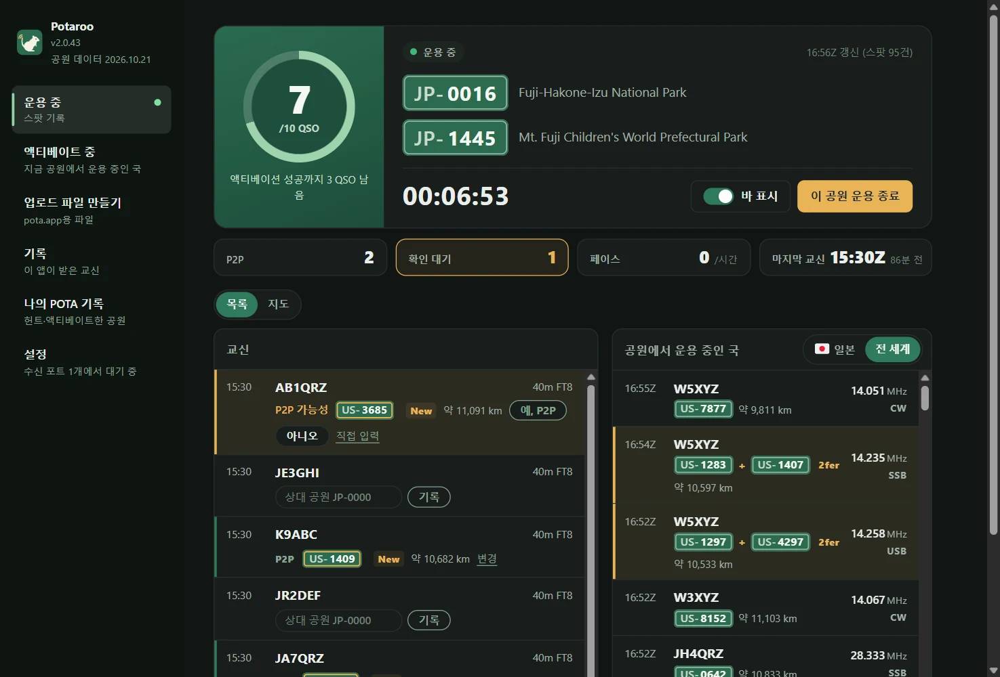
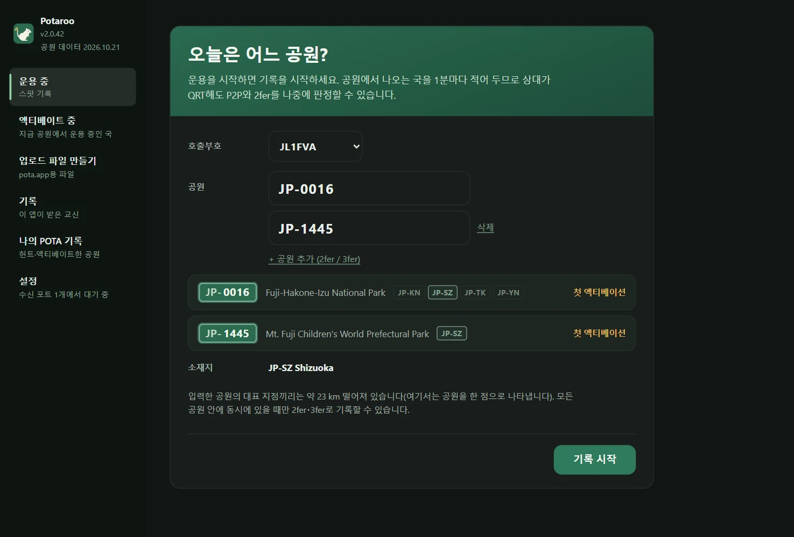
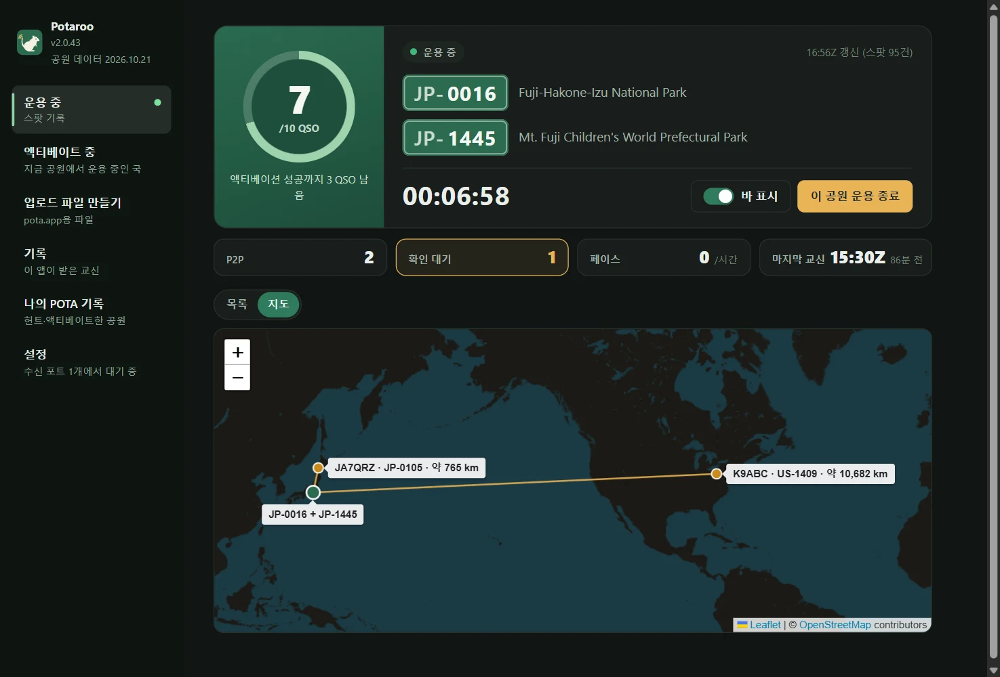
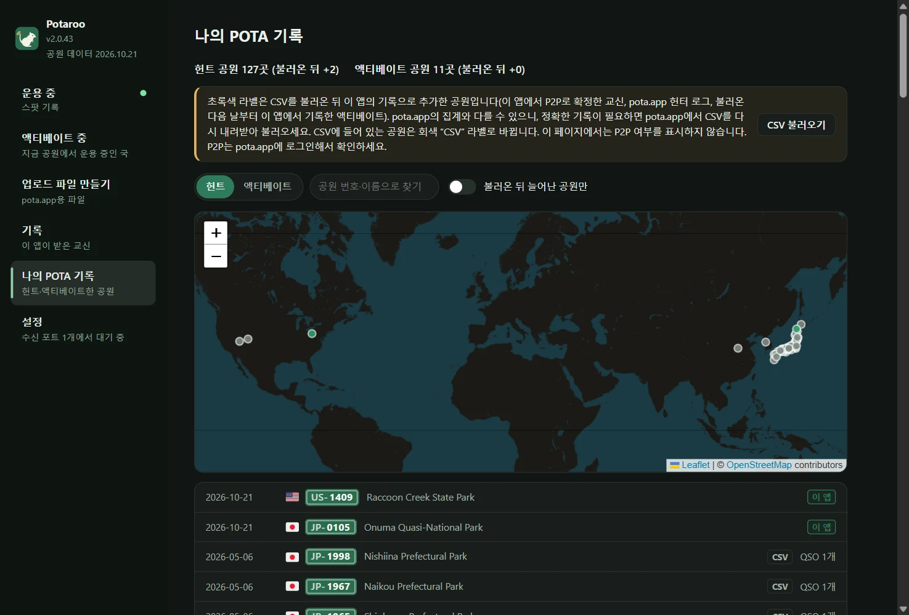
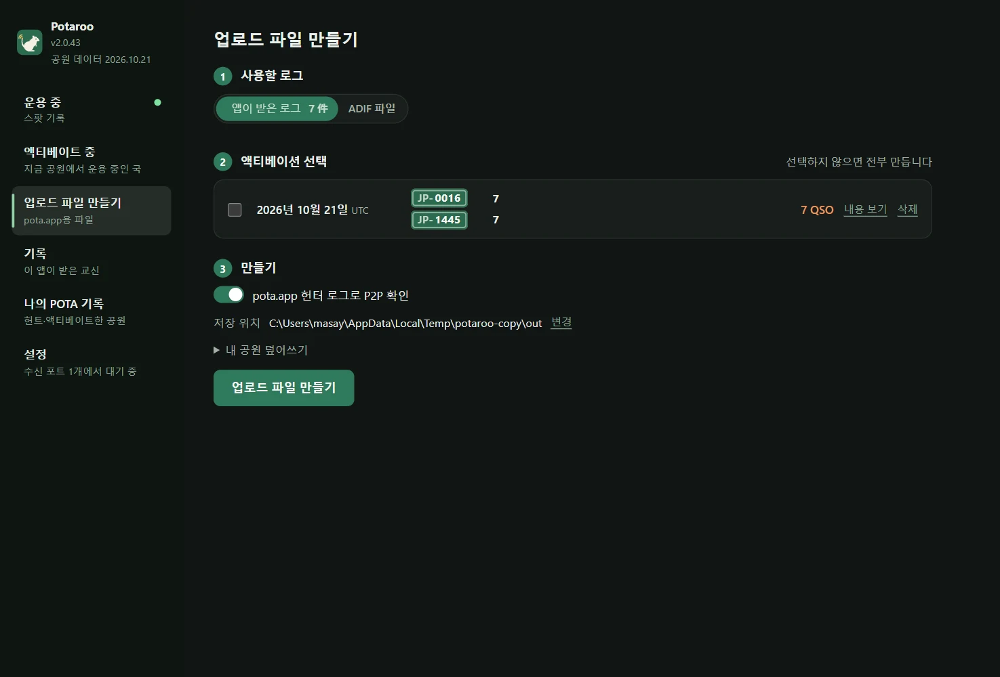
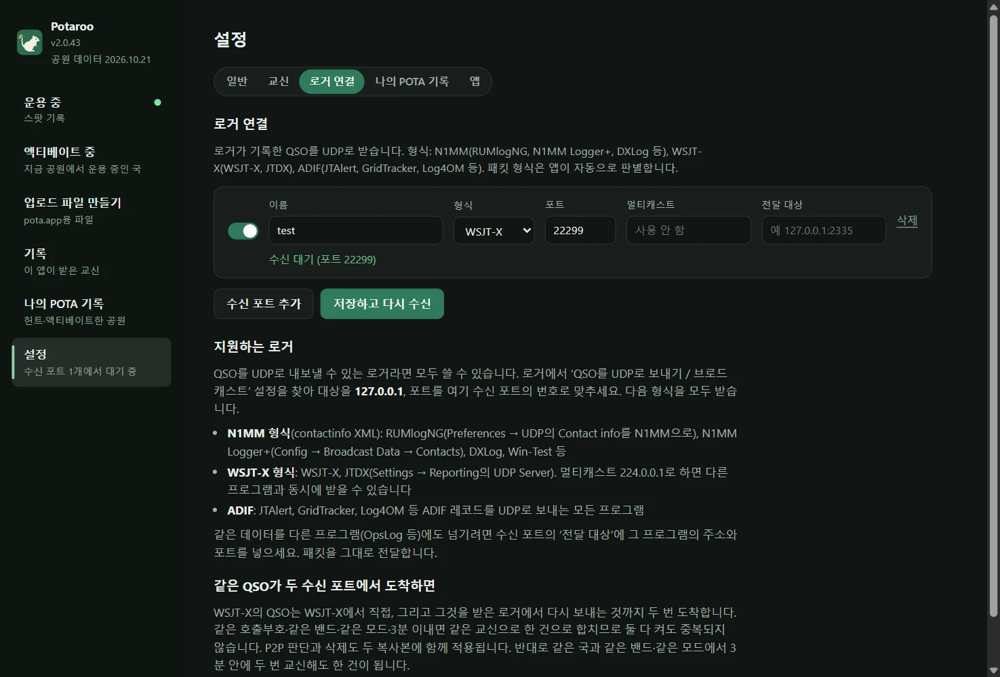

# Potaroo

*이전 이름: POTA Upload Helper*

[日本語](README.md) · [English](README.en.md) · [简体中文](README.zh-CN.md) · [繁體中文](README.zh-TW.md) · [Français](README.fr.md) · [Deutsch](README.de.md) · [Español](README.es.md) · [Italiano](README.it.md) · [Português (Brasil)](README.pt-BR.md) · [한국어](README.ko.md) · [Polski](README.pl.md)

<a href="https://buymeacoffee.com/pudipara"></a>

POTA(Parks on the Air) 액티베이션을 운용 중부터 업로드까지 도와주는 데스크톱 앱입니다. macOS와 Windows에서 동작합니다.

FT8 등에서는 상대가 공원에서 운용하고 있는지, 더 나아가 2fer인지 그 자리에서는 알 수 없습니다. 이 앱은 운용 중에 pota.app 스팟을 기록하고, 로거에서 온 QSO와 그 자리에서 대조하여 **P2P(Park to Park)와 2fer 후보를 보여 주고, 사용자가 확인해서 기록합니다**. 운용을 마치면 내 공원별·UTC 날짜별로 pota.app에 그대로 올릴 수 있는 파일을 만듭니다.



## 할 수 있는 일

### 운용 전
- **공원을 입력하고 기록을 시작하기만 하면 됩니다**: 공원 번호를 넣으면 공원 이름, 소재지(도·주), 몇 번째 액티베이션인지를 표시합니다. 2fer·3fer는 ‘+ 공원 추가 (2fer / 3fer)’로 나란히 입력합니다.
- **2fer 확인**: 입력한 공원들에 공통되는 도·주가 없거나 pota.app의 공원 정보에 ‘겹치지 않는다’고 적혀 있으면 2fer로 기록할 수 없으므로 시작 버튼을 누를 수 없게 됩니다. 여러 도에 걸친 공원은 공통되는 지역 중에서만 드롭다운으로 고릅니다(하나뿐이면 자동으로 정해집니다).



### 운용 중
- **운용 중 화면**: 10 QSO까지의 링(10을 넘으면 /20, /30…), 경과 시간, P2P와 확인 대기 수, 최근 1시간의 페이스, 마지막 교신. 교신과 공원에서 운용 중인 국을 목록 또는 지도로 볼 수 있습니다.
- **바**: 작은 알림 배너를 별도 창으로 맨 앞에 띄워 로거 위에 둘 수 있습니다. 최신 교신과 P2P 확인(예·아니오·건너뛰기)을 여기서 끝낼 수 있고, 본체 화면은 다른 페이지를 보는 데 쓸 수 있습니다. 바의 폭은 내용에 맞춰 자동으로 바뀝니다.
- **로거에서 QSO 수신**: OpsLog나 JTAlert처럼 UDP로 받습니다. N1MM 형식(RUMlogNG, N1MM Logger+, DXLog 등), WSJT-X / JTDX(멀티캐스트 지원), ADIF(JTAlert, GridTracker, Log4OM 등), QLog의 QSO 변경 알림. Windows에서는 실행 중인 Turbo HAMLOG에서도 읽어 옵니다. 로거에서의 수정·삭제도 반영합니다.
- **P2P는 그 자리에서 확인**: 도착한 QSO의 상대가 공원에서 운용 중이면 ‘P2P 가능성’과 공원 번호를 보여 주고, ‘예’ ‘아니오’로 정합니다. 스팟에 나오지 않은 상대(Phone이나 CW로 공원 번호를 들은 경우)는 그 행에 공원 번호를 직접 입력합니다. 마음대로 P2P로 처리하지 않습니다.
- **거리와 지도**: 상대 공원까지의 직선거리를 ‘약 820 km’처럼 표시합니다(2fer는 공원들의 중간 지점에서 계산). 지도 탭에서는 내 위치를 중심으로 P2P한 공원까지 선을 긋습니다. 거리 단위는 km와 마일 중에서 고를 수 있습니다.
- **10 QSO마다 축하**: 액티베이션이 성립하는 순간과 그 뒤 10 QSO마다 꽃가루로 알려 줍니다.
- **종료하면 파일 생성**: ‘이 공원 운용 종료’를 누르면 그날의 업로드용 파일(`JL1FVA@JP-1266-20261020.adi`)을 저장 위치에 쓰고 처음 화면으로 돌아갑니다. 상대가 2fer면 QSO를 공원 수만큼 복제하고, 내가 2fer면 공원별로 파일을 나눕니다. 운용 중에 앱을 닫아도 운용은 끝나지 않으며, 다음에 실행하면 이어서 기록합니다(닫기 전에 확인 창이 나옵니다).

| 바 | 지도 |
|---|---|
|  |  |

### 그 밖에
- **액티베이트 중**: 기록하지 않을 때도 지금 공원에서 운용 중인 국을 pota.app 스팟으로 목록화합니다(1분마다 갱신). 국가와 지역, 밴드, 모드, 2fer 이상, 헌트 안 한 곳, QRT 숨기기로 걸러 볼 수 있습니다.
- **기록**: 이 앱이 받은 교신을 날짜별로 목록화하고, 한 건씩 삭제할 수 있습니다.
- **나의 POTA 기록**: pota.app에서 내려받은 `hunter_parks.csv` / `activator_parks.csv`를 불러오면 헌트·액티베이트한 공원을 목록과 지도로 볼 수 있습니다. 불러온 뒤에 이 앱에서 늘어난 공원은 녹색으로 표시합니다.
- **업로드 파일 만들기**: 앱의 로그나 로거의 ADIF로 지난 날짜의 파일을 한꺼번에 만들 수 있습니다.
- **표시**: 글자 크기(표준·크게·아주 크게)와 배색(OS 설정 따르기·라이트·다크)을 바꿀 수 있습니다. 바에도 반영됩니다.
- **전달**: 받은 데이터를 그대로 다른 앱으로 흘려보낼 수 있습니다(RUMlog → 이 앱 → OpsLog).
- **공원 데이터는 매달 갱신**: 공원 목록과 위치는 앱에 들어 있으며, 매달 pota.app의 최신판으로 갱신합니다(앱 업데이트와는 별개의 작은 업데이트로 전달됩니다).

| 나의 POTA 기록 | 업로드 파일 만들기 |
|---|---|
|  |  |

상대 공원은 다음 우선순위로 정합니다.

1. **pota.app 헌터 로그**(상대가 업로드한 기록 = 확정). 시각 ±5분·같은 밴드로 대조
2. **운용 중에 확인·입력한 공원**(앱의 로그로 만들 때). 확인하지 않은 QSO는 P2P로 처리하지 않습니다
3. **운용 중의 스팟 기록**(ADIF 파일로 만들 때만. QSO 30분 전~10분 후의 스팟)
4. 로거의 SIG_INFO / POTA_REF

pota.app이 공개한 데이터(api.pota.app)만 읽으며 로그인은 필요 없습니다(POTA의 공식 지원을 받은 것은 아닙니다). 로그 보관은 로거의 몫입니다. 이 앱은 판정과 업로드용 파일 생성만 맡으며, 로거의 로그는 고치지 않습니다.

## 다운로드

[Releases](../../releases)에서 최신 버전을 받으세요.

| OS | 파일 | 사용법 |
|---|---|---|
| macOS(Apple Silicon) | `Potaroo-macOS.dmg` | 열어서 `Potaroo`를 `Applications`로 드래그 |
| Windows 10 / 11 | `Potaroo-Setup.exe` | 실행하면 사용자별 위치(관리자 권한 불필요)에 설치되고 시작 메뉴에 등록됩니다 |

zip 버전(`Potaroo-macOS.zip` / `Potaroo-Windows.zip`)도 첨부되어 있습니다. 앱 내 업데이트가 이 zip을 사용하므로 Release에서 지우지 마세요.

서명하지 않은 앱이라 처음에는 경고가 나옵니다.

- **macOS**: 앱을 우클릭 → ‘열기’ → ‘열기’. 열리지 않으면 ‘시스템 설정 → 개인정보 보호 및 보안’ 아래쪽에 있는 ‘그래도 열기’
- **Windows**: ‘Windows의 PC 보호’ → ‘추가 정보’ → ‘실행’

**두 번째부터는 앱 안에서 업데이트할 수 있습니다.** 실행할 때 새 버전이 있는지 확인하고, 알림이 나오면 ‘지금 업데이트’를 누르세요. 내려받아 교체하고 다시 시작합니다. 확인은 언제든 ‘설정 → 앱’에서 할 수 있습니다. DMG 안의 앱을 그대로(`Applications`에 넣지 않고) 열고 있으면 macOS 구조상 교체할 수 없으므로, 새 앱을 ‘다운로드’ 폴더에 두고 알려 줍니다. 이전 이름(POTA Upload Helper)으로 설치된 앱은 업데이트 후 처음 실행할 때 Potaroo로 이름을 바꿉니다(Windows는 바로 가기도 다시 연결합니다).

## 로거 연결

‘설정 → 로거 연결’에서 수신 포트를 만듭니다(몇 개든 추가할 수 있습니다). **QSO를 UDP로 내보낼 수 있는 로거라면 사용할 수 있습니다.** 로거에서 ‘QSO를 UDP로 보내기’ 설정을 열고, 대상을 `127.0.0.1`, 포트를 수신 포트와 같은 번호로 맞추세요. 도착한 패킷의 형식은 앱이 자동으로 판별합니다.



| 형식 | 로거 예 | 설정 위치 |
|---|---|---|
| N1MM(contactinfo XML) | RUMlogNG, N1MM Logger+, DXLog, Win-Test | RUMlogNG: Preferences → UDP의 Contact info를 N1MM으로. N1MM Logger+: Config → Broadcast Data → Contacts |
| WSJT-X | WSJT-X, JTDX | Settings → Reporting의 UDP Server. `224.0.0.1`(멀티캐스트)로 하면 다른 앱과 동시에 받을 수 있습니다 |
| ADIF | JTAlert, GridTracker, Log4OM 등 | 각 소프트웨어의 ‘ADIF를 UDP로 보내기’ 설정 |
| QLog(JSON) | QLog | Settings → Network → Notifications의 **QSO Changes**에 `127.0.0.1:포트` |
| Turbo HAMLOG(Windows) | Turbo HAMLOG/Win | 수신 포트 종류를 ‘Turbo HAMLOG’로. 포트는 필요 없으며, 실행 중인 HAMLOG에서 읽어 옵니다(JT_Linker·JT-Get's를 거친 QSO 포함) |

로거에서 수정·삭제한 QSO도 앱에 반영됩니다. Windows 11에서 확인된 것은 WSJT-X, Log4OM 2, Turbo HAMLOG, QLog, N1MM Logger+입니다(CW·SSB·FT8 수신과 수정·삭제).

**같은 컴퓨터의 로거에서만 받을 수 있습니다.** 수신 포트는 `127.0.0.1`에서 대기하므로 다른 컴퓨터의 로거에서는 도착하지 않습니다.

**Windows에서 WSJT-X / JTDX 멀티캐스트를 쓰는 경우**: Windows에서는 멀티캐스트 수신 포트도 루프백(`127.0.0.1`)에서 대기합니다. WSJT-X의 Settings → Reporting → **Outgoing interfaces**에 **loopback**을 포함하세요. 이 조합은 Windows 11에서 동작을 확인했습니다. 도착하지 않으면 [Issue](../../issues)로 알려 주시면 감사하겠습니다. 멀티캐스트를 쓰지 않고 WSJT-X의 UDP Server를 `127.0.0.1`로 하는 방법이라면 확실히 받을 수 있습니다(다만 그 경우 다른 앱과 동시에는 받을 수 없습니다).

**WSJT-X와 함께 쓰는 로거 설정**(Windows 11에서 확인. FT8 도중에 CW·SSB·FM을 섞어도 한 건씩 올바르게 들어갑니다):

| 로거 | WSJT-X에서 받는 방법 | 앱으로 넘기는 방법 |
|---|---|---|
| JT_Linker + Turbo HAMLOG | JT_Linker가 WSJT-X의 로그 파일을 보고 HAMLOG에 등록 | 수신 포트 ‘Turbo HAMLOG’ |
| N1MM Logger+ | Config → Configure Ports → WSJT/JTDX Setup의 Radio #1을 Enable(유니캐스트면 `127.0.0.1`, 멀티캐스트면 `224.0.0.1`, 포트 2237) | Broadcast Data → Contacts를 `127.0.0.1:수신 포트 번호` |
| QLog | Settings → Network의 Wsjtx Port 2237(멀티캐스트면 Join Multicast를 켜고 Multicast Address에 `224.0.0.1`) | Notifications → QSO Changes를 `127.0.0.1:수신 포트 번호` |

WSJT-X의 QSO는 앱에도 직접 도착하며(WSJT-X 수신 포트), 로거를 거친 것과 합쳐 한 건으로 정리됩니다. 멀티캐스트로 여러 소프트웨어에 동시에 보낼 때는 다음 사항에 주의하세요.

- **QLog와 N1MM은 다른 소프트웨어보다 먼저 실행하세요.** 2237번 포트를 다른 소프트웨어와 공유하는 설정으로 열지 않기 때문에, 나중에 실행하면 ‘사용 중’이 되어 받을 수 없습니다.
- **Turbo HAMLOG도 2237번 포트를 엽니다.** JT_Linker와 함께 쓰면 HAMLOG가 ‘두 번째 QSO’로 등록할지 물어볼 때가 있습니다. 그때는 ‘아니오’를 선택하세요. QLog·N1MM과는 동시에 쓸 수 없습니다(나중에 실행한 HAMLOG가 오류가 납니다).

다른 앱(OpsLog 등)에도 같은 데이터를 넘기고 싶다면 수신 포트의 ‘전달 대상’에 그 앱의 주소와 포트를 넣습니다.

**둘 다 켜도 중복되지 않습니다**: WSJT-X의 QSO는 WSJT-X에서 직접 오는 것과 로거가 받아서 다시 보내는 것, 이렇게 두 번 도착합니다(시작 시각과 종료 시각 때문에 1분 정도 차이가 납니다). 같은 호출부호·같은 밴드·같은 모드이고 시각 차이가 3분 이내면 같은 교신으로 보고 한 건으로 합치며, P2P 판단과 삭제도 양쪽에 반영합니다. 반대로 같은 국과 같은 밴드·같은 모드로 3분 안에 두 번 교신한 경우에도 한 건이 됩니다.

## 데이터 저장 위치

| OS | 위치 |
|---|---|
| macOS | `~/Library/Application Support/Potaroo/` |
| Windows | `%APPDATA%\Potaroo\` |

`qsolog.db`(받은 QSO), `spots-YYYYMMDD.jsonl`(스팟 기록), `sessions.json`(내 운용 시간과 공원), `hunter.json`(헌터 로그 사본), `mypota.json`(불러온 기록 CSV), `settings.json`, `potaroo.log`(오류 기록).
pota.app 공개 프로필에 나오는 헌터 로그는 최근 25건뿐이므로, 기록 중과 파일을 만들 때마다 `hunter.json`에 추가해 이력을 쌓습니다. 받은 교신 등의 내부 데이터는 삭제하지 않는 한 남아 있습니다(‘기록’에서 한 건씩, ‘설정 → 앱 → 내부 데이터’에서 한꺼번에 삭제할 수 있습니다).

## 문제 보고

‘설정 → 앱 → 문제 보고’를 누르면 버전·OS·로그의 마지막 부분이 들어간 보고문이 열립니다. 내용을 확인·편집한 뒤 ‘복사’해서 이메일 등으로 보내거나, ‘GitHub에 보고’로 [Issue](../../issues) 작성 화면을 여세요(GitHub 보고는 공개됩니다). 앱이 자동으로 보내는 것은 없습니다. 로그에는 호출부호와 공원 번호가 포함됩니다.

## 언어

日本語, English, 简体中文, 繁體中文, Français, Deutsch, Español, Italiano, Português (Brasil), 한국어, Polski. OS 언어에 맞춰 자동으로 선택되며, ‘설정’의 ‘언어’에서 바꿀 수 있습니다.

## 이용 약관 및 면책 사항

이 앱은 개인이 취미로 만든 무보증 소프트웨어입니다. **이 앱의 사용으로 발생한 어떠한 손해(pota.app에 잘못된 내용을 업로드한 것, QSO의 중복이나 누락, 로그나 파일의 손실, 로거나 네트워크 설정에 미치는 영향 등)에 대해서도 제작자는 책임을 지지 않습니다.** 업로드할 파일의 내용은 반드시 직접 확인하세요. P2P와 2fer 판정은 추정이며 정확성을 보증하지 않습니다. 이 앱은 Parks on the Air® 및 pota.app과 관계가 없습니다. 전문은 [TERMS.md](TERMS.md)에 있으며, 앱을 처음 실행할 때도 표시됩니다.

취약점 신고는 [SECURITY.md](SECURITY.md)를 참고하세요.

## 소스에서 실행

```sh
pip install -r requirements.txt
python3 app.py
```

명령줄만으로도 사용할 수 있습니다(표준 라이브러리만 사용).

```sh
python3 pota_spotlog.py --parks JP-1266,JP-1206
python3 pota_build.py export.adif --date 20261020
```

## 개발

```sh
scripts/dev.sh                                  # venv를 만들어 실행(데이터는 ./data에 저장, 실제 로그는 건드리지 않음)
scripts/dev.sh --debug                          # 개발자 도구 포함
scripts/send_test_qso.py 22237 JA1XYZ           # 개발용 수신 포트에 테스트 QSO 보내기(2237로는 보내지 않음)
python3 -m unittest discover -s tests
```

변경은 브랜치를 만들어 Pull Request로 보내 주세요. PR마다 macOS / Windows에서 테스트가 돌고, `main`에 머지하면 GitHub Actions가 두 OS용 빌드를 만들어 Release `v<VERSION>`(`potacommon.py`의 `VERSION`)에 첨부합니다. `scripts/`에는 데이터 사본으로 두 번째 앱을 실행하는 `copy_instance.py`, 화면 글자 위치를 점검하는 `check_align.mjs`, 이 README의 이미지를 찍는 `readme_shots.mjs` 등이 있습니다.

## License

MIT

국기 표시에는 Twemoji(CC-BY 4.0)의 국기만 담은 [country-flag-emoji-polyfill](https://github.com/talkjs/country-flag-emoji-polyfill)(MIT) 글꼴을 함께 넣었습니다. 지도는 [Leaflet](https://leafletjs.com/)(BSD-2-Clause)과 © [OpenStreetMap](https://www.openstreetmap.org/copyright) contributors의 타일을 사용합니다. 날씨는 [Open-Meteo](https://open-meteo.com/)의 데이터(CC BY 4.0)입니다.
