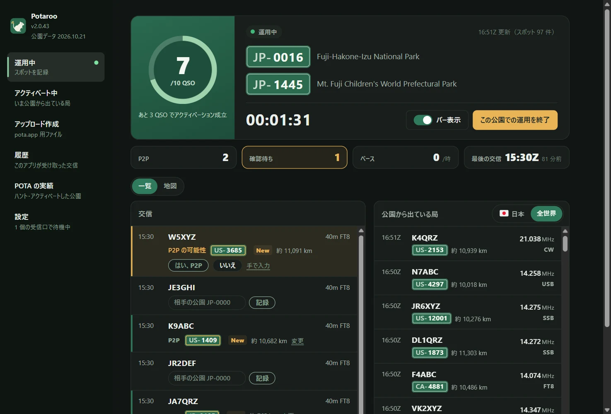
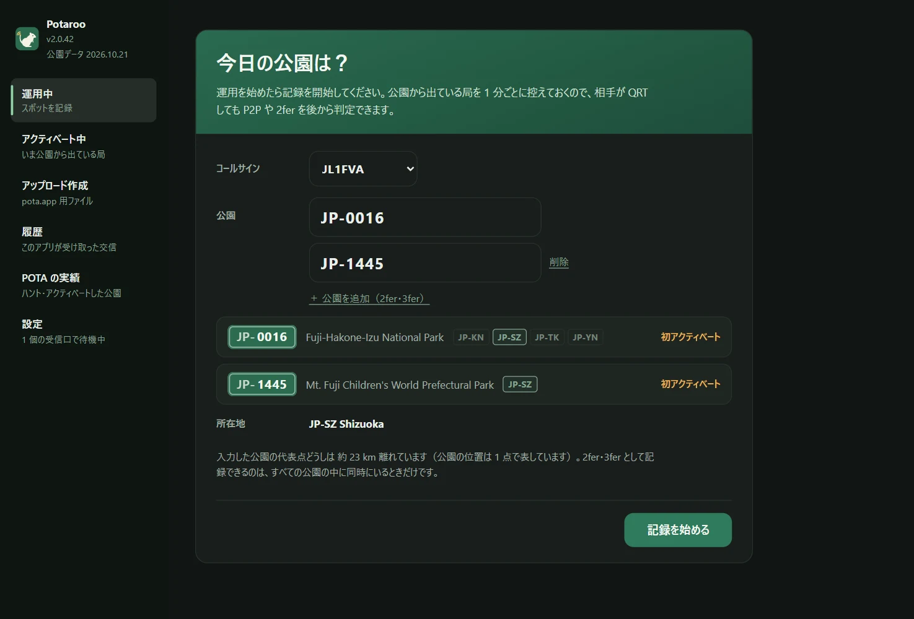
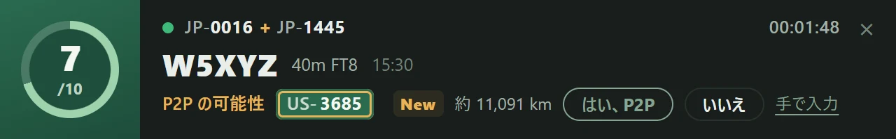
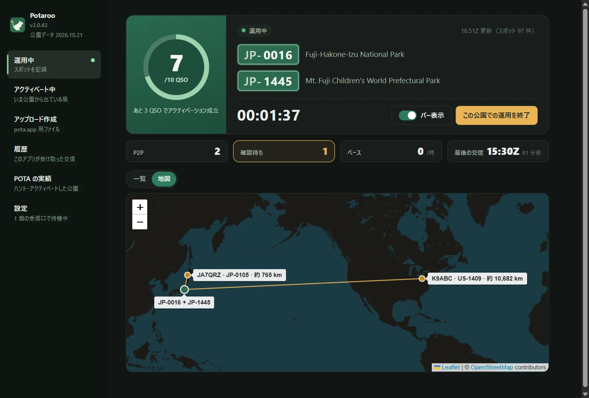
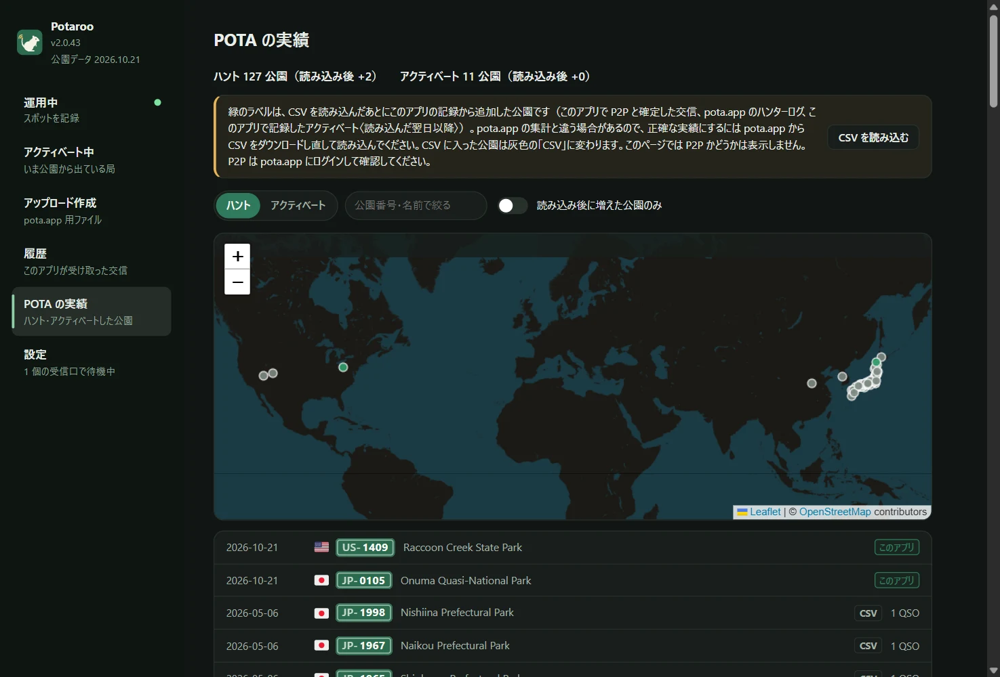
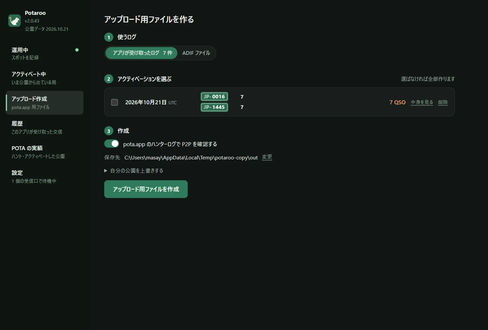
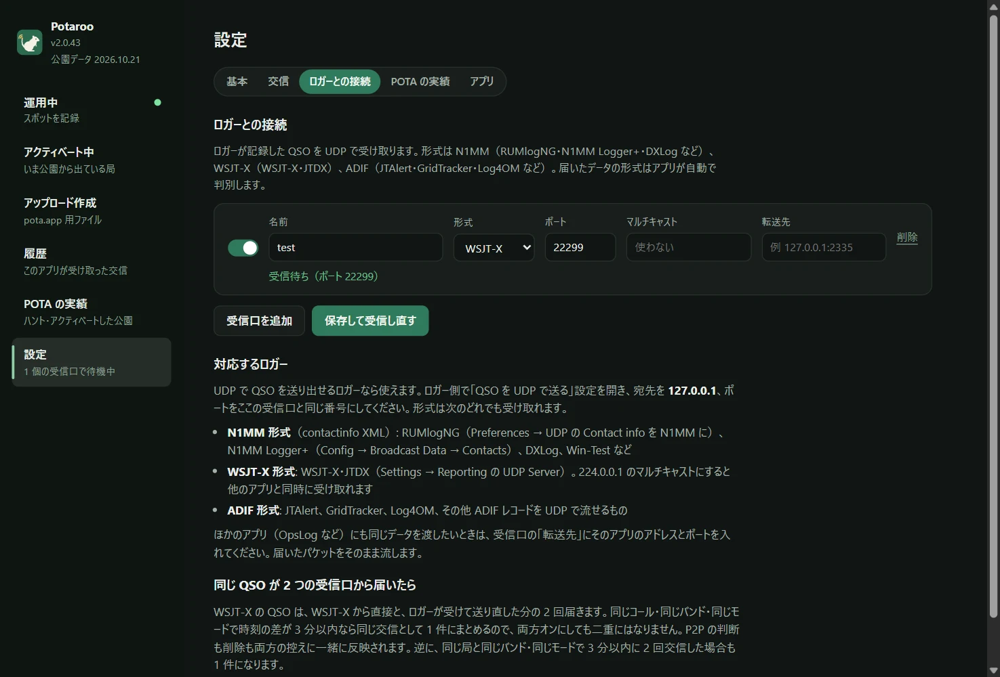

# Potaroo

*旧名：POTA Upload Helper*

[日本語](README.md) · [English](README.en.md) · [简体中文](README.zh-CN.md) · [繁體中文](README.zh-TW.md) · [Français](README.fr.md) · [Deutsch](README.de.md) · [Español](README.es.md) · [Italiano](README.it.md) · [Português (Brasil)](README.pt-BR.md) · [한국어](README.ko.md) · [Polski](README.pl.md)

<a href="https://buymeacoffee.com/pudipara"></a>

POTA（Parks on the Air）のアクティベーションを、運用中からアップロードまで手伝うデスクトップアプリです。macOS と Windows で動きます。

FT8 などでは、相手が公園から運用しているのか、さらに 2fer なのかはその場では分かりません。このアプリは運用中に pota.app のスポットを記録し、ロガーから届いた QSO とその場で突き合わせて **P2P（Park to Park）と 2fer の候補を出し、あなたが確認して記録します**。運用を終えると、自分の公園ごと・UTC 日付ごとに pota.app へそのまま上げられるファイルを作ります。



## できること

### 運用の前
- **公園を入れて記録を始めるだけ**：公園番号を入れると、公園名・所在地（都道府県・州）・何回目のアクティベートかを表示します。2fer・3fer は「公園を追加」で並べます。
- **2fer の確認**：入れた公園に共通する都道府県・州がないとき、または pota.app の公園情報に「重ならない」とあるときは、2fer として記録できないので開始ボタンが押せなくなります。複数の都道府県にまたがる公園は、共通する地域だけからプルダウンで選びます（1 つなら自動で決まります）。



### 運用中
- **運用中の画面**：10 QSO までのリング（10 を超えると /20、/30…）、経過時間、P2P と確認待ちの数、直近 1 時間のペース、最後の交信。交信と公園から出ている局を一覧で、または地図で見られます。
- **バー**：小さな通知バナーを別ウインドウで最前面に出し、ロガーの上に置いておけます。最新の交信と P2P の確認（はい・いいえ・スキップ）をここで済ませられ、本体の画面はほかのページを見るのに使えます。バーの幅は中身に合わせて自動で変わります。
- **ロガーから QSO を受信**：OpsLog や JTAlert と同じく UDP で受け取ります。N1MM 形式（RUMlogNG・N1MM Logger+・DXLog など）、WSJT-X / JTDX（マルチキャスト対応）、ADIF（JTAlert・GridTracker・Log4OM など）、QLog の QSO 変更通知。Windows では起動中の Turbo HAMLOG からも読み取ります。ロガーでの修正・削除も反映します。
- **P2P はその場で確認**：届いた QSO の相手が公園から出ていれば「P2P の可能性」と公園番号を出し、「はい」「いいえ」で決めます。スポットに出ていない相手（Phone や CW で公園番号を聞いたとき）は、その行に公園番号を直接入力します。勝手に P2P にはしません。
- **距離と地図**：相手の公園までの直線距離を「約 820 km」のように表示します（2fer は公園の中間地点から）。地図タブでは、自分の位置を中心に P2P した公園まで線を引きます。距離の単位は km とマイルから選べます。
- **10 QSO ごとにお祝い**：アクティベーション成立の瞬間と、その後 10 QSO ごとに紙吹雪で知らせます。
- **終了でファイル作成**：「この公園での運用を終了」を押すと、その日のアップロード用ファイル（`JL1FVA@JP-1266-20261020.adi`）を保存先に書き、最初の画面に戻ります。相手が 2fer なら QSO を公園の数だけ複製し、自分が 2fer なら公園ごとにファイルを分けます。運用中にアプリを閉じても運用は終わらず、次に起動したときに続きから記録します（閉じる前に確認が出ます）。
- **アップロードは UTC 3〜11 時を避けて**：この時間帯は pota.app のデータベース保守などでアップロードが「Unknown Failure」になりやすく、POTA からメールや SNS で避けるよう告知されています（docs.pota.app には載っていません）。ファイル作成の結果欄に、あなたの現地時間でこの時間帯を出し、いまがその時間なら目立つ色で知らせます。
- **天気と注意報**：記録を始めると公園の天気を 15 分ごとに確かめます。日本の公園は気象庁の注意報・警報を市区町村の単位で出し（雷注意報や警報は目立つ帯で）、「天気」タブの予報も気象庁の府県天気予報です（気象業務法により、日本の地点の予報は気象庁のものだけを出します）。日本以外の公園は、雷・強風・強い雨が近づくとバーと本体で知らせ、「天気」タブで Open-Meteo の数時間先の予報を見られます。避難指示などの避難情報は市町村が出すもので、このアプリには出ません。
- **シフトとイベント**：Early Shift / Late Shift の時間帯に入る・終わるとき、バーに日の出や月の出のアニメーションを出します。Support Your Parks などの POTA イベント中はその旨を表示します。
- **アワード達成の見込み**：Rover・Unique Parks・Repeat Offender・Kilo に届いた QSO で、メダルと紙吹雪で知らせます（確定するのは pota.app にログを上げてから）。同じ局が別の公園から呼んできたときは「前回は … から」と添えます。
- **クラブ局と時計**：クラブ局はオペレーターを登録して運用中に切り替えられます。パソコンの時計が pota.app と 1 分以上ずれていると注意を出します（P2P は双方の時刻が 15 分以内であることが条件です）。

| バー | 地図 |
|---|---|
|  |  |

### そのほか
- **アクティベート中**：記録していないときでも、いま公園から出ている局を pota.app のスポットから一覧にします（1 分ごとに更新）。国と地域、バンド、モード、2fer 以上、未ハント、QRT を隠す、で絞れます。
- **履歴**：このアプリが受け取った交信を日付ごとに一覧にし、1 件ずつ削除できます。
- **POTA の実績**：pota.app からダウンロードした `hunter_parks.csv` / `activator_parks.csv` を読み込むと、ハント・アクティベートした公園を一覧と地図で見られます。読み込んだあとにこのアプリで増えた公園は緑で示します。
- **アップロード作成**：アプリのログやロガーの ADIF から、過去の日付のファイルをまとめて作れます。
- **表示**：文字の大きさ（標準・大きめ・特大）と配色（OS に合わせる・ライト・ダーク）を変えられます。バーにも反映されます。
- **転送**：受け取ったデータをそのまま別のアプリへ流せます（RUMlog → このアプリ → OpsLog）。
- **公園データは毎月更新**：公園の一覧と位置はアプリに入っていて、毎月 pota.app の最新版に更新します（アプリの更新とは別の、小さな更新として届きます）。
- **使い方ガイド**：初めて起動したときに、コールサインの登録からファイル作成までを 7 つの手順で案内します。左下の「使い方ガイド」からいつでも開けます。
- **6 Pack の進み具合**：「POTA の実績」に、6m で成立したアクティベーション・P2P の公園数を出します（このアプリの記録から）。

| POTA の実績 | アップロード作成 |
|---|---|
|  |  |

相手の公園は次の優先順で決めます。

1. **pota.app ハンターログ**（相手がアップロードした記録 = 確定）。時刻 ±15 分・同じバンドで照合
2. **運用中に確認・入力した公園**（アプリのログから作るとき）。確認していない QSO は P2P にしません
3. **運用中のスポット記録**（ADIF ファイルから作るときだけ。QSO の 30 分前〜10 分後のスポット）
4. ロガーの SIG_INFO / POTA_REF

読み込むのは pota.app が公開しているデータ（api.pota.app）だけで、ログインは不要です（POTA の公式なサポートを受けたものではありません）。ログの保管はロガーの仕事です。このアプリは判定とアップロード用ファイルの作成だけを受け持ち、ロガーのログは書き換えません。

## ダウンロード

[Releases](../../releases) から最新版を取ってください。

| OS | ファイル | 使い方 |
|---|---|---|
| macOS（Apple Silicon） | `Potaroo-macOS.dmg` | 開いて `Potaroo` を `Applications` にドラッグ |
| Windows 10 / 11 | `Potaroo-Setup.exe` | 実行するとユーザーごとの場所（管理者権限不要）にインストールされ、スタートメニューに入ります |

zip 版（`Potaroo-macOS.zip` / `Potaroo-Windows.zip`）も添付しています。アプリ内の更新はこの zip を使うので、Release からは消さないでください。

署名していないアプリなので、初回は警告が出ます。

- **macOS**：アプリを右クリック →「開く」→「開く」。開けないときは「システム設定 → プライバシーとセキュリティ」の下の方にある「このまま開く」
- **Windows**：「Windows によって PC が保護されました」→「詳細情報」→「実行」

**2 回目からはアプリの中で更新できます。** 起動時に新しい版があるかを確認し、知らせが出たら「今すぐ更新」を押してください。ダウンロードして入れ替え、再起動します。確認はいつでも「設定 → アプリ」からできます。DMG の中のアプリをそのまま（`Applications` に入れずに）開いている場合は、macOS の仕組みで入れ替えができないので、新しいアプリを「ダウンロード」フォルダに置いて知らせます。旧名（POTA Upload Helper）のまま入っているアプリは、更新後の最初の起動で Potaroo に名前を変えます（Windows はショートカットも付け替えます）。

## ロガーとの接続

「設定 → ロガーとの接続」で受信口を作ります（いくつでも追加できます）。**QSO を UDP で送り出せるロガーなら使えます。** ロガー側で「QSO を UDP で送る」設定を開き、宛先を `127.0.0.1`、ポートを受信口と同じ番号にしてください。届いたパケットの形式はアプリが自動で判別します。



| 形式 | ロガーの例 | 設定の場所 |
|---|---|---|
| N1MM（contactinfo XML） | RUMlogNG、N1MM Logger+、DXLog、Win-Test | RUMlogNG: Preferences → UDP の Contact info を N1MM に。N1MM Logger+: Config → Broadcast Data → Contacts |
| WSJT-X | WSJT-X、JTDX | Settings → Reporting の UDP Server。`224.0.0.1`（マルチキャスト）にすると他のアプリと同時に受け取れます |
| ADIF | JTAlert、GridTracker、Log4OM など | 各ソフトの「ADIF を UDP で送る」設定 |
| QLog（JSON） | QLog | Settings → Network → Notifications の **QSO Changes** に `127.0.0.1:ポート` |
| Turbo HAMLOG（Windows） | Turbo HAMLOG/Win | 受信口の種類を「Turbo HAMLOG」に。ポートは不要で、起動中の HAMLOG から読み取ります（JT_Linker・JT-Get's 経由の QSO も含む） |

ロガーで修正・削除した QSO もアプリに反映されます。Windows 11 で確認済みなのは WSJT-X、Log4OM 2、Turbo HAMLOG、QLog、N1MM Logger+ です（CW・SSB・FT8 の受信と修正・削除）。

**受け取れるのは同じパソコンのロガーからだけです。** 受信口は `127.0.0.1` で待ち受けるので、別のパソコンのロガーからは届きません。

**Windows で WSJT-X / JTDX のマルチキャストを使う場合**：Windows ではマルチキャストの受信口もループバック（`127.0.0.1`）で待ち受けます。WSJT-X の Settings → Reporting → **Outgoing interfaces** に **loopback** を含めてください。この組み合わせは Windows 11 で動作を確認しています。届かないときは [Issue](../../issues) で知らせてもらえると助かります。マルチキャストを使わず、WSJT-X の UDP Server を `127.0.0.1` にする方法なら確実に受け取れます（ただしその場合、ほかのアプリと同時には受け取れません）。

**WSJT-X と一緒に使うロガーの設定**（Windows 11 で確認。FT8 の途中に CW・SSB・FM を混ぜても、1 件ずつ正しく入ります）：

| ロガー | WSJT-X からの受け取り | アプリへの渡し方 |
|---|---|---|
| JT_Linker + Turbo HAMLOG | JT_Linker が WSJT-X のログファイルを見て HAMLOG に登録 | 受信口「Turbo HAMLOG」 |
| N1MM Logger+ | Config → Configure Ports → WSJT/JTDX Setup の Radio #1 を Enable（ユニキャストなら `127.0.0.1`、マルチキャストなら `224.0.0.1`、ポート 2237） | Broadcast Data → Contacts を `127.0.0.1:受信口のポート` |
| QLog | Settings → Network の Wsjtx Port 2237（マルチキャストなら Join Multicast をオンにして Multicast Address に `224.0.0.1`） | Notifications → QSO Changes を `127.0.0.1:受信口のポート` |

WSJT-X の QSO はアプリにも直接届き（WSJT-X の受信口）、ロガー経由の分と合わせて 1 件にまとまります。マルチキャストで複数のソフトに同時に配るときは、次の点に注意してください。

- **QLog と N1MM は、ほかのソフトより先に起動してください。** 2237 番をほかのソフトと共有する設定で開かないため、後から起動すると「使用中」になって受け取れません。
- **Turbo HAMLOG も 2237 番を開きます。** JT_Linker と併用すると HAMLOG が「2 回目の QSO」として登録を尋ねてくることがあります。そのときは「いいえ」にしてください。QLog・N1MM と同時には使えません（後から起動した HAMLOG がエラーになります）。

ほかのアプリ（OpsLog など）にも同じデータを渡したいときは、受信口の「転送先」にそのアプリのアドレスとポートを入れます。

**両方オンでも二重にはなりません**：WSJT-X の QSO は、WSJT-X から直接と、ロガーが受けて送り直した分の 2 回届きます（開始時刻と終了時刻で 1 分ほどずれます）。同じコール・同じバンド・同じモードで時刻の差が 3 分以内なら同じ交信として 1 件にまとめ、P2P の判断や削除も両方に反映します。逆に、同じ局と同じバンド・同じモードで 3 分以内に 2 回交信した場合も 1 件になります。

## データの保存場所

| OS | 場所 |
|---|---|
| macOS | `~/Library/Application Support/Potaroo/` |
| Windows | `%APPDATA%\Potaroo\` |

`qsolog.db`（受け取った QSO）、`spots-YYYYMMDD.jsonl`（スポット記録）、`sessions.json`（自分の運用時間と公園）、`hunter.json`（ハンターログの控え）、`mypota.json`（読み込んだ実績の CSV）、`settings.json`、`potaroo.log`（エラーの記録）。
pota.app の公開プロフィールに出るハンターログは直近 25 件だけなので、記録中と作成のたびに `hunter.json` に追記して履歴を貯めます。受け取った交信などの内部データは、削除しない限り残ります（「履歴」で 1 件ずつ、「設定 → アプリ → 内部データ」でまとめて削除できます）。

## 不具合の報告

「設定 → アプリ → 不具合を報告」を押すと、バージョン・OS・ログの最後の部分が入った報告文が開きます。内容を確認・編集してから、「コピー」してメールなどで送るか、「GitHub で報告」で [Issue](../../issues) の作成画面を開いてください（GitHub の報告は公開されます）。アプリから自動で送るものはありません。ログにはコールサインや公園番号が含まれます。

## 言語

日本語・English・简体中文・繁體中文・Français・Deutsch・Español・Italiano・Português (Brasil)・한국어・Polski。OS の言語に合わせて自動で選ばれ、「設定」の「言語」で切り替えられます。

## 利用規約・免責事項

このアプリは個人が趣味で作った無保証のソフトウェアです。**このアプリの使用によって生じたいかなる損害（pota.app へ誤った内容をアップロードしたこと、QSO の重複や欠落、ログやファイルの消失、ロガーやネットワーク設定への影響など）についても、作者は責任を負いません。** アップロードするファイルの内容は必ず自分で確認してください。P2P や 2fer の判定は推定で、正しさは保証されません。このアプリは Parks on the Air® および pota.app とは無関係です。全文は [TERMS.md](TERMS.md) にあり、アプリの初回起動時にも表示されます。

脆弱性の報告は [SECURITY.md](SECURITY.md) を見てください。

## ソースから動かす

```sh
pip install -r requirements.txt
python3 app.py
```

コマンドラインだけでも使えます（標準ライブラリのみ）。

```sh
python3 pota_spotlog.py --parks JP-1266,JP-1206
python3 pota_build.py export.adif --date 20261020
```

## 開発

```sh
scripts/dev.sh                                  # venv を作って起動（データは ./data に保存、本番ログは触らない）
scripts/dev.sh --debug                          # 開発者ツール付き
scripts/send_test_qso.py 22237 JA1XYZ           # 開発用の受信口にテスト QSO を流す（2237 には送らない）
python3 -m unittest discover -s tests
```

変更はブランチを切って Pull Request にしてください。PR ごとに macOS / Windows でテストが走り、`main` にマージすると GitHub Actions が両 OS 版を作って Release `v<VERSION>`（`potacommon.py` の `VERSION`）に添付します。`scripts/` には、データのコピーで 2 つ目のアプリを起動する `copy_instance.py`、画面の文字位置を点検する `check_align.mjs`、この README の画像を撮る `readme_shots.mjs` などがあります。

## License

MIT

国旗の表示には、Twemoji（CC-BY 4.0）の国旗だけを収めた [country-flag-emoji-polyfill](https://github.com/talkjs/country-flag-emoji-polyfill)（MIT）のフォントを同梱しています。地図は [Leaflet](https://leafletjs.com/)（BSD-2-Clause）と © [OpenStreetMap](https://www.openstreetmap.org/copyright) contributors のタイルを使っています。天気は [Open-Meteo](https://open-meteo.com/) のデータ（CC BY 4.0）です。日本の公園の注意報・警報は気象庁のデータ（出典：気象庁ホームページ）、公園の市町村は国土地理院の逆ジオコーディングを使っています。
