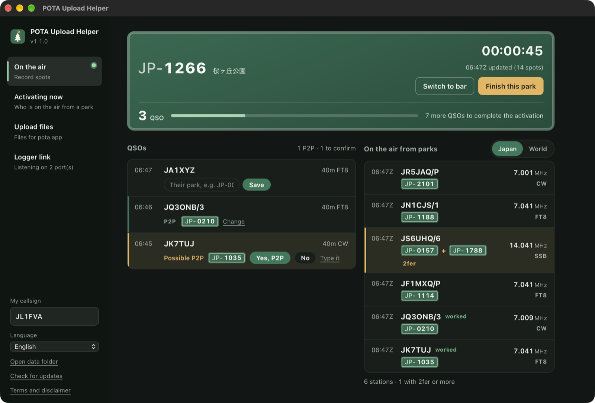
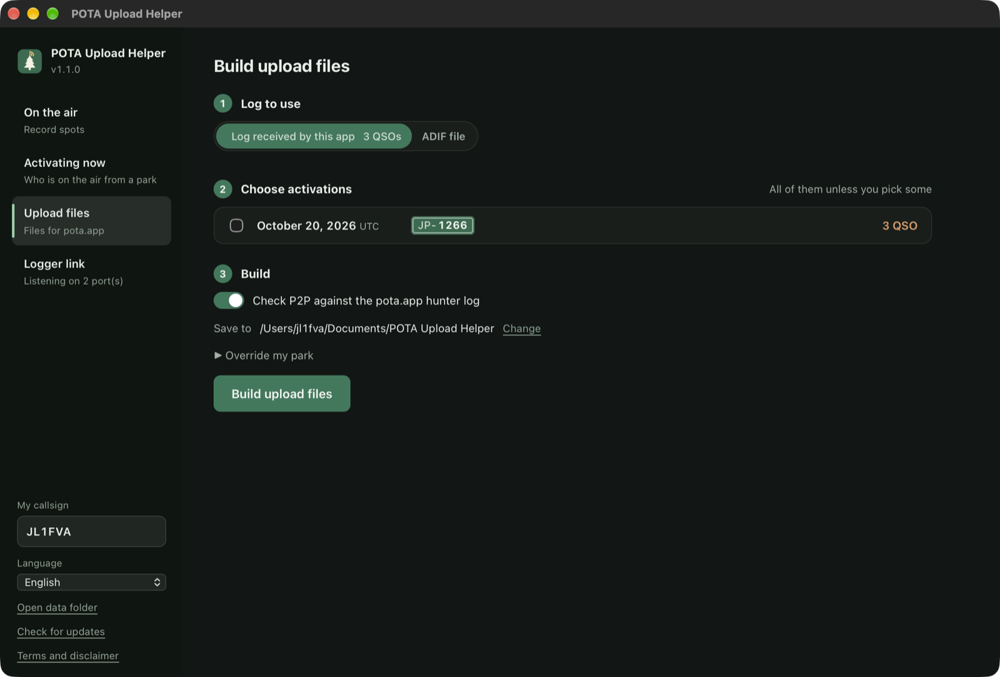
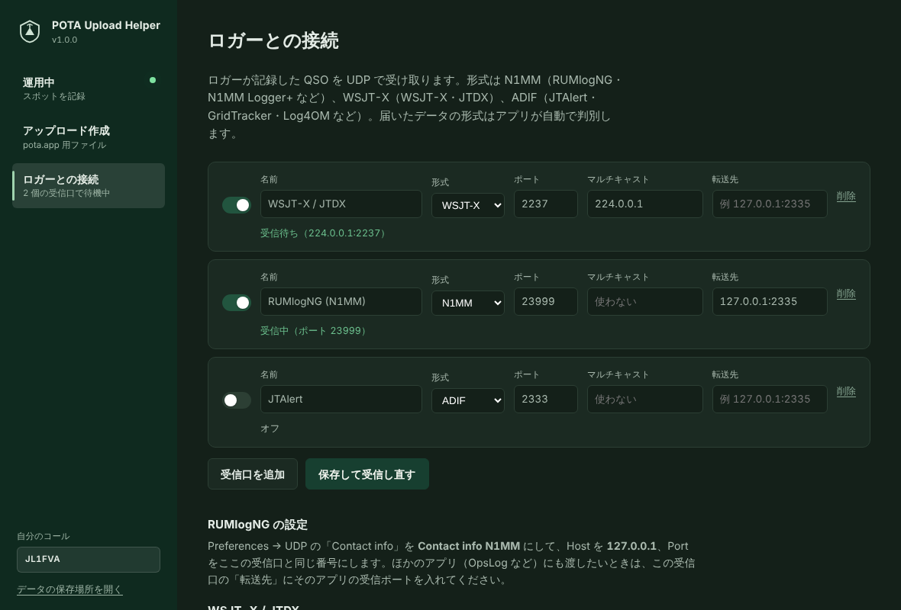

# POTA Upload Helper

POTA（Parks on the Air）のアクティベーションを、運用中からアップロードまで手伝うデスクトップアプリです。macOS と Windows で動きます。

FT8 などでは、相手が公園から運用しているのか、さらに 2fer なのかがその場では分かりません。このアプリは運用中に POTA のスポットを記録し、ロガーから届いた QSO とその場で突き合わせて **P2P（Park to Park）と 2fer を自動で判定**します。運用後は、自分の公園ごと・UTC 日付ごとに pota.app へそのまま上げられるファイルを作ります。



## できること

- **運用中はバー表示**：公園番号を入れて記録を始めると、ウィンドウが小さな帯になってロガーの上に残ります（自分の公園、経過時間、QSO 数、直近の交信）。「広げる」で元の大きさに戻せます。公園から出ている局は 1 分ごとに記録するので、相手が QRT しても後から判定できます。
- **ロガーから QSO を受信**：OpsLog や JTAlert と同じく UDP で受け取ります。N1MM 形式（RUMlogNG・N1MM Logger+ など）、WSJT-X / JTDX（マルチキャスト対応）、ADIF（JTAlert・GridTracker・Log4OM など）。ロガーでの修正・削除も反映します。
- **P2P はその場で確認**：届いた QSO の相手が公園から出ていれば「P2P の可能性」と公園番号を出し、「はい」「いいえ」で決めます。スポットに出ていない相手（Phone や CW で公園番号を聞いたとき）は、その行に公園番号を直接入力します。勝手に P2P にはしません。
- **10 QSO で知らせる**：アクティベーション成立の瞬間に画面いっぱいに表示します。
- **終了でファイル作成**：「この公園での運用を終了」を押すと、その公園・その日のアップロード用ファイル（`JL1FVA@JP-1281-20261020.adi`）を保存先に書き、最初の画面に戻ります。次の公園に着いたら番号を入れるだけです。相手が 2fer なら QSO を公園の数だけ複製し、自分が 2fer なら公園ごとにファイルを分けます。
- **転送**：受け取ったデータをそのまま別のアプリへ流せます（RUMlog → このアプリ → OpsLog）。
- **作り直し**：「アップロード作成」タブでは、アプリのログや RUMlogNG の ADIF から過去の日付のファイルをまとめて作れます。

ログの保管はロガーの仕事です。このアプリは判定とアップロード用ファイルの作成だけを受け持ち、ロガーのログは書き換えません。



相手の公園は次の優先順で決めます。

1. **pota.app ハンターログ**（相手がアップロードした記録 = 確定）。時刻 ±5 分・同じバンドで照合
2. **運用中に確認・入力した公園**（アプリのログから作るとき）。確認していない QSO は P2P にしません
3. **運用中のスポット記録**（ADIF ファイルから作るときだけ。QSO の 30 分前〜10 分後のスポット）
4. ロガーの SIG_INFO / POTA_REF

使うのは公開 API（api.pota.app）だけで、ログインは不要です。ロガーのログは読むだけで書き換えません。

## ダウンロード

[Releases](../../releases) から最新版を取ってください。

| OS | ファイル | 使い方 |
|---|---|---|
| macOS（Apple Silicon） | `POTA-Upload-Helper-macOS.zip` | 展開した `POTA Upload Helper.app` をアプリケーションへ |
| Windows 10 / 11 | `POTA-Upload-Helper-Windows.zip` | 展開した `POTA Upload Helper.exe` を実行 |

署名していないアプリなので、初回は警告が出ます。

- **macOS**：アプリを右クリック →「開く」→「開く」。開けないときは「システム設定 → プライバシーとセキュリティ」の下の方にある「このまま開く」
- **Windows**：「Windows によって PC が保護されました」→「詳細情報」→「実行」

## ロガーとの接続

アプリの「ロガーとの接続」で受信口を作ります（いくつでも追加できます）。



**RUMlogNG**：Preferences → UDP の「Contact info」を **Contact info N1MM** にし、Host `127.0.0.1`、Port を受信口と同じ番号に。ほかのアプリ（OpsLog など）にも渡したいときは、受信口の「転送先」にそのアプリのポートを入れます。

**WSJT-X / JTDX**：Settings → Reporting の UDP Server を `224.0.0.1`（マルチキャスト）にすると、ほかのアプリと同時に受け取れます。WSJT-X とロガーの両方から同じ QSO が届いても 1 件として扱います。

## データの保存場所

| OS | 場所 |
|---|---|
| macOS | `~/Library/Application Support/POTA Upload Helper/` |
| Windows | `%APPDATA%\POTA Upload Helper\` |

`qsolog.db`（受け取った QSO）、`spots-YYYYMMDD.jsonl`（スポット記録）、`sessions.json`（自分の運用時間と公園）、`hunter.json`（ハンターログの控え）、`settings.json`。
pota.app の公開プロフィールに出るハンターログは直近 25 件だけなので、記録中と作成のたびに `hunter.json` に追記して履歴を貯めます。

## ソースから動かす

```sh
pip install -r requirements.txt
python3 app.py
```

コマンドラインだけでも使えます（標準ライブラリのみ）。

```sh
python3 pota_spotlog.py --parks JP-1281,JP-1285
python3 pota_build.py export.adif --date 20261020
```

## 開発

```sh
scripts/dev.sh                                  # venv を作って起動（データは ./data に保存、本番ログは触らない）
scripts/dev.sh --debug                          # WebKit のインスペクタ付き
scripts/send_test_qso.py 22237 JS6UHQ/6         # 開発用の受信口にテスト QSO を流す（2237 には送らない）
python3 -m unittest discover -s tests
```

`VERSION`（`potacommon.py`）を上げて `main` に push すると、GitHub Actions が macOS / Windows 版を作って Release `v<VERSION>` に添付します。

## License

MIT
