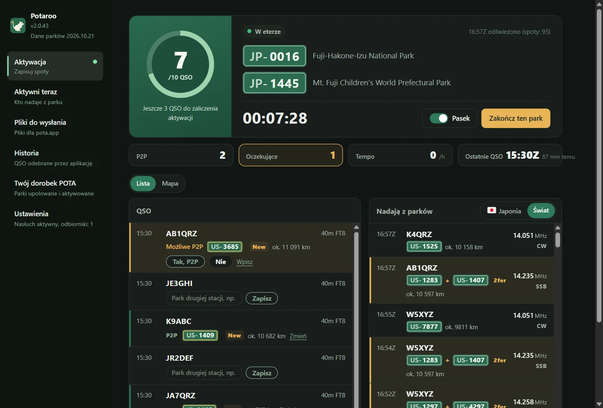
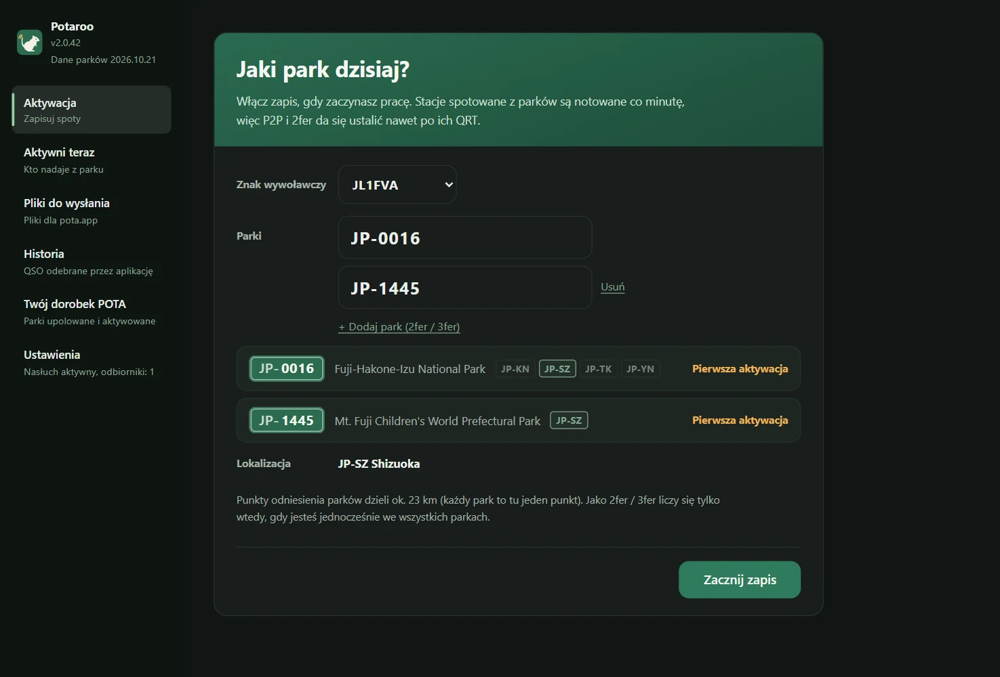
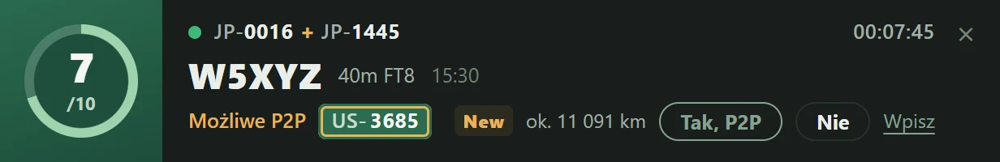
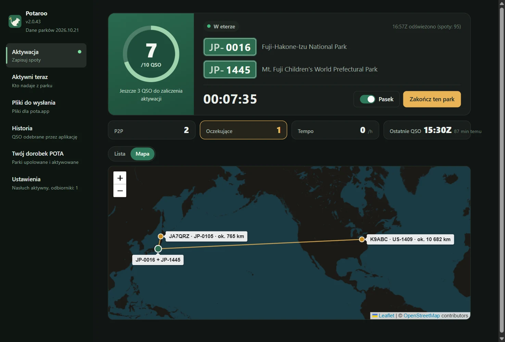
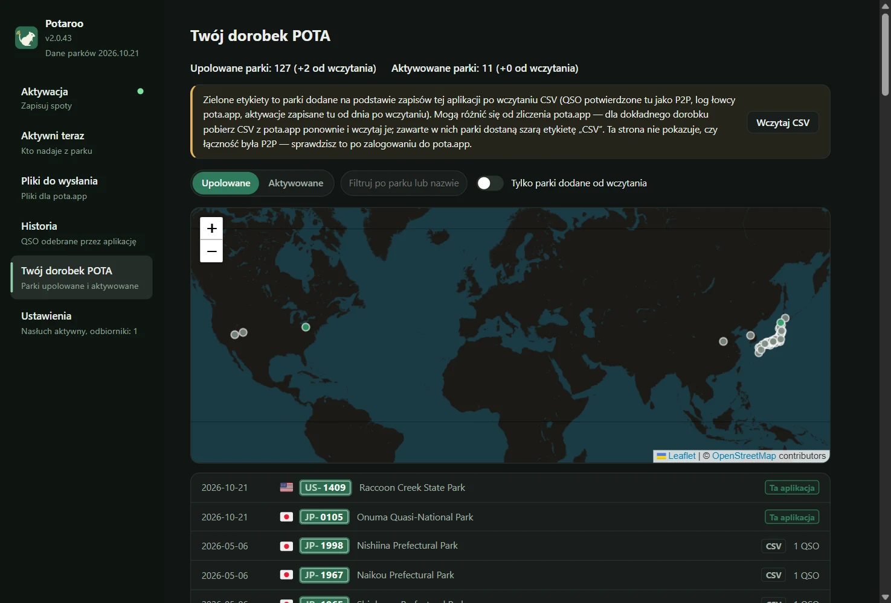
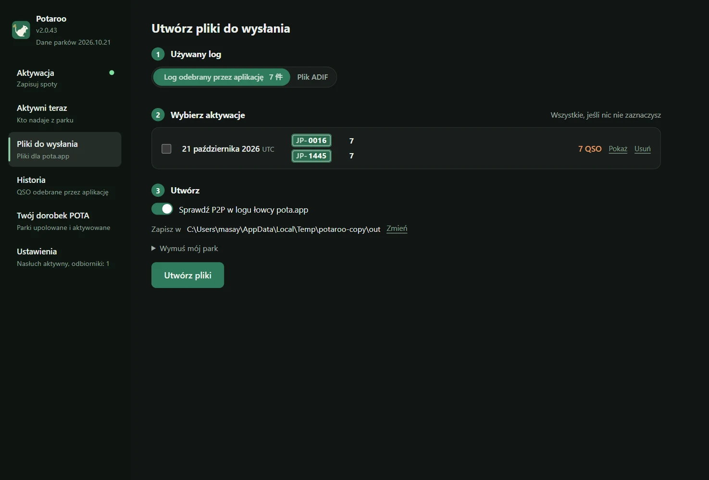
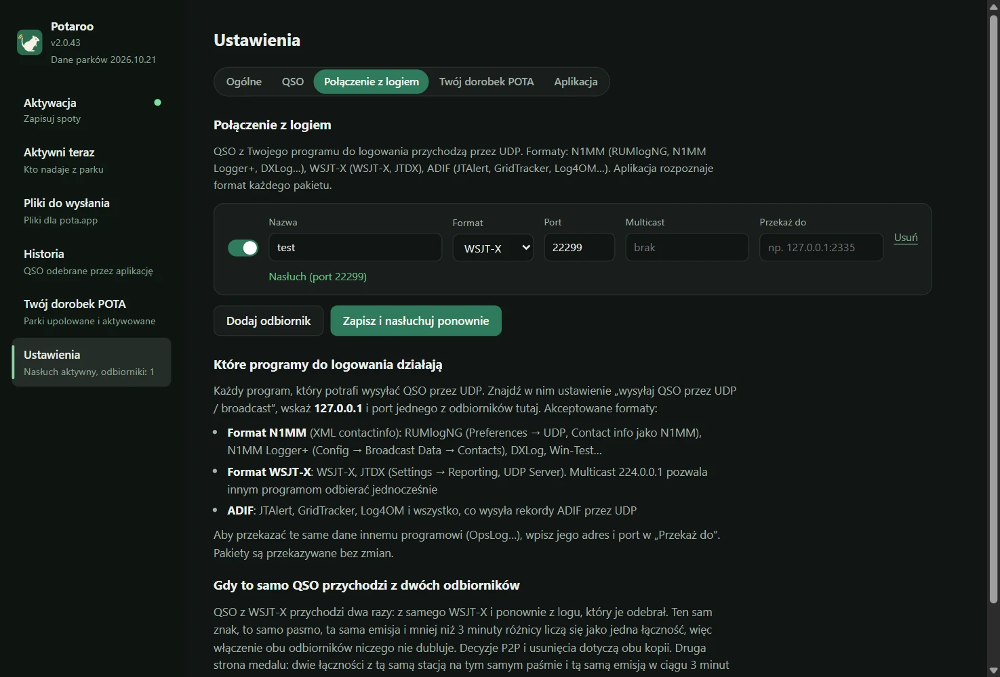

# Potaroo

*Dawniej POTA Upload Helper*

[日本語](README.md) · [English](README.en.md) · [简体中文](README.zh-CN.md) · [繁體中文](README.zh-TW.md) · [Français](README.fr.md) · [Deutsch](README.de.md) · [Español](README.es.md) · [Italiano](README.it.md) · [Português (Brasil)](README.pt-BR.md) · [한국어](README.ko.md) · [Polski](README.pl.md)

<a href="https://buymeacoffee.com/pudipara"></a>

Aplikacja desktopowa, która pomaga przy aktywacjach POTA (Parks on the Air): od pracy w eterze aż po wysłanie logu. Działa na macOS i Windows.

W FT8 i podobnych emisjach nie wiadomo na bieżąco, czy druga stacja nadaje z parku, a tym bardziej, czy to 2fer. Ta aplikacja podczas aktywacji zapisuje spoty z pota.app, na bieżąco zestawia je z QSO przysyłanymi przez program do logowania i **proponuje kandydatów na P2P (Park to Park) i 2fer, a Ty je potwierdzasz i zapisujesz**. Po zakończeniu tworzy pliki gotowe do wysłania bez zmian na pota.app: osobno dla każdego Twojego parku i każdego dnia UTC.



## Co potrafi

### Przed aktywacją
- **Wystarczy wpisać park i zacząć zapis**: po wpisaniu oznaczenia parku aplikacja pokazuje jego nazwę, położenie (województwo / stan) i numer kolejnej aktywacji. 2fer i 3fer dodajesz przyciskiem „+ Dodaj park (2fer / 3fer)”.
- **Sprawdzenie 2fer**: jeśli wpisane parki nie mają wspólnego województwa / stanu albo informacje o parku na pota.app mówią, że parki „się nie pokrywają”, nie da się ich zapisać jako 2fer i przycisku startu nie można nacisnąć. Dla parku leżącego w kilku województwach wybierasz z listy rozwijanej jedno ze wspólnych (jeśli jest tylko jedno, zostaje wybrane automatycznie).



### Podczas aktywacji
- **Ekran aktywacji**: pierścień do 10 QSO (po przekroczeniu 10: /20, /30…), czas od startu, liczba P2P i oczekujących na potwierdzenie, tempo z ostatniej godziny, ostatnie QSO. Łączności i stacje nadające z parków możesz oglądać jako listę lub na mapie.
- **Pasek**: mały baner powiadomień w osobnym oknie, zawsze na wierzchu, który możesz położyć nad programem do logowania. Ostatnie QSO i potwierdzanie P2P (tak / nie / pomiń) załatwisz w nim, a główne okno zostaje wolne do oglądania innych stron. Szerokość paska dopasowuje się do zawartości.
- **QSO z programu do logowania**: odbierane przez UDP, tak jak w OpsLog czy JTAlert. Format N1MM (RUMlogNG, N1MM Logger+, DXLog itd.), WSJT-X / JTDX (z obsługą multicastu), ADIF (JTAlert, GridTracker, Log4OM itd.), powiadomienia QLog o zmianach QSO. W Windows aplikacja odczytuje też QSO z uruchomionego Turbo HAMLOG. Poprawki i usunięcia w logu również są uwzględniane.
- **P2P potwierdzasz na bieżąco**: jeśli druga stacja nadaje z parku, wiersz QSO pokazuje „Możliwe P2P” z oznaczeniem parku, a Ty decydujesz „Tak” lub „Nie”. Dla stacji, której nie ma w spotach (gdy oznaczenie parku usłyszałeś na fonii lub CW), wpisujesz je bezpośrednio w tym wierszu. Nic nie zostaje uznane za P2P samo z siebie.
- **Odległość i mapa**: odległość w linii prostej do parku drugiej stacji wyświetlana jest jako np. „ok. 820 km” (dla 2fer liczona od punktu pośrodku parków). Na karcie „Mapa” od Twojej pozycji prowadzone są linie do parków, z którymi zrobiłeś P2P. Jednostkę odległości wybierasz: km lub mile.
- **Świętowanie co 10 QSO**: w chwili zaliczenia aktywacji i potem co 10 QSO aplikacja daje znać konfetti.
- **Zakończenie tworzy pliki**: „Zakończ ten park” zapisuje w wybranym folderze plik do wysłania za ten dzień (`JL1FVA@JP-1266-20261020.adi`) i wraca do pierwszego ekranu. Jeśli druga stacja miała 2fer, QSO jest powielane dla każdego jej parku; jeśli Ty masz 2fer, pliki są rozdzielane na parki. Zamknięcie aplikacji w trakcie nie kończy aktywacji: po następnym uruchomieniu zapis jest kontynuowany (przed zamknięciem pojawia się pytanie).

| Pasek | Mapa |
|---|---|
|  |  |

### Pozostałe
- **Aktywni teraz**: nawet bez zapisu lista stacji nadających właśnie z parków, ze spotów pota.app (odświeżana co minutę). Filtry: kraj i region, pasmo, emisja, 2fer i więcej, nieupolowane, ukryj QRT.
- **Historia**: łączności odebrane przez aplikację, pogrupowane według dni; każdą możesz usunąć osobno.
- **Twój dorobek POTA**: po wczytaniu pobranych z pota.app plików `hunter_parks.csv` / `activator_parks.csv` zobaczysz upolowane i aktywowane parki na liście i na mapie. Parki dodane przez aplikację po wczytaniu plików są oznaczone na zielono.
- **Pliki do wysłania**: z logu aplikacji lub z ADIF programu do logowania możesz od razu utworzyć pliki za minione dni.
- **Wygląd**: rozmiar tekstu (standardowy / większy / największy) i kolory (jak w systemie / jasny / ciemny). Ustawienia dotyczą też paska.
- **Przekazywanie**: odebrane dane możesz przekazać bez zmian do innej aplikacji (RUMlog → ta aplikacja → OpsLog).
- **Dane parków aktualizowane co miesiąc**: lista parków i ich położenie są wbudowane w aplikację i co miesiąc aktualizowane do najnowszej wersji z pota.app (przychodzi to jako mała aktualizacja, niezależna od aktualizacji aplikacji).

| Twój dorobek POTA | Pliki do wysłania |
|---|---|
|  |  |

Park drugiej stacji ustalany jest w tej kolejności:

1. **Log huntera z pota.app** (to, co wysłała druga stacja = potwierdzone). Dopasowanie: czas ±5 minut, to samo pasmo
2. **Park potwierdzony lub wpisany podczas aktywacji** (przy tworzeniu z logu aplikacji). Niepotwierdzone QSO nie są uznawane za P2P
3. **Spoty zapisane podczas aktywacji** (tylko przy tworzeniu z pliku ADIF; spoty od 30 minut przed do 10 minut po QSO)
4. SIG_INFO / POTA_REF z programu do logowania

Aplikacja korzysta tylko z publicznego API (api.pota.app), logowanie nie jest potrzebne. Przechowywanie logu to zadanie programu do logowania. Ta aplikacja zajmuje się tylko oceną i tworzeniem plików do wysłania i nigdy nie zmienia logu w programie do logowania.

## Pobieranie

Najnowszą wersję pobierz z [Releases](../../releases).

| System | Plik | Jak użyć |
|---|---|---|
| macOS (Apple Silicon) | `Potaroo-macOS.dmg` | Otwórz i przeciągnij `Potaroo` do `Applications` |
| Windows 10 / 11 | `Potaroo-Setup.exe` | Po uruchomieniu instaluje się w folderze użytkownika (bez uprawnień administratora) i pojawia się w menu Start |

Dołączone są też wersje zip (`Potaroo-macOS.zip` / `Potaroo-Windows.zip`). Aktualizacja w aplikacji z nich korzysta, więc nie usuwaj ich z Release.

Aplikacja nie jest podpisana, więc przy pierwszym uruchomieniu pojawi się ostrzeżenie.

- **macOS**: kliknij aplikację prawym przyciskiem → „Otwórz” → „Otwórz”. Jeśli nadal się nie otwiera: „Ustawienia systemowe → Prywatność i ochrona”, na dole „Otwórz mimo to”
- **Windows**: „System Windows ochronił ten komputer” → „Więcej informacji” → „Uruchom mimo to”

**Później aktualizujesz w samej aplikacji.** Przy starcie sprawdza ona, czy jest nowa wersja; gdy pojawi się powiadomienie, naciśnij „Aktualizuj teraz”. Aplikacja zostanie pobrana, podmieniona i uruchomiona ponownie. Sprawdzić możesz w każdej chwili w „Ustawienia → Aplikacja”. Jeśli otwierasz aplikację prosto z DMG (bez przeniesienia do `Applications`), macOS nie pozwala jej podmienić, więc nowa aplikacja trafia do folderu Pobrane, a Ty dostajesz o tym informację. Aplikacja zainstalowana pod dawną nazwą (POTA Upload Helper) przy pierwszym uruchomieniu po aktualizacji zmienia nazwę na Potaroo (w Windows poprawia też skróty).

## Połączenie z logiem

W „Ustawienia → Połączenie z logiem” utwórz odbiorniki (ile chcesz). **Zadziała każdy program do logowania, który potrafi wysyłać QSO przez UDP.** W programie otwórz ustawienie „wysyłaj QSO przez UDP”, jako adres podaj `127.0.0.1`, a jako port ten sam numer co w odbiorniku. Format przychodzących pakietów aplikacja rozpoznaje sama.



| Format | Przykładowe programy | Gdzie ustawić |
|---|---|---|
| N1MM (XML contactinfo) | RUMlogNG, N1MM Logger+, DXLog, Win-Test | RUMlogNG: Preferences → UDP, Contact info ustaw na N1MM. N1MM Logger+: Config → Broadcast Data → Contacts |
| WSJT-X | WSJT-X, JTDX | Settings → Reporting, UDP Server. Z `224.0.0.1` (multicast) inne programy mogą odbierać równocześnie |
| ADIF | JTAlert, GridTracker, Log4OM itd. | ustawienie „wysyłaj ADIF przez UDP” w danym programie |
| QLog (JSON) | QLog | Settings → Network → Notifications, w **QSO Changes** wpisz `127.0.0.1:port` |
| Turbo HAMLOG (Windows) | Turbo HAMLOG/Win | Jako rodzaj odbiornika wybierz „Turbo HAMLOG”. Port nie jest potrzebny: aplikacja odczytuje QSO z uruchomionego HAMLOG (także te, które przyszły przez JT_Linker i JT-Get's) |

QSO poprawione lub usunięte w programie do logowania są też poprawiane w aplikacji. W Windows 11 sprawdzone zostały WSJT-X, Log4OM 2, Turbo HAMLOG, QLog i N1MM Logger+ (odbiór CW, SSB i FT8 oraz poprawki i usunięcia).

**Odbierać można tylko z programów do logowania na tym samym komputerze.** Odbiorniki nasłuchują na `127.0.0.1`, więc QSO z programu na innym komputerze do nich nie dotrą.

**Multicast WSJT-X / JTDX w Windows**: w Windows odbiornik multicast także nasłuchuje na loopbacku (`127.0.0.1`). W WSJT-X, w Settings → Reporting → **Outgoing interfaces**, zaznacz **loopback**. To połączenie zostało sprawdzone w Windows 11. Jeśli nic nie dociera, będę wdzięczny za zgłoszenie w [Issue](../../issues). Bez multicastu, z UDP Server w WSJT-X ustawionym na `127.0.0.1`, odbiór działa zawsze (ale wtedy inne programy nie mogą odbierać równocześnie).

**Ustawienia programów do logowania używanych razem z WSJT-X** (sprawdzone w Windows 11; nawet gdy w trakcie FT8 przeplatasz CW, SSB i FM, każde QSO trafia poprawnie jako jedno):

| Program | Odbiór z WSJT-X | Przekazanie do aplikacji |
|---|---|---|
| JT_Linker + Turbo HAMLOG | JT_Linker śledzi plik logu WSJT-X i zapisuje QSO w HAMLOG | odbiornik „Turbo HAMLOG” |
| N1MM Logger+ | Config → Configure Ports → WSJT/JTDX Setup, Radio #1 na Enable (unicast: `127.0.0.1`, multicast: `224.0.0.1`, port 2237) | Broadcast Data → Contacts na `127.0.0.1:port odbiornika` |
| QLog | Settings → Network, Wsjtx Port 2237 (dla multicastu włącz Join Multicast i w Multicast Address wpisz `224.0.0.1`) | Notifications → QSO Changes na `127.0.0.1:port odbiornika` |

QSO z WSJT-X docierają też bezpośrednio do aplikacji (odbiornik WSJT-X) i łączą się w jedno z tymi, które przyszły przez program do logowania. Gdy rozsyłasz dane multicastem do kilku programów naraz, pamiętaj o kilku rzeczach:

- **QLog i N1MM uruchamiaj przed innymi programami.** Nie otwierają portu 2237 w trybie współdzielenia z innymi programami, więc uruchomione później dostaną „port zajęty” i nic nie odbiorą.
- **Turbo HAMLOG też otwiera port 2237.** W połączeniu z JT_Linker HAMLOG może zapytać, czy zapisać „drugie QSO”. Wtedy wybierz „Nie”. Nie da się go używać równocześnie z QLog ani N1MM (HAMLOG uruchomiony później zgłosi błąd).

Aby przekazać te same dane innej aplikacji (np. OpsLog), wpisz jej adres i port w polu „Przekaż do” odbiornika.

**Dwa włączone źródła niczego nie dublują**: QSO z WSJT-X przychodzi dwa razy: bezpośrednio z WSJT-X oraz od programu do logowania, który je odebrał i wysłał dalej (różnica ok. minuty: czas początku i końca łączności). Ten sam znak, to samo pasmo, ta sama emisja i różnica czasu do 3 minut = ta sama łączność, połączona w jedną; decyzja o P2P i usunięcie dotyczą obu kopii. Z drugiej strony dwie łączności z tą samą stacją na tym samym paśmie i tą samą emisją w ciągu 3 minut też staną się jedną.

## Gdzie są dane

| System | Miejsce |
|---|---|
| macOS | `~/Library/Application Support/Potaroo/` |
| Windows | `%APPDATA%\Potaroo\` |

`qsolog.db` (odebrane QSO), `spots-YYYYMMDD.jsonl` (zapisane spoty), `sessions.json` (czas Twoich aktywacji i parki), `hunter.json` (kopia logu huntera), `mypota.json` (wczytane pliki CSV z dorobkiem), `settings.json`, `potaroo.log` (zapis błędów).
Publiczny profil na pota.app pokazuje tylko 25 ostatnich wpisów logu huntera, dlatego aplikacja podczas zapisu i przy każdym tworzeniu plików dopisuje je do `hunter.json`, gromadząc historię. Dane aplikacji, takie jak odebrane łączności, zostają, dopóki ich nie usuniesz (pojedynczo w „Historia”, wszystkie naraz w „Ustawienia → Aplikacja → Dane aplikacji”).

## Zgłaszanie problemów

„Ustawienia → Aplikacja → Zgłoś problem” otwiera tekst zgłoszenia z wersją, systemem i końcówką logu. Sprawdź i popraw treść, a potem użyj „Kopiuj” i wyślij ją np. e-mailem albo przyciskiem „Zgłoś na GitHubie” otwórz formularz nowego [Issue](../../issues) (zgłoszenia na GitHubie są publiczne). Aplikacja niczego nie wysyła sama. Log zawiera znaki wywoławcze i oznaczenia parków.

## Języki

日本語, English, 简体中文, 繁體中文, Français, Deutsch, Español, Italiano, Português (Brasil), 한국어, Polski. Język wybierany jest automatycznie według języka systemu i można go zmienić w „Język” w „Ustawieniach”.

## Warunki użytkowania i wyłączenie odpowiedzialności

Ta aplikacja to hobbystyczne oprogramowanie stworzone przez osobę prywatną, dostarczane bez żadnej gwarancji. **Autor nie ponosi odpowiedzialności za jakiekolwiek szkody wynikłe z jej używania (wysłanie błędnych danych na pota.app, zdublowane lub brakujące QSO, utrata logów lub plików, wpływ na program do logowania lub ustawienia sieci itp.).** Zawsze samodzielnie sprawdzaj zawartość plików przed wysłaniem. Rozpoznawanie P2P i 2fer to szacunek, a jego poprawność nie jest gwarantowana. Aplikacja nie jest powiązana z Parks on the Air® ani z pota.app. Pełny tekst znajduje się w [TERMS.md](TERMS.md) i jest też wyświetlany przy pierwszym uruchomieniu aplikacji.

Zgłaszanie luk bezpieczeństwa: zobacz [SECURITY.md](SECURITY.md).

## Uruchomienie ze źródeł

```sh
pip install -r requirements.txt
python3 app.py
```

Działa też sam wiersz poleceń (tylko biblioteka standardowa).

```sh
python3 pota_spotlog.py --parks JP-1266,JP-1206
python3 pota_build.py export.adif --date 20261020
```

## Rozwój

```sh
scripts/dev.sh                                  # tworzy venv i uruchamia (dane w ./data, prawdziwego logu nie dotyka)
scripts/dev.sh --debug                          # z narzędziami deweloperskimi
scripts/send_test_qso.py 22237 JA1XYZ           # wysyła testowe QSO do odbiornika deweloperskiego (nigdy na 2237)
python3 -m unittest discover -s tests
```

Zmiany zgłaszaj na osobnej gałęzi jako Pull Request. Dla każdego PR testy uruchamiają się na macOS i Windows, a po scaleniu z `main` GitHub Actions buduje wersje na oba systemy i dołącza je do Release `v<VERSION>` (`VERSION` w `potacommon.py`). W `scripts/` są m.in. `copy_instance.py` (uruchamia drugą instancję aplikacji na kopii danych), `check_align.mjs` (sprawdza położenie tekstu na ekranie) i `readme_shots.mjs` (robi zrzuty ekranu do tego README).

## License

MIT

Do wyświetlania flag dołączona jest czcionka z [country-flag-emoji-polyfill](https://github.com/talkjs/country-flag-emoji-polyfill) (MIT), zawierająca tylko flagi z Twemoji (CC-BY 4.0). Mapa korzysta z [Leaflet](https://leafletjs.com/) (BSD-2-Clause) i kafelków © [OpenStreetMap](https://www.openstreetmap.org/copyright) contributors.
