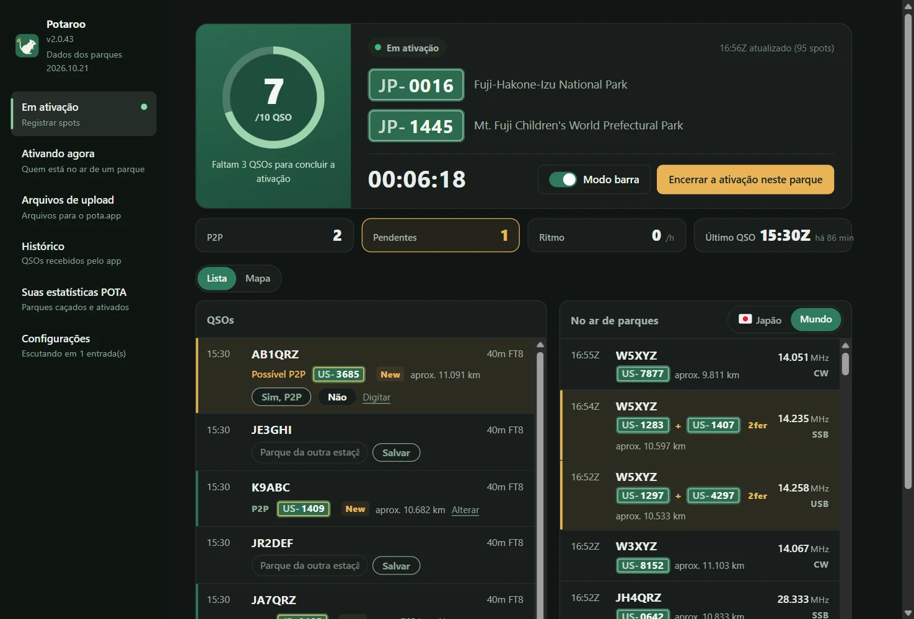
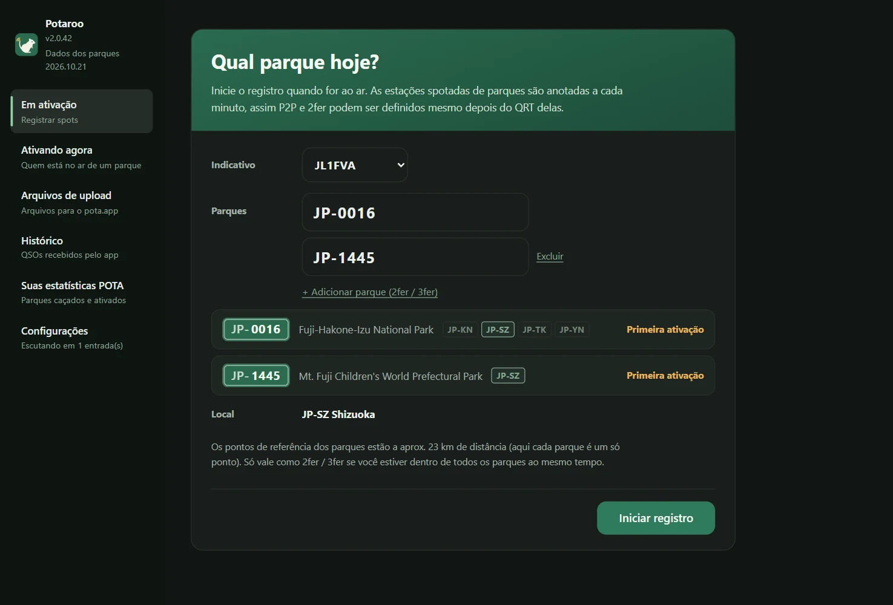
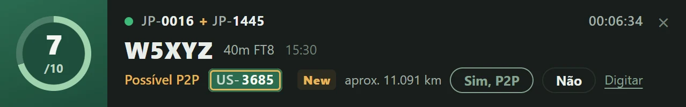
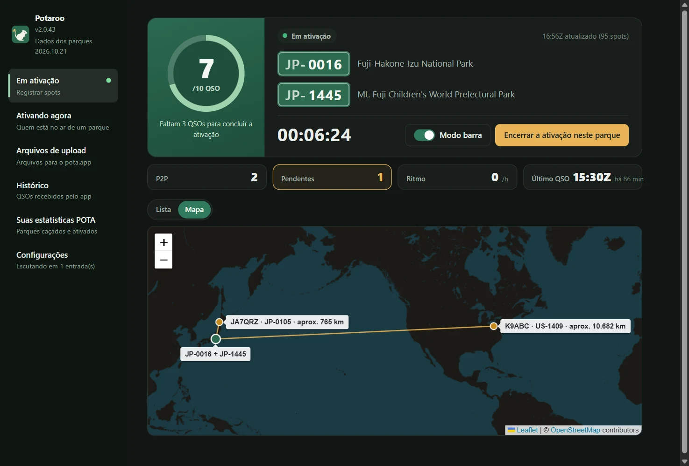
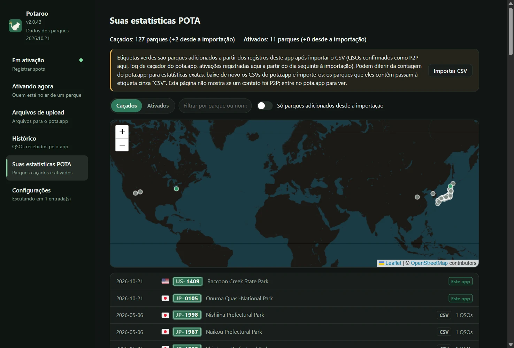
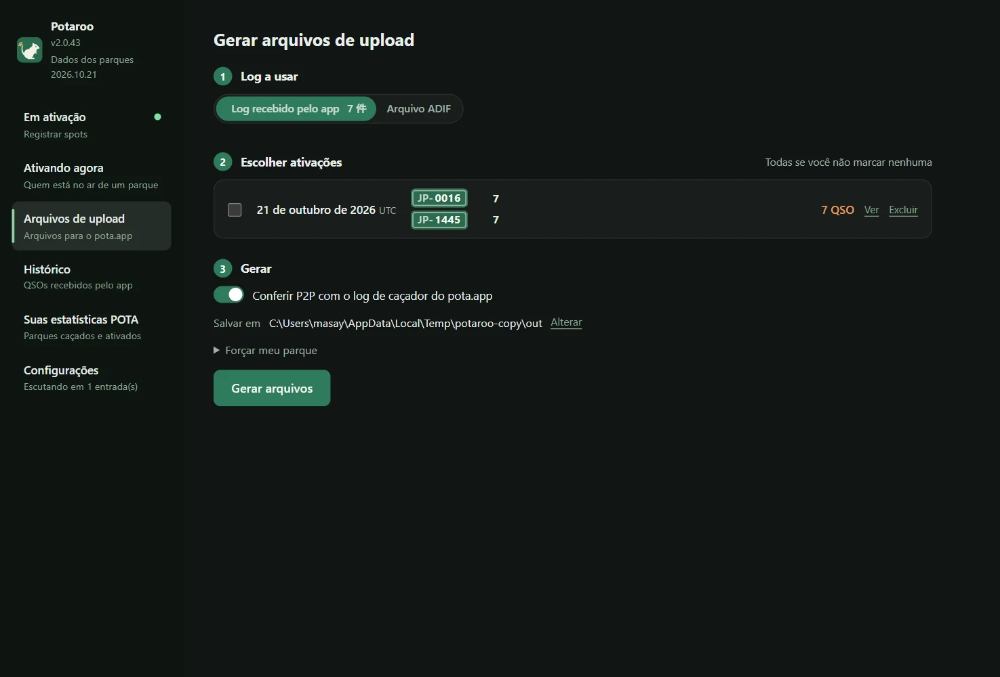
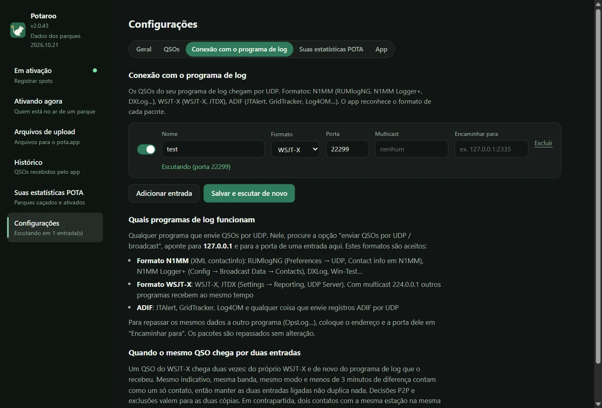

# Potaroo

*Antes POTA Upload Helper*

[日本語](README.md) · [English](README.en.md) · [简体中文](README.zh-CN.md) · [繁體中文](README.zh-TW.md) · [Français](README.fr.md) · [Deutsch](README.de.md) · [Español](README.es.md) · [Italiano](README.it.md) · [Português (Brasil)](README.pt-BR.md) · [한국어](README.ko.md) · [Polski](README.pl.md)

<a href="https://buymeacoffee.com/pudipara"></a>

Um app de desktop que ajuda nas ativações POTA (Parks on the Air), da hora de ir ao ar até o upload. Funciona em macOS e Windows.

Em FT8 e modos parecidos, na hora você não sabe se a outra estação está transmitindo de um parque, muito menos se é um 2fer. Durante a ativação, este app grava os spots do pota.app, cruza com os QSOs que chegam do programa de log na mesma hora e **sugere possíveis P2P (Park to Park) e 2fer, que você confirma e registra**. Ao terminar, gera para cada parque seu e cada data UTC arquivos prontos para subir no pota.app do jeito que estão.



## O que faz

### Antes de ir ao ar
- **É só digitar o parque e iniciar o registro**: ao digitar a referência, o app mostra o nome do parque, o local (província / estado) e qual é o número desta ativação. Para 2fer e 3fer, acrescente os parques com “Adicionar parque”.
- **Verificação do 2fer**: se os parques digitados não têm nenhuma província / estado em comum, ou se os dados do parque no pota.app dizem que eles não se sobrepõem, não dá para registrar como 2fer e o botão de iniciar fica desativado. Para um parque que abrange várias províncias / estados, escolha numa lista suspensa entre as regiões em comum (se houver só uma, ela é escolhida automaticamente).



### Durante a ativação
- **Tela da ativação**: um anel até 10 QSOs (passando de 10 vira /20, /30…), tempo decorrido, número de P2P e de “Pendentes”, ritmo da última hora e último QSO. Os QSOs e as estações no ar de parques aparecem em lista ou no mapa.
- **Barra**: um pequeno banner de notificação numa janela separada, sempre por cima, para deixar sobre o programa de log. Nela você vê o último QSO e resolve a confirmação de P2P (sim / não / “Pular”), enquanto a janela principal fica livre para ver outras páginas. A largura da barra se ajusta sozinha ao conteúdo.
- **QSOs do programa de log**: recebidos por UDP, como fazem o OpsLog e o JTAlert. Formato N1MM (RUMlogNG, N1MM Logger+, DXLog…), WSJT-X / JTDX (com multicast), ADIF (JTAlert, GridTracker, Log4OM…) e as notificações de alteração de QSO do QLog. No Windows também lê do Turbo HAMLOG em execução. Correções e exclusões feitas no programa de log são refletidas.
- **P2P confirmado na hora**: se a estação do QSO está no ar de um parque, a linha mostra “Possível P2P” com a referência, e você decide com “Sim, P2P” ou “Não”. Para uma estação que não está nos spots (em fonia ou CW, quando te passam o parque), digite a referência direto na linha. Nada vira P2P sozinho.
- **Distância e mapa**: mostra a distância em linha reta até o parque da outra estação, por exemplo “aprox. 820 km” (num 2fer, a partir do ponto médio entre os parques). A aba “Mapa” traça linhas da sua posição até os parques trabalhados em P2P. A unidade de distância pode ser km ou milhas.
- **Comemoração a cada 10 QSOs**: confete no momento em que a ativação é concluída e depois a cada 10 QSOs.
- **Encerrar gera os arquivos**: “Encerrar a ativação neste parque” grava na pasta escolhida o arquivo de upload do dia (`JL1FVA@JP-1266-20261020.adi`) e volta à primeira tela. Se a outra estação é um 2fer, o QSO é repetido para cada parque dela; se o 2fer é você, é gerado um arquivo por parque. Fechar o app durante uma ativação não a encerra: na próxima abertura o registro continua de onde parou (antes de fechar, o app pede confirmação).
- **Tempo e alertas**: ao começar o registro, o tempo do parque é verificado a cada 15 minutos; a barra e a janela principal avisam quando trovoadas, vento forte ou chuva intensa se aproximam. Para parques no Japão aparecem os avisos e alertas da JMA por município (trovoada e alertas numa faixa destacada), e a aba Tempo mostra as próximas horas. Ordens de evacuação vêm dos municípios e não são mostradas.
- **Shifts e eventos**: quando a Early Shift / Late Shift começa ou termina, a barra mostra um nascer do sol ou da lua. Durante eventos POTA como Support Your Parks, uma etiqueta avisa.
- **Diplomas ao alcance**: um QSO que atinge Rover, Unique Parks, Repeat Offender ou Kilo traz medalha e confete (o pota.app confirma depois que o log é enviado). Uma estação que chama de novo de outro parque ganha «da última vez de …» na linha.
- **Estações de clube e relógio**: uma estação de clube pode cadastrar operadores e trocá-los durante a ativação. Um aviso aparece se o relógio do computador diferir um minuto ou mais do pota.app (o P2P exige até 15 minutos entre os dois logs).

| Barra | Mapa |
|---|---|
|  |  |

### Outros
- **Ativando agora**: mesmo sem estar gravando, lista a partir dos spots do pota.app as estações no ar de parques neste momento (atualizada a cada minuto). Filtros: país e região, banda, modo, “Só 2fer ou mais”, “Só não caçados”, “Ocultar QRT”.
- **Histórico**: os QSOs recebidos pelo app, agrupados por dia; dá para excluir um por um.
- **Suas estatísticas POTA**: importando `hunter_parks.csv` / `activator_parks.csv` baixados do pota.app, você vê em lista e no mapa os parques que caçou e ativou. Os parques acrescentados por este app depois da importação aparecem em verde.
- **Arquivos de upload**: gera de uma vez os arquivos de dias passados a partir do log do app ou do ADIF do programa de log.
- **Exibição**: dá para mudar o tamanho do texto (Padrão / Maior / Muito grande) e as cores (Igual ao sistema / Claro / Escuro). As escolhas também valem para a barra.
- **Encaminhamento**: os dados recebidos podem ser repassados sem alteração para outro app (RUMlog → este app → OpsLog).
- **Dados dos parques atualizados todo mês**: a lista de parques e suas posições vêm no app e são atualizadas todo mês para a versão mais recente do pota.app (chegam como uma pequena atualização própria, separada da atualização do app).
- **Guia de início**: na primeira abertura, sete passos levam do indicativo aos arquivos. Abra de novo quando quiser em «Guia de início», no canto inferior esquerdo.
- **Progresso do 6 Pack**: Suas estatísticas POTA contam os parques ativados e trabalhados em P2P nos 6 m (pelo registro do app).

| Suas estatísticas POTA | Arquivos de upload |
|---|---|
|  |  |

O parque da outra estação é decidido nesta ordem:

1. **Log de caçador do pota.app** (o que a outra estação subiu = confirmado), cruzado a ±5 minutos na mesma banda
2. **Os parques confirmados ou digitados durante a ativação** (ao gerar do log do app). QSOs não confirmados não viram P2P
3. **Spots gravados durante a ativação** (só ao gerar de um arquivo ADIF; spots de 30 minutos antes até 10 minutos depois do QSO)
4. SIG_INFO / POTA_REF do programa de log

Só lê dados que o pota.app torna públicos (api.pota.app), sem login (e sem suporte oficial do POTA). Guardar o log é trabalho do programa de log: este app só julga e gera os arquivos de upload, e nunca altera o log do programa de log.

## Download

Baixe a versão mais recente em [Releases](../../releases).

| SO | Arquivo | Como usar |
|---|---|---|
| macOS (Apple Silicon) | `Potaroo-macOS.dmg` | Abra e arraste `Potaroo` para `Applications` |
| Windows 10 / 11 | `Potaroo-Setup.exe` | Ao executar, instala na pasta do usuário (sem precisar de administrador) e aparece no menu Iniciar |

Os zips (`Potaroo-macOS.zip` / `Potaroo-Windows.zip`) também vão anexados. A atualização de dentro do app usa esses zips, então não os apague da Release.

O app não é assinado, por isso a primeira abertura mostra um aviso.

- **macOS**: clique direito no app → “Abrir” → “Abrir”. Se não abrir, vá em “Ajustes do Sistema → Privacidade e Segurança” e, mais embaixo, clique em “Abrir Mesmo Assim”
- **Windows**: “O Windows protegeu o computador” → “Mais informações” → “Executar mesmo assim”

**Da segunda vez em diante, o app se atualiza por dentro.** Ao iniciar, ele verifica se há versão nova; quando aparecer o aviso, aperte “Atualizar agora”: ele baixa, substitui e reinicia. Você pode verificar a qualquer hora em “Configurações → App”. Se você abre o app direto do DMG (sem colocar em `Applications`), o macOS não permite a troca: o novo app fica na pasta Downloads e o app avisa. Um app instalado com o nome antigo (POTA Upload Helper) é renomeado para Potaroo na primeira abertura depois da atualização (no Windows os atalhos também são refeitos).

## Conexão com o programa de log

Crie as entradas em “Configurações → Conexão com o programa de log” (quantas quiser). **Serve qualquer programa de log que envie QSOs por UDP.** No programa de log, abra a opção “enviar QSOs por UDP” e aponte para `127.0.0.1` e para a mesma porta da entrada. O app reconhece sozinho o formato dos pacotes recebidos.



| Formato | Programas de exemplo | Onde configurar |
|---|---|---|
| N1MM (XML contactinfo) | RUMlogNG, N1MM Logger+, DXLog, Win-Test | RUMlogNG: Preferences → UDP, Contact info em N1MM. N1MM Logger+: Config → Broadcast Data → Contacts |
| WSJT-X | WSJT-X, JTDX | Settings → Reporting, UDP Server. Com `224.0.0.1` (multicast) outros apps recebem ao mesmo tempo |
| ADIF | JTAlert, GridTracker, Log4OM… | a opção “enviar ADIF por UDP” de cada programa |
| QLog (JSON) | QLog | Settings → Network → Notifications, em **QSO Changes** coloque `127.0.0.1:porta` |
| Turbo HAMLOG (Windows) | Turbo HAMLOG/Win | Escolha o formato “Turbo HAMLOG” na entrada. Não precisa de porta: lê do HAMLOG em execução (inclusive QSOs que vêm pelo JT_Linker ou JT-Get's) |

QSOs corrigidos ou excluídos no programa de log também são refletidos no app. Verificados no Windows 11: WSJT-X, Log4OM 2, Turbo HAMLOG, QLog, N1MM Logger+ (recepção de CW, SSB e FT8, além de correções e exclusões).

**Só programas de log do mesmo computador conseguem enviar.** As entradas escutam em `127.0.0.1`, então um programa de log em outro PC não as alcança.

**Multicast do WSJT-X / JTDX no Windows**: no Windows a entrada multicast também escuta no loopback (`127.0.0.1`). No WSJT-X, em Settings → Reporting → **Outgoing interfaces**, inclua **loopback**. Essa combinação foi verificada no Windows 11. Se nada chegar, avise numa [issue](../../issues), isso ajuda muito. Sem multicast, colocando o UDP Server do WSJT-X em `127.0.0.1`, a recepção é garantida (mas aí outros apps não recebem ao mesmo tempo).

**Configuração dos programas de log usados junto com o WSJT-X** (verificada no Windows 11; mesmo misturando CW, SSB e FM no meio do FT8, cada QSO entra certo, um por um):

| Programa de log | Recepção do WSJT-X | Envio ao app |
|---|---|---|
| JT_Linker + Turbo HAMLOG | O JT_Linker lê o arquivo de log do WSJT-X e registra no HAMLOG | entrada “Turbo HAMLOG” |
| N1MM Logger+ | Config → Configure Ports → WSJT/JTDX Setup, habilite o Radio #1 (em unicast `127.0.0.1`, em multicast `224.0.0.1`, porta 2237) | Broadcast Data → Contacts em `127.0.0.1:porta da entrada` |
| QLog | Settings → Network, Wsjtx Port 2237 (em multicast, ative Join Multicast e coloque `224.0.0.1` em Multicast Address) | Notifications → QSO Changes em `127.0.0.1:porta da entrada` |

Os QSOs do WSJT-X também chegam direto ao app (por uma entrada WSJT-X) e são juntados num só com os que vêm pelo programa de log. Ao distribuir por multicast para vários programas ao mesmo tempo, atenção ao seguinte.

- **Inicie o QLog e o N1MM antes dos outros programas.** Eles não abrem a porta 2237 de forma compartilhada com outros programas: se forem iniciados depois, a porta fica “em uso” e eles não recebem.
- **O Turbo HAMLOG também abre a porta 2237.** Usado junto com o JT_Linker, o HAMLOG pode perguntar se deve registrar um “segundo QSO”: nesse caso, responda “Não”. Ele não pode ser usado junto com o QLog ou o N1MM (o HAMLOG dá erro se for iniciado depois).

Para passar os mesmos dados também a outro app (OpsLog…), coloque o endereço e a porta dele em “Encaminhar para” na entrada.

**Com as duas ligadas, nada é contado em dobro**: um QSO do WSJT-X chega duas vezes, direto do WSJT-X e do programa de log que o recebeu e reenviou (com cerca de um minuto de diferença entre hora de início e hora de fim). Mesmo indicativo, mesma banda, mesmo modo e menos de 3 minutos de diferença = um só QSO; decisões de P2P e exclusões valem para os dois. Em contrapartida, dois QSOs com a mesma estação, na mesma banda e no mesmo modo em menos de 3 minutos também viram um só.

## Onde ficam os dados

| SO | Local |
|---|---|
| macOS | `~/Library/Application Support/Potaroo/` |
| Windows | `%APPDATA%\Potaroo\` |

`qsolog.db` (QSOs recebidos), `spots-YYYYMMDD.jsonl` (spots gravados), `sessions.json` (horários das suas ativações e parques), `hunter.json` (cópia do log de caçador), `mypota.json` (CSVs de estatísticas importados), `settings.json`, `potaroo.log` (registro de erros).
O perfil público do pota.app mostra só os últimos 25 QSOs do log de caçador, então o app os acrescenta ao `hunter.json` durante o registro e a cada geração de arquivos, para acumular o histórico. Os dados internos, como os QSOs recebidos, ficam guardados até você excluí-los (um por um em “Histórico”, todos de uma vez em “Configurações → App → Dados do app”).

## Relatar problemas

Ao apertar “Configurações → App → Relatar um problema”, abre-se um texto de relato com a versão, o sistema operacional e o final do log de erros. Confira e edite, depois aperte “Copiar” para mandar por e-mail ou outro meio, ou “Relatar no GitHub” para abrir a página de criação de uma [issue](../../issues) (relatos no GitHub são públicos). O app não envia nada sozinho. O log contém indicativos e referências de parques.

## Idiomas

日本語, English, 简体中文, 繁體中文, Français, Deutsch, Español, Italiano, Português (Brasil), 한국어, Polski. O idioma é escolhido automaticamente pelo idioma do sistema e pode ser trocado em “Idioma” nas “Configurações”.

## Termos de uso e isenção de responsabilidade

Este app é um software amador feito por uma pessoa como hobby e fornecido sem nenhuma garantia. **O autor não se responsabiliza por nenhum dano decorrente do uso deste app (upload de conteúdo errado ao pota.app, QSOs duplicados ou perdidos, perda de logs ou arquivos, efeitos no programa de log ou nas configurações de rede etc.).** Sempre confira você mesmo o conteúdo dos arquivos antes de subir. A detecção de P2P e 2fer é uma estimativa, e sua exatidão não é garantida. Este app não tem vínculo com Parks on the Air® nem com o pota.app. O texto completo está em [TERMS.md](TERMS.md) e também é mostrado na primeira abertura do app.

Para relatar vulnerabilidades, veja [SECURITY.md](SECURITY.md).

## Rodar a partir do código-fonte

```sh
pip install -r requirements.txt
python3 app.py
```

Também funciona só pela linha de comando (apenas biblioteca padrão).

```sh
python3 pota_spotlog.py --parks JP-1266,JP-1206
python3 pota_build.py export.adif --date 20261020
```

## Desenvolvimento

```sh
scripts/dev.sh                                  # cria um venv e inicia (dados em ./data, o log real não é tocado)
scripts/dev.sh --debug                          # com as ferramentas de desenvolvedor
scripts/send_test_qso.py 22237 JA1XYZ           # envia um QSO de teste à entrada de desenvolvimento (nunca para a 2237)
python3 -m unittest discover -s tests
```

Para mudanças, crie um branch e abra um Pull Request. A cada PR os testes rodam em macOS e Windows; ao fazer merge em `main`, o GitHub Actions gera as versões dos dois sistemas e anexa à Release `v<VERSION>` (`VERSION` em `potacommon.py`). Em `scripts/` há, entre outros, `copy_instance.py`, que abre um segundo app com uma cópia dos dados, `check_align.mjs`, que confere a posição dos textos na tela, e `readme_shots.mjs`, que tira as imagens deste README.

## License

MIT

Para as bandeiras, vem incluída a fonte do [country-flag-emoji-polyfill](https://github.com/talkjs/country-flag-emoji-polyfill) (MIT), que contém só as bandeiras do Twemoji (CC-BY 4.0). O mapa usa o [Leaflet](https://leafletjs.com/) (BSD-2-Clause) e tiles de © [OpenStreetMap](https://www.openstreetmap.org/copyright) contributors. Dados do tempo do [Open-Meteo](https://open-meteo.com/) (CC BY 4.0). Avisos para parques no Japão: agência meteorológica do Japão (fonte: site da JMA); o município do parque: geocodificador reverso do GSI.
