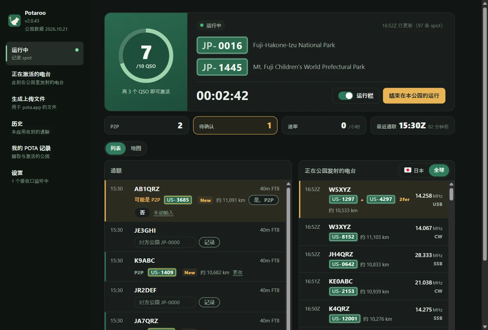
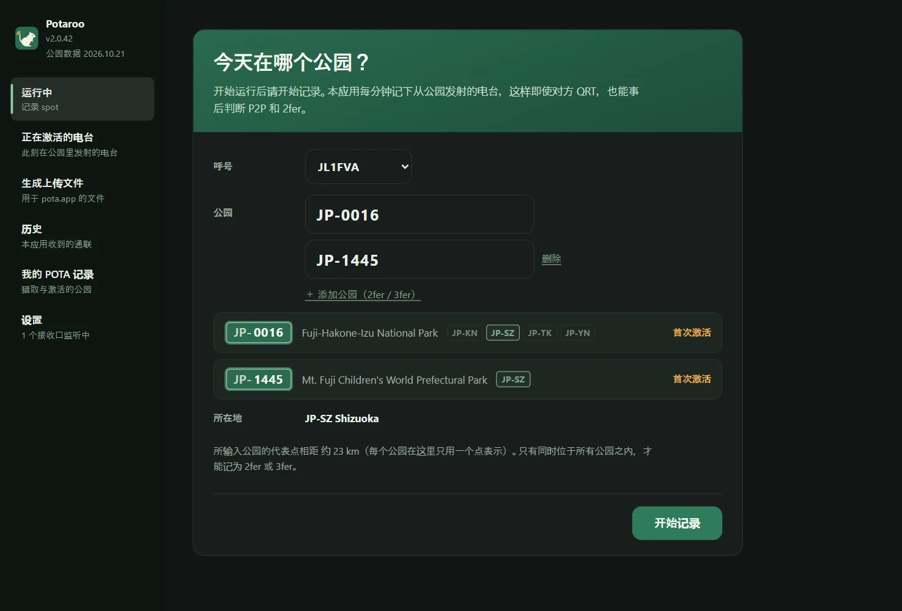
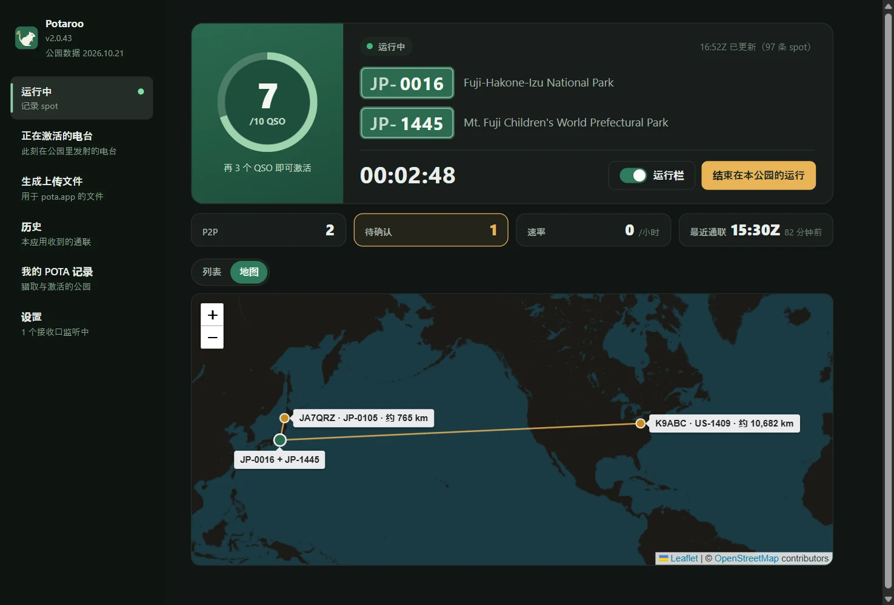
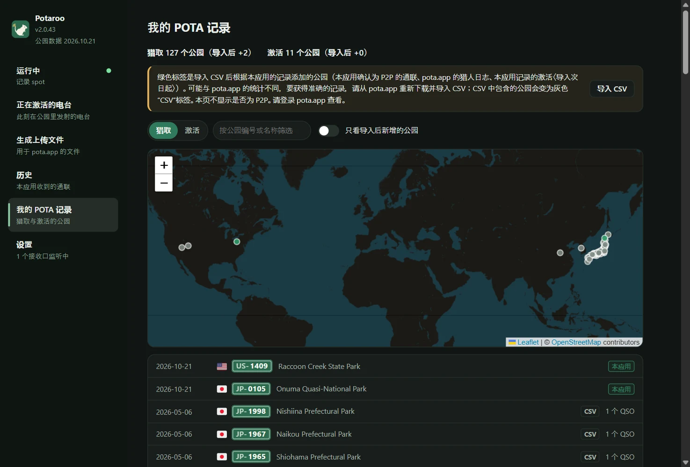
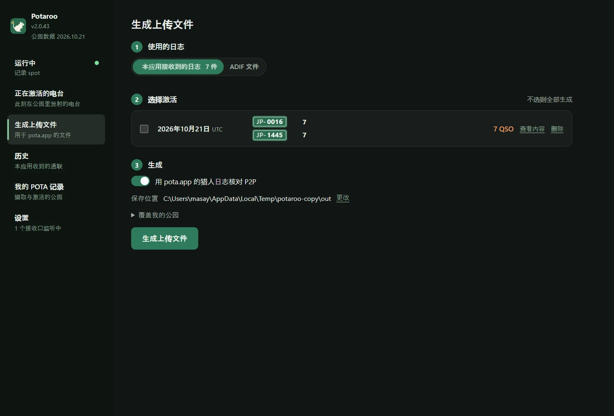
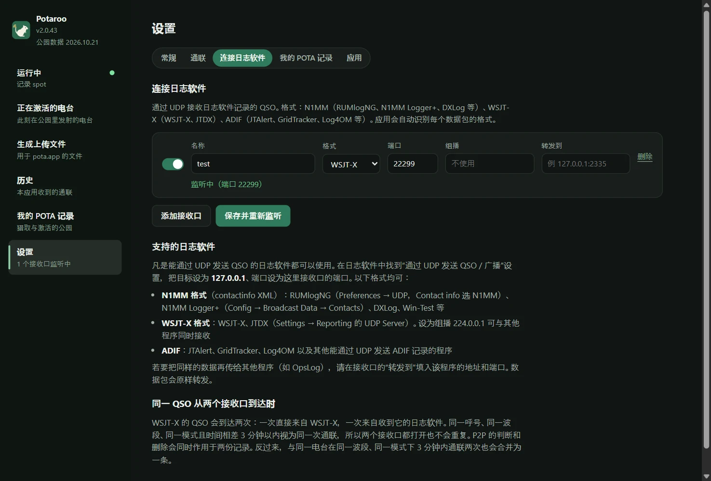

# Potaroo

*旧名：POTA Upload Helper*

[日本語](README.md) · [English](README.en.md) · [简体中文](README.zh-CN.md) · [繁體中文](README.zh-TW.md) · [Français](README.fr.md) · [Deutsch](README.de.md) · [Español](README.es.md) · [Italiano](README.it.md) · [Português (Brasil)](README.pt-BR.md) · [한국어](README.ko.md) · [Polski](README.pl.md)

<a href="https://buymeacoffee.com/pudipara"></a>

一款桌面应用，在 POTA（Parks on the Air）激活中从运行一直帮到上传。支持 macOS 和 Windows。

在 FT8 等模式下，当场很难知道对方是否在公园里，更不用说是不是 2fer。本应用在运行期间记录 pota.app 的 spot，与日志软件发来的 QSO 当场比对，**给出 P2P（Park to Park）和 2fer 的候选，由你确认后记录**。运行结束后，按自己的公园和 UTC 日期生成可直接上传到 pota.app 的文件。



## 功能

### 运行之前
- **输入公园即可开始记录**：输入公园编号后，会显示公园名称、所在地（省/州）以及这是第几次激活。2fer、3fer 用“添加公园”依次列出。
- **2fer 检查**：所输入的公园没有共同的省/州，或 pota.app 的公园信息注明“不重叠”时，无法作为 2fer 记录，开始按钮会变为不可用。跨越多个省/州的公园，从只含共同地区的下拉列表中选择（只有一个时自动确定）。



### 运行中
- **运行中的画面**：显示到 10 QSO 的进度环（超过 10 后为 /20、/30…）、经过时间、P2P 与待确认的数量、最近 1 小时的速率和最后一次通联。通联和正在公园发射的电台可以用列表或地图查看。
- **运行栏**：把一个小通知栏作为单独窗口置顶，放在日志软件上方。最新的通联和 P2P 确认（是、否、跳过）都能在这里完成，主窗口则可以用来查看其他页面。运行栏的宽度会根据内容自动调整。
- **从日志软件接收 QSO**：和 OpsLog、JTAlert 一样通过 UDP 接收。支持 N1MM 格式（RUMlogNG、N1MM Logger+、DXLog 等）、WSJT-X / JTDX（支持组播）、ADIF（JTAlert、GridTracker、Log4OM 等），以及 QLog 的 QSO 变更通知。在 Windows 上还能读取正在运行的 Turbo HAMLOG。日志软件中的修改和删除也会同步。
- **当场确认 P2P**：收到的 QSO 中，对方若正在公园发射，该行会显示“可能是 P2P”和公园编号，用“是”“否”决定。对方不在 spot 上时（Phone 或 CW 中口头得知公园编号），直接在该行输入公园编号。不会自动记为 P2P。
- **距离和地图**：以“约 820 km”的形式显示到对方公园的直线距离（2fer 从各公园的中间点算起）。地图标签页以自己的位置为中心，向已 P2P 的公园画线。距离单位可选 km 或英里。
- **每 10 QSO 庆祝一次**：激活成功的那一刻，以及之后每 10 个 QSO，都会撒彩纸提醒。
- **结束即生成文件**：按“结束在本公园的运行”，就会把当天的上传文件（`JL1FVA@JP-1266-20261020.adi`）写到保存位置，并回到初始画面。对方是 2fer 时按公园数复制 QSO；自己是 2fer 时按公园分别生成文件。运行中关闭应用不会结束运行，下次启动时会接着记录（关闭前会弹出确认）。

| 运行栏 | 地图 |
|---|---|
|  |  |

### 其他
- **正在激活的电台**：即使没有在记录，也能根据 pota.app 的 spot 列出此刻正在公园发射的电台（每分钟更新）。可按国家和地区、波段、模式、只看 2fer 以上、只看未猎、隐藏 QRT 筛选。
- **历史**：按日期列出本应用收到的通联，可逐条删除。
- **我的 POTA 记录**：导入从 pota.app 下载的 `hunter_parks.csv` / `activator_parks.csv` 后，可以用列表和地图查看猎取、激活过的公园。导入后在本应用中新增的公园以绿色显示。
- **生成上传文件**：可以从应用日志或日志软件的 ADIF 批量生成过去日期的文件。
- **显示**：可更改文字大小（标准、较大、特大）和配色（跟随系统、浅色、深色），运行栏也会同步。
- **转发**：收到的数据可以原样转给其他程序（RUMlog → 本应用 → OpsLog）。
- **公园数据每月更新**：公园列表和位置内置在应用中，每月更新为 pota.app 的最新版本（作为与应用更新分开的小更新送达）。

| 我的 POTA 记录 | 生成上传文件 |
|---|---|
|  |  |

对方的公园按以下优先顺序确定：

1. **pota.app 猎人日志**（对方上传的记录 = 确定）。按时间 ±5 分钟、同一波段比对
2. **运行中确认或输入的公园**（从应用日志生成时）。未确认的 QSO 不记为 P2P
3. **运行中的 spot 记录**（仅从 ADIF 文件生成时。QSO 前 30 分钟到后 10 分钟的 spot）
4. 日志软件的 SIG_INFO / POTA_REF

只读取 pota.app 公开的数据（api.pota.app），无需登录（未获得 POTA 的官方支持）。保存日志是日志软件的工作。本应用只负责判断和生成上传文件，不会改写日志软件的日志。

## 下载

请从 [Releases](../../releases) 获取最新版。

| 系统 | 文件 | 用法 |
|---|---|---|
| macOS（Apple Silicon） | `Potaroo-macOS.dmg` | 打开后把 `Potaroo` 拖到 `Applications` |
| Windows 10 / 11 | `Potaroo-Setup.exe` | 运行后安装到当前用户的目录（无需管理员权限），并加入开始菜单 |

同时附有 zip 版（`Potaroo-macOS.zip` / `Potaroo-Windows.zip`）。应用内更新使用这些 zip，请不要从 Release 中删除。

应用未签名，首次打开时会出现警告。

- **macOS**：右键点击应用 →“打开”→“打开”。仍无法打开时，到“系统设置 → 隐私与安全性”靠下的位置点“仍要打开”
- **Windows**：“Windows 已保护你的电脑”→“更多信息”→“仍要运行”

**之后可以在应用内更新。** 启动时会检查是否有新版本，出现提示时按“立即更新”，应用会下载、替换并重新启动。随时都可以在“设置 → 应用”中检查。如果直接打开 DMG 里的应用（没有放进 `Applications`），由于 macOS 的机制无法替换，新版本会放到“下载”文件夹并提示你。仍以旧名（POTA Upload Helper）安装的应用，会在更新后的首次启动时改名为 Potaroo（Windows 上也会同时更新快捷方式）。

## 连接日志软件

在“设置 → 连接日志软件”中创建接收口（数量不限）。**只要能通过 UDP 发送 QSO 的日志软件都可以使用。** 在日志软件中打开“通过 UDP 发送 QSO”的设置，目标设为 `127.0.0.1`，端口与接收口相同。应用会自动识别收到的数据包格式。



| 格式 | 日志软件示例 | 设置位置 |
|---|---|---|
| N1MM（contactinfo XML） | RUMlogNG、N1MM Logger+、DXLog、Win-Test | RUMlogNG：Preferences → UDP，Contact info 选 N1MM。N1MM Logger+：Config → Broadcast Data → Contacts |
| WSJT-X | WSJT-X、JTDX | Settings → Reporting 的 UDP Server。设为 `224.0.0.1`（组播）可与其他程序同时接收 |
| ADIF | JTAlert、GridTracker、Log4OM 等 | 各软件的“通过 UDP 发送 ADIF”设置 |
| QLog（JSON） | QLog | 在 Settings → Network → Notifications 的 **QSO Changes** 中填入 `127.0.0.1:端口` |
| Turbo HAMLOG（Windows） | Turbo HAMLOG/Win | 把接收口的格式设为“Turbo HAMLOG”。无需端口，直接读取正在运行的 HAMLOG（包括经由 JT_Linker、JT-Get's 的 QSO） |

在日志软件中修改或删除的 QSO 也会同步到应用。已在 Windows 11 上验证的有 WSJT-X、Log4OM 2、Turbo HAMLOG、QLog、N1MM Logger+（CW、SSB、FT8 的接收以及修改和删除）。

**只能接收同一台电脑上的日志软件。** 接收口在 `127.0.0.1` 上监听，其他电脑上的日志软件发不过来。

**在 Windows 上使用 WSJT-X / JTDX 组播时**：Windows 上组播接收口也在回环地址（`127.0.0.1`）上监听。请在 WSJT-X 的 Settings → Reporting → **Outgoing interfaces** 中包含 **loopback**。这种组合已在 Windows 11 上验证。如果收不到，欢迎通过 [Issue](../../issues) 告诉我们。不用组播、把 WSJT-X 的 UDP Server 设为 `127.0.0.1` 的方法一定能收到（但这样就无法与其他程序同时接收）。

**与 WSJT-X 一起使用的日志软件设置**（已在 Windows 11 上验证。即使在 FT8 中间穿插 CW、SSB、FM，也会逐条正确录入）：

| 日志软件 | 从 WSJT-X 接收 | 如何传给本应用 |
|---|---|---|
| JT_Linker + Turbo HAMLOG | JT_Linker 读取 WSJT-X 的日志文件并录入 HAMLOG | 接收口“Turbo HAMLOG” |
| N1MM Logger+ | Config → Configure Ports → WSJT/JTDX Setup 中启用 Radio #1（单播用 `127.0.0.1`，组播用 `224.0.0.1`，端口 2237） | Broadcast Data → Contacts 设为 `127.0.0.1:接收口端口` |
| QLog | Settings → Network 的 Wsjtx Port 设为 2237（组播时打开 Join Multicast，并在 Multicast Address 中填 `224.0.0.1`） | Notifications → QSO Changes 设为 `127.0.0.1:接收口端口` |

WSJT-X 的 QSO 也会直接送到本应用（WSJT-X 的接收口），与经由日志软件的那条合并为一条。用组播同时分发给多个软件时，请注意以下几点。

- **请先于其他软件启动 QLog 和 N1MM。** 它们不会以与其他软件共享的方式打开 2237 端口，后启动会显示“已被占用”而无法接收。
- **Turbo HAMLOG 也会打开 2237 端口。** 与 JT_Linker 一起使用时，HAMLOG 有时会把它当作“第二次 QSO”询问是否录入，这时请选“否”。它不能与 QLog、N1MM 同时使用（后启动的 HAMLOG 会报错）。

若要把同样的数据也传给其他程序（如 OpsLog），在接收口的“转发到”中填入该程序的地址和端口。

**两个都打开也不会重复**：WSJT-X 的 QSO 会到达两次，一次直接来自 WSJT-X，一次来自收到它后再转发的日志软件（开始时间和结束时间约相差 1 分钟）。同一呼号、同一波段、同一模式且时间相差 3 分钟以内，视为同一次通联合并为一条，P2P 判断和删除也会同时作用于两者。反过来，与同一电台在同一波段、同一模式下 3 分钟内通联两次，也会合并为一条。

## 数据保存位置

| 系统 | 位置 |
|---|---|
| macOS | `~/Library/Application Support/Potaroo/` |
| Windows | `%APPDATA%\Potaroo\` |

`qsolog.db`（收到的 QSO）、`spots-YYYYMMDD.jsonl`（spot 记录）、`sessions.json`（自己的运行时段和公园）、`hunter.json`（猎人日志的副本）、`mypota.json`（导入的记录 CSV）、`settings.json`、`potaroo.log`（错误记录）。
pota.app 公开资料页上只显示最近 25 条猎人日志，因此应用在记录中和每次生成文件时都会追加到 `hunter.json`，以积累历史。收到的通联等内部数据，只要不删除就会一直保留（可在“历史”中逐条删除，或在“设置 → 应用 → 内部数据”中一次性删除）。

## 报告问题

按“设置 → 应用 → 报告问题”，会打开一份包含版本、操作系统和日志末尾部分的报告。确认并编辑内容后，可以“复制”后通过邮件等发送，或用“在 GitHub 报告”打开 [Issue](../../issues) 的创建页面（GitHub 上的报告是公开的）。应用不会自动发送任何内容。日志中包含呼号和公园编号。

## 语言

日本語、English、简体中文、繁體中文、Français、Deutsch、Español、Italiano、Português (Brasil)、한국어、Polski。按操作系统的语言自动选择，可在“设置”的“语言”中切换。

## 使用条款与免责声明

本应用是个人出于爱好开发、不提供任何保证的软件。**对于因使用本应用而造成的任何损失（向 pota.app 上传了错误内容、QSO 重复或缺失、日志或文件丢失、对日志软件或网络设置的影响等），作者概不负责。** 请务必自行检查要上传的文件内容。P2P 与 2fer 的判断只是推测，不保证正确。本应用与 Parks on the Air® 及 pota.app 无关。全文见 [TERMS.md](TERMS.md)，应用首次启动时也会显示。

报告安全漏洞请见 [SECURITY.md](SECURITY.md)。

## 从源码运行

```sh
pip install -r requirements.txt
python3 app.py
```

也可以只用命令行（仅需标准库）。

```sh
python3 pota_spotlog.py --parks JP-1266,JP-1206
python3 pota_build.py export.adif --date 20261020
```

## 开发

```sh
scripts/dev.sh                                  # 创建 venv 并启动（数据保存在 ./data，不碰正式日志）
scripts/dev.sh --debug                          # 带开发者工具
scripts/send_test_qso.py 22237 JA1XYZ           # 向开发用接收口发送测试 QSO（不发到 2237）
python3 -m unittest discover -s tests
```

修改请新建分支并提交 Pull Request。每个 PR 都会在 macOS / Windows 上运行测试；合并到 `main` 后，GitHub Actions 会构建两个系统的版本并附加到 Release `v<VERSION>`（`potacommon.py` 中的 `VERSION`）。`scripts/` 中还有用数据副本启动第二个应用实例的 `copy_instance.py`、检查画面文字位置的 `check_align.mjs`、拍摄本 README 图片的 `readme_shots.mjs` 等。

## License

MIT

国旗显示使用了随附的 [country-flag-emoji-polyfill](https://github.com/talkjs/country-flag-emoji-polyfill)（MIT）字体，其中只收录了 Twemoji（CC-BY 4.0）的国旗。地图使用 [Leaflet](https://leafletjs.com/)（BSD-2-Clause）和 © [OpenStreetMap](https://www.openstreetmap.org/copyright) contributors 的地图瓦片。天气数据来自 [Open-Meteo](https://open-meteo.com/)（CC BY 4.0）。日本公园的注意报与警报来自日本气象厅（出处：气象厅网站），公园所在市町村使用国土地理院的逆地理编码。
