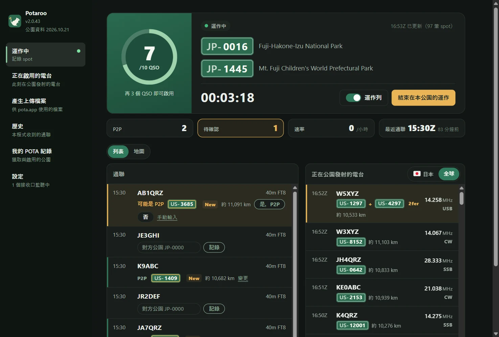
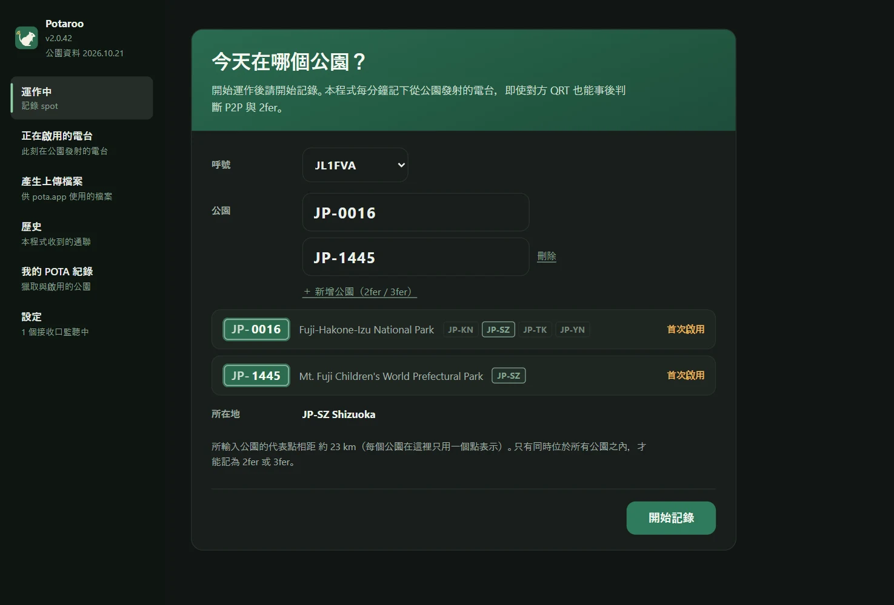
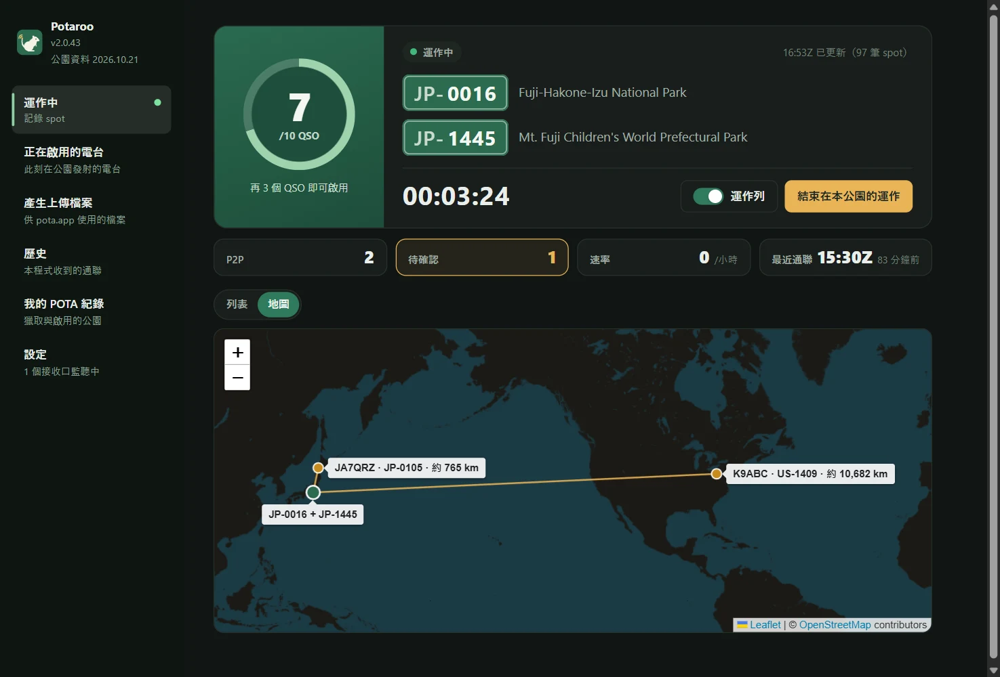
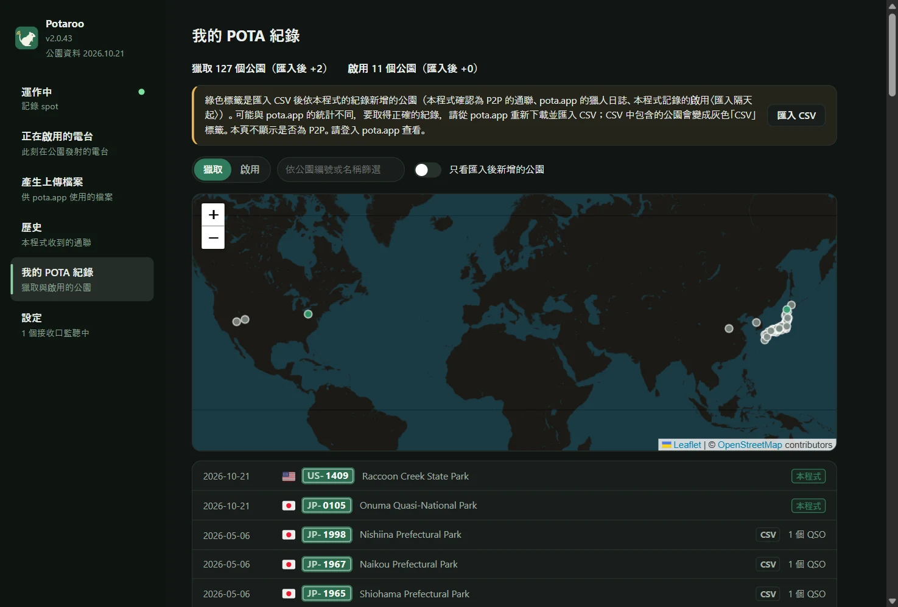
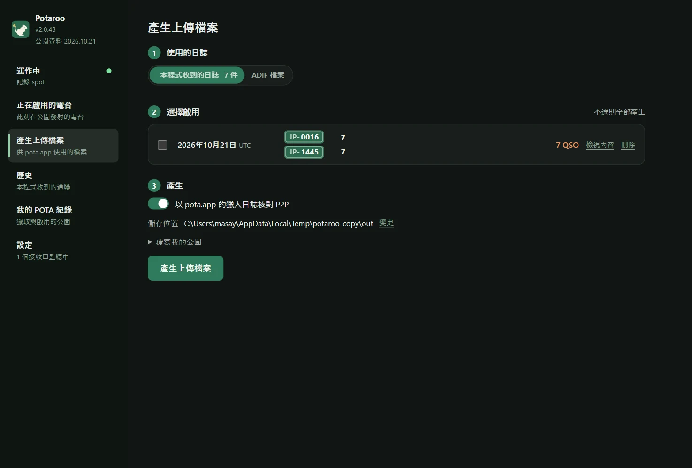
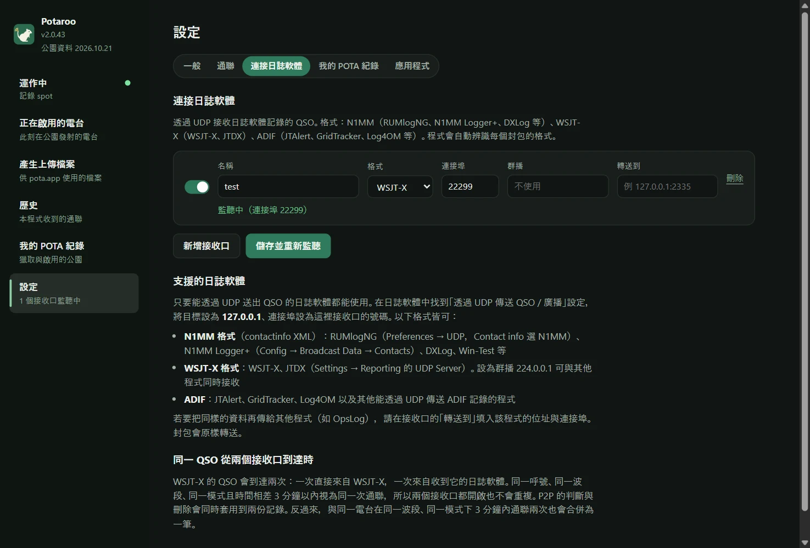

# Potaroo

*舊名：POTA Upload Helper*

[日本語](README.md) · [English](README.en.md) · [简体中文](README.zh-CN.md) · [繁體中文](README.zh-TW.md) · [Français](README.fr.md) · [Deutsch](README.de.md) · [Español](README.es.md) · [Italiano](README.it.md) · [Português (Brasil)](README.pt-BR.md) · [한국어](README.ko.md) · [Polski](README.pl.md)

<a href="https://buymeacoffee.com/pudipara"></a>

一款桌面程式，在 POTA（Parks on the Air）啟用時從運作一路協助到上傳。支援 macOS 與 Windows。

在 FT8 等模式下，當場很難知道對方是否在公園，更別說是不是 2fer。本程式在運作期間記錄 pota.app 的 spot，與日誌軟體送來的 QSO 當場比對，**提出 P2P（Park to Park）與 2fer 的候選，由你確認後記錄**。運作結束後，依自己的公園與 UTC 日期產生可直接上傳到 pota.app 的檔案。



## 功能

### 運作之前
- **輸入公園即可開始記錄**：輸入公園編號後，會顯示公園名稱、所在地（縣/州）以及這是第幾次啟用。2fer、3fer 用「新增公園」依序列出。
- **2fer 檢查**：輸入的公園沒有共同的縣/州，或 pota.app 的公園資訊註明「不重疊」時，無法以 2fer 記錄，開始按鈕會變成無法按下。跨越多個縣/州的公園，從只含共同地區的下拉選單中選擇（只有一個時自動決定）。



### 運作中
- **運作中的畫面**：顯示到 10 QSO 的進度環（超過 10 後為 /20、/30…）、經過時間、P2P 與待確認的數量、最近 1 小時的速率與最後一次通聯。通聯與正在公園發射的電台可以用列表或地圖檢視。
- **運作列**：把一個小通知列以獨立視窗置頂，放在日誌軟體上方。最新的通聯與 P2P 確認（是、否、略過）都能在這裡完成，主視窗則可用來查看其他頁面。運作列的寬度會依內容自動調整。
- **從日誌軟體接收 QSO**：和 OpsLog、JTAlert 一樣透過 UDP 接收。支援 N1MM 格式（RUMlogNG、N1MM Logger+、DXLog 等）、WSJT-X / JTDX（支援群播）、ADIF（JTAlert、GridTracker、Log4OM 等），以及 QLog 的 QSO 變更通知。在 Windows 上也能讀取執行中的 Turbo HAMLOG。日誌軟體中的修改與刪除也會同步。
- **當場確認 P2P**：收到的 QSO 中，對方若正在公園發射，該列會顯示「可能是 P2P」與公園編號，以「是」「否」決定。對方不在 spot 上時（Phone 或 CW 中口頭得知公園編號），直接在該列輸入公園編號。不會自動記為 P2P。
- **距離與地圖**：以「約 820 km」的形式顯示到對方公園的直線距離（2fer 從各公園的中間點算起）。地圖分頁以自己的位置為中心，向已 P2P 的公園畫線。距離單位可選 km 或英里。
- **每 10 QSO 慶祝一次**：啟用成功的那一刻，以及之後每 10 個 QSO，都會灑彩紙通知。
- **結束即產生檔案**：按「結束在本公園的運作」，就會把當天的上傳檔案（`JL1FVA@JP-1266-20261020.adi`）寫到儲存位置，並回到初始畫面。對方是 2fer 時依公園數複製 QSO；自己是 2fer 時依公園分別產生檔案。運作中關閉程式不會結束運作，下次啟動時會接著記錄（關閉前會跳出確認）。

| 運作列 | 地圖 |
|---|---|
|  |  |

### 其他
- **正在啟用的電台**：即使沒有在記錄，也能依 pota.app 的 spot 列出此刻正在公園發射的電台（每分鐘更新）。可依國家與地區、波段、模式、只看 2fer 以上、只看未獵、隱藏 QRT 篩選。
- **歷史**：依日期列出本程式收到的通聯，可逐筆刪除。
- **我的 POTA 紀錄**：匯入從 pota.app 下載的 `hunter_parks.csv` / `activator_parks.csv` 後，可以用列表與地圖檢視獵取、啟用過的公園。匯入後在本程式中新增的公園以綠色標示。
- **產生上傳檔案**：可以從程式日誌或日誌軟體的 ADIF 批次產生過去日期的檔案。
- **顯示**：可變更文字大小（標準、較大、特大）與配色（跟隨系統、淺色、深色），運作列也會套用。
- **轉送**：收到的資料可以原樣轉給其他程式（RUMlog → 本程式 → OpsLog）。
- **公園資料每月更新**：公園清單與位置內建在程式中，每月更新為 pota.app 的最新版本（以有別於程式更新的小型更新送達）。

| 我的 POTA 紀錄 | 產生上傳檔案 |
|---|---|
|  |  |

對方的公園依以下優先順序決定：

1. **pota.app 獵人日誌**（對方上傳的紀錄 = 確定）。依時間 ±5 分鐘、同一波段比對
2. **運作中確認或輸入的公園**（從程式日誌產生時）。未確認的 QSO 不記為 P2P
3. **運作中的 spot 紀錄**（僅從 ADIF 檔產生時。QSO 前 30 分鐘到後 10 分鐘的 spot）
4. 日誌軟體的 SIG_INFO / POTA_REF

只讀取 pota.app 公開的資料（api.pota.app），不需登入（未獲得 POTA 的官方支援）。保存日誌是日誌軟體的工作。本程式只負責判斷與產生上傳檔案，不會改寫日誌軟體的日誌。

## 下載

請從 [Releases](../../releases) 取得最新版。

| 系統 | 檔案 | 用法 |
|---|---|---|
| macOS（Apple Silicon） | `Potaroo-macOS.dmg` | 開啟後把 `Potaroo` 拖到 `Applications` |
| Windows 10 / 11 | `Potaroo-Setup.exe` | 執行後安裝到目前使用者的位置（不需系統管理員權限），並加入開始功能表 |

同時附有 zip 版（`Potaroo-macOS.zip` / `Potaroo-Windows.zip`）。程式內更新會使用這些 zip，請勿從 Release 刪除。

程式未經簽署，首次開啟時會出現警告。

- **macOS**：在程式上按右鍵 →「打開」→「打開」。仍無法開啟時，到「系統設定 → 隱私權與安全性」靠下方的位置按「仍要打開」
- **Windows**：「Windows 已保護您的電腦」→「其他資訊」→「仍要執行」

**之後可以在程式內更新。** 啟動時會檢查是否有新版本，出現通知時按「立即更新」，程式會下載、替換並重新啟動。隨時都可以在「設定 → 應用程式」中檢查。如果直接開啟 DMG 裡的程式（沒有放進 `Applications`），因 macOS 的機制無法替換，新版本會放到「下載項目」資料夾並通知你。仍以舊名（POTA Upload Helper）安裝的程式，會在更新後第一次啟動時改名為 Potaroo（Windows 也會一併更新捷徑）。

## 連接日誌軟體

在「設定 → 連接日誌軟體」中建立接收口（數量不限）。**只要能透過 UDP 送出 QSO 的日誌軟體都可以使用。** 在日誌軟體中開啟「透過 UDP 傳送 QSO」的設定，目標設為 `127.0.0.1`，連接埠與接收口相同。程式會自動辨識收到的封包格式。



| 格式 | 日誌軟體範例 | 設定位置 |
|---|---|---|
| N1MM（contactinfo XML） | RUMlogNG、N1MM Logger+、DXLog、Win-Test | RUMlogNG：Preferences → UDP，Contact info 選 N1MM。N1MM Logger+：Config → Broadcast Data → Contacts |
| WSJT-X | WSJT-X、JTDX | Settings → Reporting 的 UDP Server。設為 `224.0.0.1`（群播）可與其他程式同時接收 |
| ADIF | JTAlert、GridTracker、Log4OM 等 | 各軟體的「透過 UDP 傳送 ADIF」設定 |
| QLog（JSON） | QLog | 在 Settings → Network → Notifications 的 **QSO Changes** 填入 `127.0.0.1:連接埠` |
| Turbo HAMLOG（Windows） | Turbo HAMLOG/Win | 將接收口的格式設為「Turbo HAMLOG」。不需連接埠，直接讀取執行中的 HAMLOG（包含經由 JT_Linker、JT-Get's 的 QSO） |

在日誌軟體中修改或刪除的 QSO 也會同步到程式。已在 Windows 11 上驗證的有 WSJT-X、Log4OM 2、Turbo HAMLOG、QLog、N1MM Logger+（CW、SSB、FT8 的接收以及修改與刪除）。

**只能接收同一台電腦上的日誌軟體。** 接收口在 `127.0.0.1` 上監聽，其他電腦上的日誌軟體送不過來。

**在 Windows 上使用 WSJT-X / JTDX 群播時**：Windows 上群播接收口也在回送位址（`127.0.0.1`）上監聽。請在 WSJT-X 的 Settings → Reporting → **Outgoing interfaces** 中包含 **loopback**。這種組合已在 Windows 11 上驗證。如果收不到，歡迎透過 [Issue](../../issues) 告訴我們。不用群播、把 WSJT-X 的 UDP Server 設為 `127.0.0.1` 的方式一定收得到（但這樣就無法與其他程式同時接收）。

**與 WSJT-X 一起使用的日誌軟體設定**（已在 Windows 11 上驗證。即使在 FT8 之間穿插 CW、SSB、FM，也會逐筆正確登錄）：

| 日誌軟體 | 從 WSJT-X 接收 | 如何傳給本程式 |
|---|---|---|
| JT_Linker + Turbo HAMLOG | JT_Linker 讀取 WSJT-X 的日誌檔並登錄到 HAMLOG | 接收口「Turbo HAMLOG」 |
| N1MM Logger+ | Config → Configure Ports → WSJT/JTDX Setup 中啟用 Radio #1（單播用 `127.0.0.1`，群播用 `224.0.0.1`，連接埠 2237） | Broadcast Data → Contacts 設為 `127.0.0.1:接收口連接埠` |
| QLog | Settings → Network 的 Wsjtx Port 設為 2237（群播時開啟 Join Multicast，並在 Multicast Address 填入 `224.0.0.1`） | Notifications → QSO Changes 設為 `127.0.0.1:接收口連接埠` |

WSJT-X 的 QSO 也會直接送到本程式（WSJT-X 的接收口），與經由日誌軟體的那筆合併為一筆。以群播同時分送給多個軟體時，請注意以下幾點。

- **請比其他軟體先啟動 QLog 與 N1MM。** 它們不會以與其他軟體共用的方式開啟 2237 連接埠，較晚啟動會顯示「使用中」而無法接收。
- **Turbo HAMLOG 也會開啟 2237 連接埠。** 與 JT_Linker 一起使用時，HAMLOG 有時會把它當成「第二次 QSO」詢問是否登錄，這時請選「否」。它無法與 QLog、N1MM 同時使用（較晚啟動的 HAMLOG 會出錯）。

若要把同樣的資料也傳給其他程式（如 OpsLog），在接收口的「轉送到」填入該程式的位址與連接埠。

**兩個都開啟也不會重複**：WSJT-X 的 QSO 會到達兩次，一次直接來自 WSJT-X，一次來自收到後再轉送的日誌軟體（開始時間與結束時間約相差 1 分鐘）。同一呼號、同一波段、同一模式且時間相差 3 分鐘以內，視為同一次通聯並合併為一筆，P2P 判斷與刪除也會同時套用到兩者。反過來，與同一電台在同一波段、同一模式下 3 分鐘內通聯兩次，也會合併為一筆。

## 資料儲存位置

| 系統 | 位置 |
|---|---|
| macOS | `~/Library/Application Support/Potaroo/` |
| Windows | `%APPDATA%\Potaroo\` |

`qsolog.db`（收到的 QSO）、`spots-YYYYMMDD.jsonl`（spot 紀錄）、`sessions.json`（自己的運作時段與公園）、`hunter.json`（獵人日誌的副本）、`mypota.json`（匯入的紀錄 CSV）、`settings.json`、`potaroo.log`（錯誤紀錄）。
pota.app 公開個人頁面只顯示最近 25 筆獵人日誌，因此程式在記錄中與每次產生檔案時都會追加到 `hunter.json`，以累積歷史。收到的通聯等內部資料，只要不刪除就會一直保留（可在「歷史」中逐筆刪除，或在「設定 → 應用程式 → 內部資料」中一次刪除）。

## 回報問題

按「設定 → 應用程式 → 回報問題」，會開啟一份包含版本、作業系統與記錄檔末段的回報內容。確認並編輯後，可以按「複製」再透過電子郵件等寄出，或用「在 GitHub 回報」開啟 [Issue](../../issues) 的建立頁面（GitHub 上的回報是公開的）。程式不會自動傳送任何內容。記錄檔中包含呼號與公園編號。

## 語言

日本語、English、简体中文、繁體中文、Français、Deutsch、Español、Italiano、Português (Brasil)、한국어、Polski。依作業系統的語言自動選擇，可在「設定」的「語言」中切換。

## 使用條款與免責聲明

本程式是個人出於興趣開發、不提供任何保證的軟體。**對於因使用本程式而造成的任何損害（向 pota.app 上傳了錯誤內容、QSO 重複或遺漏、日誌或檔案遺失、對日誌軟體或網路設定的影響等），作者概不負責。** 請務必自行檢查要上傳的檔案內容。P2P 與 2fer 的判斷只是推測，不保證正確。本程式與 Parks on the Air® 及 pota.app 無關。全文見 [TERMS.md](TERMS.md)，程式首次啟動時也會顯示。

回報安全性弱點請見 [SECURITY.md](SECURITY.md)。

## 從原始碼執行

```sh
pip install -r requirements.txt
python3 app.py
```

也可以只用命令列（僅需標準函式庫）。

```sh
python3 pota_spotlog.py --parks JP-1266,JP-1206
python3 pota_build.py export.adif --date 20261020
```

## 開發

```sh
scripts/dev.sh                                  # 建立 venv 並啟動（資料存在 ./data，不動正式日誌）
scripts/dev.sh --debug                          # 附開發人員工具
scripts/send_test_qso.py 22237 JA1XYZ           # 向開發用接收口送出測試 QSO（不送到 2237）
python3 -m unittest discover -s tests
```

修改請建立分支並提交 Pull Request。每個 PR 都會在 macOS / Windows 上執行測試；合併到 `main` 後，GitHub Actions 會建置兩種系統的版本並附加到 Release `v<VERSION>`（`potacommon.py` 中的 `VERSION`）。`scripts/` 中還有用資料副本啟動第二個程式實例的 `copy_instance.py`、檢查畫面文字位置的 `check_align.mjs`、拍攝本 README 圖片的 `readme_shots.mjs` 等。

## License

MIT

國旗顯示使用了隨附的 [country-flag-emoji-polyfill](https://github.com/talkjs/country-flag-emoji-polyfill)（MIT）字型，其中只收錄 Twemoji（CC-BY 4.0）的國旗。地圖使用 [Leaflet](https://leafletjs.com/)（BSD-2-Clause）與 © [OpenStreetMap](https://www.openstreetmap.org/copyright) contributors 的圖磚。
